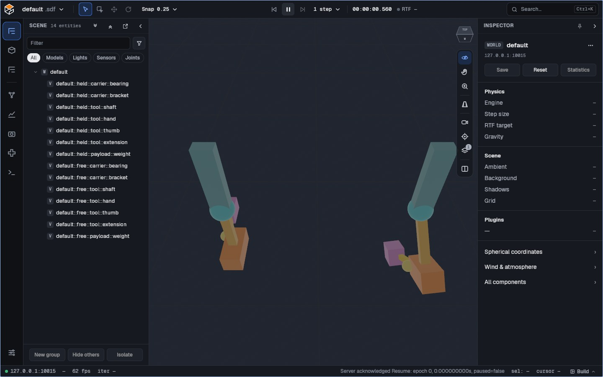

# Gravity compensation for a loaded robot wrist

A spherical wrist carries a 2 kg hand and a welded 1 kg payload. The payload's center of mass is offset by [16, −12, 5] mm from its own link origin. Both wrists start at the same posture. Every millisecond the controller applies the opposite of the predicted gravity torque to the held wrist through its ordinary three-axis effort input. The other wrist swings freely. [Open the native comparison in gz-web-rs](http://127.0.0.1:8082/?backend=primitive&ui=full&quality=low&replay=1&lifecycle=1&url=ws%3A%2F%2F127.0.0.1%3A10015%2F)



| Maximum over 1.2 s | Compensated wrist | Free wrist |
|---|---:|---:|
| Payload link displacement from its starting position | 0.00216 mm | 205.14 mm |
| Payload angular displacement | 0.000805° | 35.46° |

The initial weight was 29.43 N and its moment about the bearing was 2.33645 N m. In the authored bearing axes, the initial moment was [0.79924, 1.95415, −1.00075] N m. An independent calculation used the public hand and payload poses, the authored masses and the local center-of-mass offset. Across 1,201 observations of both models, the largest difference at the wrist or fixed clamp was 2.51 × 10⁻¹⁴ N in force and 2.76 × 10⁻¹⁵ N m in moment. An ordinary world reset repeated every reported wrist force and moment exactly, with payload positions agreeing within 2.78 × 10⁻¹⁷ m. Pause retained the first queued torque. [World definition](../../../examples/worlds/gravity_wrist.sdf) · [Machine-readable results](gravity-wrist.json)

## Using the estimate

Call `gz_sim_scene::joint_gravity_load(&sim, public_joint_id)` for the most recently committed state. The result contains signed `force_n` and `torque_nm` in the authored parent joint axes, with moment measured about that joint origin. A spherical joint accepts the opposite three torque components directly through `queue_ball_joint_effort`. A scalar joint needs the projection on its actual free axis. The native Rapier and multifidelity methods take a solver joint ID and report in the native parent joint axes. Each result includes its reporting orientation relative to the parent body.

The estimator sums each child-side body's gravity-scaled weight and its lever-arm moment about the pivot. Its topology cache rebuilds after a graph edit or reset. Tests cover a floating base, an unrelated sibling, a separately mounted neighbor, native gravity scaling, joint and body retirement, an externally imposed loop, and tilted authored axes on an ordinary Rapier hinge. Gravity feedforward models the known rigid masses. A grasped free object, an external push, contact friction and inertial forces require separate observations or dynamics. A mounted or freely rooted tree of native joints is supported. Duplicate parents, cycles and mixing robot joints with externally constructed native constraints in a connected robot return an error. [Executable controller and comparison](../../../crates/gz-sim-cli/examples/gravity_wrist.rs)

## Reproduce the experiment

Run the controller from the repository root. Choose a new output directory for the native replay and measured trajectories.

```sh
RUSTC_WRAPPER= cargo run --locked --release --no-default-features -p gz-sim-cli \
  --example gravity_wrist -- target/gravity-wrist-trial
RUSTC_WRAPPER= cargo run --locked --release --no-default-features -p gz-sim-cli \
  --bin gz-sim-rs -- target/gravity-wrist-trial/replay --server --replay --web-viewer 9002
```

The same server accepts the checked-in `docs/measurements/local-manipulation/gravity-wrist-replay` directory. Select Play in gz-web-rs to run the comparison. The WebGPU audit checked all fourteen visual poses at each of 121 instants against the committed body poses composed with the authored visual offsets and verified the native catalog through reset. [Open the replay served on port 9002](http://127.0.0.1:8082/?backend=primitive&ui=full&quality=low&replay=1&lifecycle=1&url=ws%3A%2F%2F127.0.0.1%3A9002%2F)

## Changed-source coverage

Each raw LLVM profile matched its executable's build ID. The union uses mapped changed lines and code-region start locations against the frozen base. Example controller code is included in the CLI production column. The full-crate release coverage gate runs separately. [Source commits, profile identities and per-file counts](gravity-wrist.json)

| Crate | Production lines | Production regions | Lines including tests | Regions including tests |
|---|---:|---:|---:|---:|
| gz-physics-rapier | 97/97 (100.0%) | 195/195 (100.0%) | 159/159 (100.0%) | 375/378 (99.2%) |
| gz-physics-multifidelity | 3/3 (100.0%) | 6/6 (100.0%) | 3/3 (100.0%) | 6/6 (100.0%) |
| gz-sim-scene | 34/34 (100.0%) | 61/64 (95.3%) | 114/114 (100.0%) | 209/214 (97.7%) |
| gz-sim-cli | 174/177 (98.3%) | 410/425 (96.5%) | 231/238 (97.1%) | 495/520 (95.2%) |
