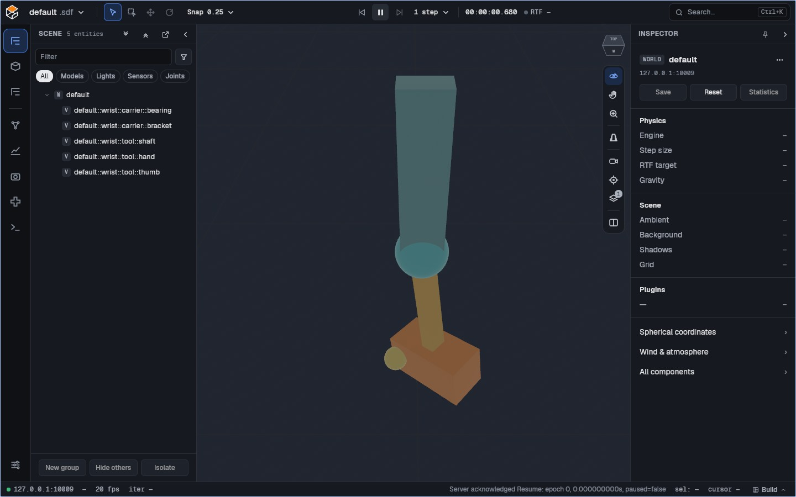

<!-- Copyright (C) 2026 Open Source Robotics Foundation -->
<!-- SPDX-License-Identifier: Apache-2.0 -->

# Parking a hanging ball wrist under gravity

The 2 kg hand hung from a spherical bearing 0.25 m above its center of mass. A mounted wrist can now enter the prescribed tier when its descendants have no net gravitational turning moment and their combined weight is balanced at or below the pivot. Moving, side-loaded and inverted wrists continue through the ordinary rigid solve. A slider attached below a rotated wrist checks its actual axis before trusting a stop. [Source world](../../../examples/worlds/local_hanging_ball_wrist.sdf) · [Measurements](hanging-ball-wrist.json)



The wrist spent ticks 51–350 in the prescribed tier. A three-axis torque queued while paused reached the first advancing solve at tick 351. Over all 1,500 ticks the maximum hand-position difference from the always-dynamic run was 2.65 × 10⁻¹⁵ m and the maximum difference in wrist angular speed was 1.32 × 10⁻¹² rad/s. Reloading the world reproduced every position, orientation and angular velocity. In a separate zero-gravity impact, the first loaded tick, normal impulse, tool state and wrist reading matched exactly. The viewer checked 755 poses across 151 frames. [Watch the wrist](http://127.0.0.1:8082/?backend=primitive&ui=full&quality=low&replay=1&lifecycle=1&url=ws%3A%2F%2F127.0.0.1%3A10009%2F)

Over this run’s 300 stationary ticks the full Bevy step took 30.64 µs at p95 for continuous physics, 2.81 µs parked and 2.88 µs parked after reset. The load, step and hardware are specific to this local comparison. All 107 native Rapier unit tests, 17 mounted-articulation regressions and six example checks passed. LLVM covered 14/14 changed production lines and 32/32 regions in Rapier and 125/129 lines and 273/286 regions in the CLI.

To record the same switched/reference comparison, choose a fresh archive path.

```sh
RUSTC_WRAPPER= cargo run --release --locked --no-default-features -p gz-sim-cli --example ball_wrist -- artifacts/my-hanging-wrist --mounted
RUSTC_WRAPPER= cargo run --release --locked --no-default-features -p gz-sim-cli --bin gz-sim-rs -- --server --replay --web-viewer 10009 artifacts/my-hanging-wrist
```
