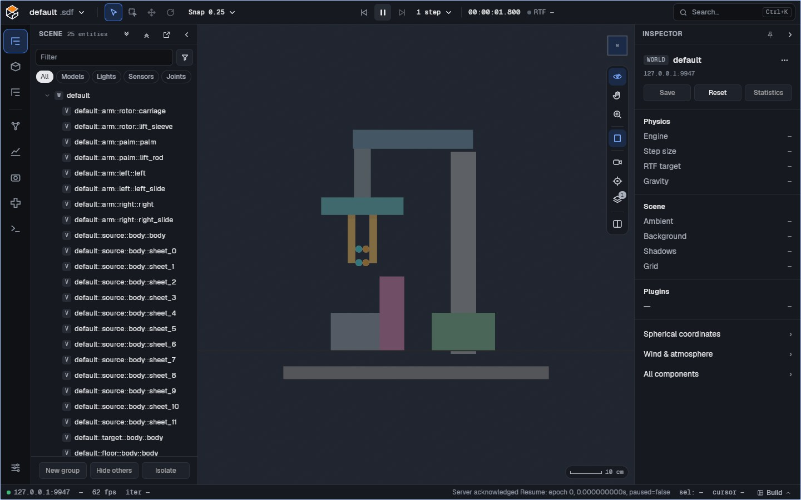

<!-- Copyright (C) 2026 Open Source Robotics Foundation -->
<!-- SPDX-License-Identifier: Apache-2.0 -->

# Tactile forces on rigid jaws holding a folded sheet

Two 2.8125 g jaws lifted the 8.4 g sheet using rigid contact pads. The solver already applied the impulses to the jaws. Its per-particle tactile report had omitted the same impulses at zero pad compliance. It now records the normal and friction contributions on the actual material nodes, including the remaining force after a swept impact. [Exact data, trajectory hashes and coverage](hard-jaw-tactile.json)

At 32 native exchanges per millisecond, the measured pad squeeze was 0.825 N on each panel. The upward reactions were 0.041227 and 0.041183 N. The largest mismatch between the sum of particle impulses and the total jaw impulse fell from 60.63 µN·s to below 10⁻¹⁹ N·s. The physical trajectories and native archives at both 32 and 64 exchanges were byte-identical before and after the correction. Incremental overflow rolls back to the last published wrench. Changed production coverage reached 39/40 executable lines (97.50%) and 57/59 regions (96.61%).

The same 3.4 s pickup then ran at twelve exchange rates with one material substep per exchange. The 16-exchange run refused at 2.482 s. All eleven higher rates completed. The per-jaw mean forces converged earlier than the position of every material node. Comparing against 250 exchanges alone had suggested 200 would suffice for the 0.1 mm trajectory tolerance. A stricter comparison against 1,000 exchanges selected 500. The 500-exchange run's largest error over 137 frames and twelve particles was 94.3 µm, compared with 141.0 µm at 400 and 2.850 mm at 32. All actuator updates stayed exactly 1 ms apart in simulation. At 500 exchanges the physics cost was 130.81 ms p95 per actuator period, versus 338.25 ms at 1,000. These are accuracy reference runs on the shared workstation.

Each replay verified 3,425 rendered poses and shapes, independent particle geometry and rewind. Use the [gripper study commands](sheet-jaw-convergence.md) with `--pad-compliance 0`, `--jaw-mass-scale 0.015625`, `--tune-damping`, `--substeps 1` and the desired `--exchanges-per-ms`. [32 exchanges in gz-web-rs](http://127.0.0.1:8082/?backend=primitive&ui=full&quality=low&replay=1&lifecycle=1&url=ws%3A%2F%2F127.0.0.1%3A9947%2F) · [250 exchanges in gz-web-rs](http://127.0.0.1:8082/?backend=primitive&ui=full&quality=low&replay=1&lifecycle=1&url=ws%3A%2F%2F127.0.0.1%3A9948%2F)
