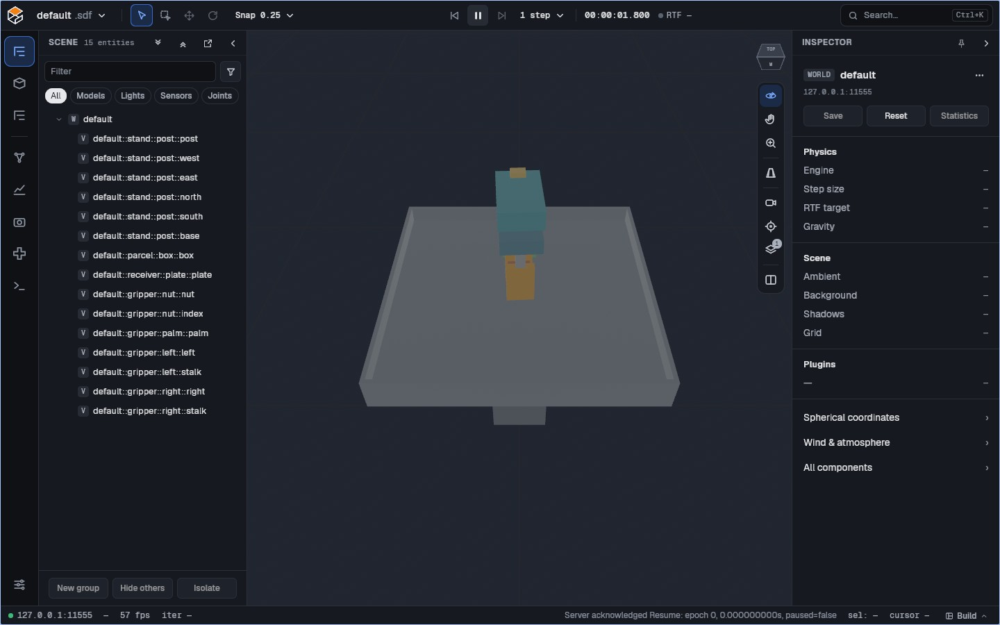

<!-- Copyright (C) 2026 Open Source Robotics Foundation -->
<!-- SPDX-License-Identifier: Apache-2.0 -->

# Operating the installed robot after a lost command or reply

The Linux CPU preview was built from clean source revision `0eb030501fa3d0c7bf93ba6a1b876ff96c213f62` with Rust 1.97.1. The archive SHA-256 is `a48a60354d338d3b5c18bb6eb209243bd26b389384526ea105a00d7a7bb75c0f`. On Ubuntu 26.04.1 the extracted package ran the unchanged upstream rotor for 250 steps and verified all 610 journal records between one and eight Bevy threads. An unprivileged Ubuntu 24.04.5 container repeated those checks and the disconnect test with loopback networking only, an empty writable temporary directory, and the runtime package and test harness as inputs. Its image ID was `sha256:73b999393d07f2bf65a40373778a44dc9a6d54ad7718d29247d8ff9413c4d6a8`. [Build the preview and run the test](../../LOCAL_CPU_MVP.md#build-the-installable-preview)

The Rust regression put a WebSocket relay between the ordinary controller executable and the real paused server. It exercised both sides of the uncertainty in one run. The pre-delivery cut left the clock at 0 ms and all three visuals at their starting poses. For the lost reply the relay verified the server’s positive receipt for 1 ms, sent an unrelated receipt, and dropped the socket. The controller reported an unknown outcome, and a fresh connection saw the committed 1 ms scene. Resending the original checked step was refused. Advancing to 2 ms, resetting, and replaying both steps without interruption reproduced every visual, including its identity and pose. A pre-reset command received in the new epoch was also refused. The baseline client from `2e7d155` failed the diagnostic assertion with only a WebSocket handshake-reset error. All 12 runs of the updated installed client passed on the host. [Executable regression](../../../crates/gz-sim-cli/tests/private/local_robot_operator/interrupted_step.rs)

The three local native operator tests, the 25 journal tests, formatting and targeted strict Clippy passed. An LLVM-instrumented local control client exercised all 19 changed executable lines and 33 of 34 changed region coordinates in the shared command implementation against the real server. The unexercised region handles a WebSocket send error. The official workspace coverage thresholds remain open. The hosted CPU run for the preceding qualified source snapshot also timed out during the workspace test command. [Full release coverage](mvp-release-coverage.md) · [Hosted run](https://github.com/gazebosim-rs/gz-sim-rs/actions/runs/45502838973)

The packaged replay server played the gripper’s full ten-second recording in gz-web-rs with WebGPU and rewound to zero. The browser checked all 251 frames, 251 lifecycle catalogs and 3,765 visual poses and shapes against the recording. The image shows the parcel in the jaws at 1.8 seconds. [Open the measured replay](http://127.0.0.1:8082/?backend=primitive&ui=full&quality=low&replay=1&lifecycle=1&url=ws%3A%2F%2F127.0.0.1%3A11555%2F)

