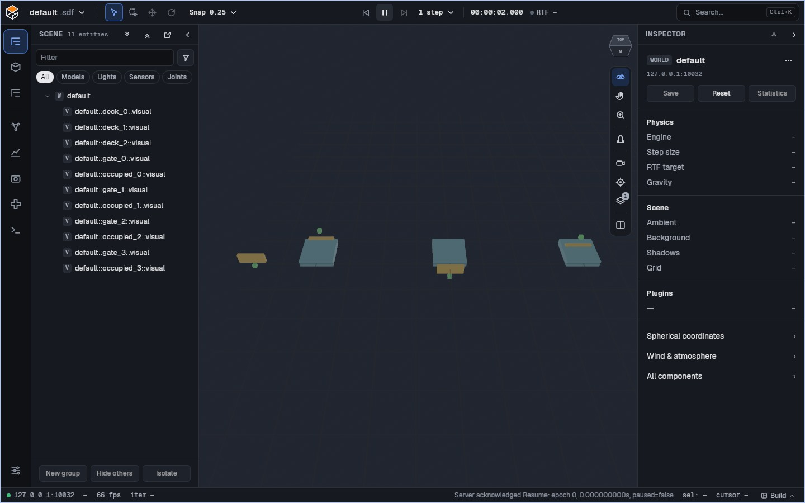

# Crossing four trigger volumes with 100,000 moving decks

On the ordinary local scene path, 100,000 prescribed decks crossed four fixed observation volumes. Looking up nearby candidates in the existing native index reduced the four volume checks from 64.53 ms to 2.64 µs at median in the sparse layout. All entry and exit samples agreed with an exhaustive scan and with an independent geometric calculation. The measured whole scene ran at 3.18× real time with sparse observations and 2.30× with every public pose and twist read, leaving the TDD's 100× target open. [gz-web-rs replay](http://127.0.0.1:8082/?backend=primitive&ui=full&quality=low&replay=1&lifecycle=1&url=ws%3A%2F%2F127.0.0.1%3A10032%2F) · [Raw timings and receipts](kinematic-fleet-gates.json)

## Workload and public contract

Each 1 × 1 × 0.2 m deck translates at 0.25 m/s. Their lanes are 4 m apart. Every 10 ms a Bevy publish system queries four 0.1 × 0.8 × 0.3 m boxes. Three probes read named links and their stable ECS IDs, local and world poses and velocities. A 100 Hz IMU and one solid vertical native ray are also checked every tick. The full reader additionally visits all 400,002 public world/local pose pairs and 100,000 twists. Both readers advance the same ordinary SDF and ECS systems. The workload has zero dynamic bodies and zero reaction impulses. The separate 1,000-payload physical contact trial remains documented in its [native contact measurements](fleet-native-cost.md).

The local Rapier and multifidelity backends expose an inclusive discrete overlap query returning sorted, unique physics body IDs. It tests the live world-space axis-aligned bounds of each attached collider, including its local offset. An empty corner of a rotated shape's bounds can therefore register, and a fast object can cross completely between samples. Standalone scenery has no body ID. Backends which do not implement the operation report an unsupported capability.

For eligible uniformly translating boxes, the native backend shares the tree already used by solid rays. A conservative search in the starting frame identifies candidates. Checking each candidate's current geometry gives the exact inclusive result. Other configurations scan live bodies and their colliders. Edits, removals and reset invalidate the shared index. Existing contact resolution and public pose production run on their original schedules.

## Timing

The frozen exhaustive and indexed executables came from independent release builds and differ only in whether the volume lookup consults the tree. Four fresh process pairs per reader alternated execution order on CPUs 24–31 of a shared AMD Ryzen 9 9950X3D. Each process advanced 20 warm-up ticks and 160 timed ticks, giving 640 samples per cell. Step time includes ECS advancement, the callback, all requested observations and the analytic checks. Real-time factor divides simulated duration by total measured wall time.

| Reader and query | Whole tick median / p95 (ms) | Four volumes median / p95 (µs) | Mean real-time factor |
|---|---:|---:|---:|
| Sparse, exhaustive | 68.51 / 116.68 | 64,535 / 110,490 | 0.137× |
| Sparse, indexed | 2.97 / 5.00 | 2.64 / 7.31 | 3.18× |
| Full, exhaustive | 64.73 / 89.03 | 59,866 / 82,016 | 0.147× |
| Full, indexed | 4.28 / 6.02 | 3.10 / 6.78 | 2.30× |

Building the shared index costs time on first use. On the first advancing tick, median sparse total time was 108.69 ms exhaustive and 42.62 ms indexed. The corresponding trigger times were 67.12 and 29.43 ms. Full-reader totals were 97.42 and 44.90 ms, with trigger times of 56.93 and 29.51 ms. In the exhaustive control the first ray builds the tree after the four trigger scans. In the indexed layout the first trigger builds it. The 100× target allows 0.10 ms per complete advancing tick. The measured mean times need a further 31.5-fold and 43.4-fold improvement respectively.

The original gate-free scene was rerun separately on CPUs 16–23 on the same host, using three process pairs and 120 samples per process. Sparse p50/p95 were 0.90/1.47 ms before and 0.96/1.37 ms after, with 8.87× and 8.15× real time. Full p50/p95 were 1.72/2.59 ms before and 2.08/2.90 ms after, with 4.73× and 4.15× real time. Both gate-free mean throughputs were lower in these samples. These independent shared-host runs do not establish a speedup in the pre-existing sensor or full publication paths. The complete per-process observations and executable SHA-256 hashes are retained.

## Correctness and visual replay

The three occupied lanes entered or left at 0.60, 1.41 and 1.80 s after the initially occupied second lane. The fourth volume remained clear in every frame. All 964 replay readings agreed with independent box geometry, and the maximum deck position discrepancy was 1.11 × 10⁻¹⁶ m. On a separate gate-free run against the original revision, 48,000,240 pose pairs, 12 million twists, 360 ray observations and 120 IMUs matched bit for bit.

The regression queues a velocity reversal while paused, checks the departing deck and repeats the original crossing after a world reset. Native controls cover an inclusive boundary and its neighboring floating-point coordinate, multiple colliders, rotated and offset shapes, changed bodies, removal, respawn and invalid input. A separate articulated control queries the same link bodies across prescribed and dynamic tier switches. The WebGPU client displayed all 2,651 poses and shapes across 241 native frames and rewound to zero. Blue objects are decks, yellow bars are trigger volumes and the green markers rise when occupied.



LLVM covered changed executable lines/regions in the physics interface (10/10, 3/3), multifidelity backend (9/9, 7/7), native Rapier backend (83/83, 154/155) and Rust example (248/248, 469/476). All 286 tests across the selected suites passed. Strict release Clippy passed for the three libraries, their tests and the example. [Playback archive, exhaustive comparison patch and timing samples](kinematic-fleet-gates-evidence.tar.xz)

## Reproduce

From the workspace root, use a new output directory. The recorder includes the initial paused frame, the warm-up and all advancing ticks. Use `--reader full` to consume every public pose and twist. Omit `--replay` for timing.

```sh
export RUSTC_WRAPPER=
cargo run --release --locked --no-default-features -p gz-sim-cli --example kinematic_gates -- \
  --decks 100000 --ticks 220 --reader sparse --replay artifacts/my-kinematic-gates
cargo run --release --locked --no-default-features -p gz-sim-cli --bin gz-sim-rs -- \
  --server --replay --web-viewer 10132 artifacts/my-kinematic-gates/replay
```

To reproduce the paired trial, apply `bench/exhaustive-reference.patch` from the archive to a separate checkout and build with a separate Cargo target directory. Run both release executables with `taskset -c 24-31`, `--decks 100000 --ticks 160` and the selected reader.
