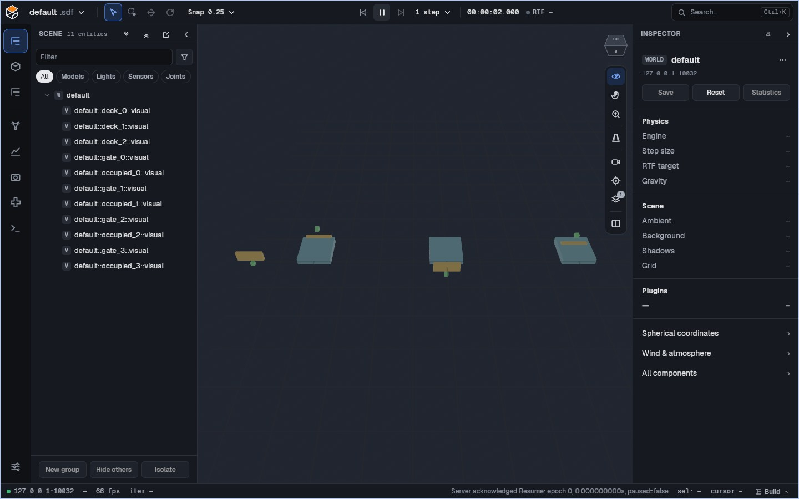

<!-- Copyright (C) 2026 Open Source Robotics Foundation -->
<!-- SPDX-License-Identifier: Apache-2.0 -->

# The public pose budget for 100,000 moving bodies

The ordinary Bevy publisher used 2.63 ms at median and 4.68 ms at p95 with only three links observed. Updating the public poses took about 99% of that sparse tick. A separate write-only control updated the same 500,001 moving coordinates in 0.383 ms at median, even after removing all physics, hierarchy calculation, sensors, events and change-tick updates from the timed interval. The 100× real-time target allows 0.10 ms for the whole step. [Native gz-web-rs replay](http://127.0.0.1:8082/?backend=primitive&ui=full&quality=low&replay=1&lifecycle=1&url=ws%3A%2F%2F127.0.0.1%3A10032%2F) · [Numerical receipt](kinematic-publication-budget.json)

## Same physical scene and readers

The 100,000 prescribed decks move at 0.25 m/s in lanes 4 m apart. The ordinary local simulation advances 10 ms at a time. Every step reads three named links, samples one IMU, casts one native ray and calls four closed collision volumes. There are no dynamic payloads or contact impulses in this specific kinematic milestone. The full consumer also reads all 400,002 public IDs and world/local pose pairs plus 100,000 twists. This requests 52,800,240 bytes of values per step before the independent probes. Both readers operate at 100 Hz of simulated time. [Scene, gate transitions and original performance baseline](kinematic-fleet-gates.md)

The Bevy components remain independently readable via an ordinary world lookup, query or a later-phase system. A consumer can begin reading any entity after the step or edit an existing component between commits. The publisher repairs derived components on the following commit. Bevy 0.20 marks each mutable contiguous table changed when the publisher splits the table. A subscriber using `Changed<LocalPose>` therefore observes a refreshed link-relative pose even when all seven values are identical. Inferring interest from the three registered link probes would omit directly readable state.

## Public-stage timings

Three independently loaded process pairs used CPUs 24–31 on the Ryzen 9 9950X3D. Each process warmed for 20 steps and advanced another 256 timed steps in eight alternating blocks. The two processes never advanced together. Stage clocks surrounded the native-state-to-link write, canonical/relative pose publication and attached pose publication. All three systems complete before the publish callback. The table shows the ordinary publisher. The combined row sums the three measurements within **each** step. CPU affinity, release binaries and raw samples are recorded in the [portable evidence archive](kinematic-publication-budget-evidence.tar.xz).

| Stage | Sparse median / p95 (ms) | Full median / p95 (ms) |
|---|---:|---:|
| Native states into link poses and twists | 0.624 / 1.162 | 0.688 / 2.976 |
| Models and parent-relative poses | 1.057 / 1.927 | 1.241 / 4.360 |
| Attached collision, visual and sensor poses | 0.902 / 1.576 | 1.025 / 4.254 |
| All three publication systems | **2.628 / 4.684** | **3.005 / 11.649** |
| Complete observed tick | 2.653 / 4.744 | 4.645 / 16.957 |

The median of the per-step publication shares was 99.2% sparse and 64.3% full. The sparse publisher alone exceeded the complete-step budget by a factor of 26.3 at median. Separate uninstrumented controls below preserve the public step and isolate clock overhead and shared-host variance.

## Bytes touched

A Linux probe captured addresses, all floating-point bit patterns and the last-changed tick for every world pose, local pose and twist immediately before and after advancing ticks 21, 60, 141 and 180. This samples ordinary motion as well as all three trigger transitions. It reset the process's soft-dirty bits before each step and read the resident mappings afterward. A matched read-only snapshot between two clears dirtied one or two component pages and changed zero pose values. Each advancing step gave the following results.

| Observation | Per step |
|---|---:|
| Components with a new Bevy change tick | 700,001 |
| Pose and twist values in those destinations | 38,400,056 bytes |
| Updated 32-bit component change ticks | 2,800,004 bytes |
| Distinct f64 coordinates whose value changed | 500,001 |
| Changed bytes within those coordinates at the four sampled ticks | 3,000,006–3,500,007 |
| Unique 64-byte lines containing a changed coordinate | 437,501 (28,000,064 bytes of line footprint) |
| Resident component pages marked dirty | 9,385 of 12,122 (38,440,960 bytes of page footprint) |

One x coordinate changes in every model, link, collision, visual and the single deck-mounted IMU. The model's world-relative local x also changes. Link-local poses and twists keep their numerical values and receive fresh change ticks. An idealized direct store of one f64 for every changed coordinate would specify 4,000,008 bytes of values, spread across the 28.0 MB of lines above. Visiting that line footprint every 0.10 ms corresponds to 280 GB/s. Cache reuse, write allocation, store merging and prefetching determine actual traffic on each hardware interface. The workstation restricts performance counters, so these are observed address, value and dirty-page counts. Physical DRAM traffic was unavailable.

The write-only control operated on the original Bevy tables after a real 100,000-deck simulation. It prevalidated homogeneous table membership, used eight workers to write x in 400,001 world transforms and 100,000 model-local transforms, bypassed change notification, and alternated two known values. Every value and component change tick matched its starting sample after the experiment. Across three processes and 1,080 warmed samples on CPUs 24–31, minimum/median/p95 were **0.144/0.383/0.791 ms**. This estimates the cost of that favorable store loop on this machine. It bounds neither all possible implementations nor the performance of other hardware.

## Avoiding unchanged writes

Two trial publishers compared the exact floating-point bit patterns before writing stable fields. Both continued to compute every requested pose each tick, kept Bevy's existing change notifications, and repaired direct edits, including a damaged quaternion. The narrower variant compared only the link-local pose in the dense flat publisher. It dirtied 8,017 component pages per step. Checking link velocities as well reduced that count to 6,844. The same 500,001 coordinates changed and all 700,001 change notifications remained observable.

Four independent pairs per layout timed each executable without stage instrumentation on CPUs 24–31. Each pair alternated eight blocks of 32 advancing steps after warm-up, reversing the starting executable between blocks and trials. Real-time factors divide simulated time by total measured time. The two experiments have distinct paired baselines.

| Comparison | Median step (ms) | p95 step (ms) | Mean real-time factor |
|---|---:|---:|---:|
| Sparse, ordinary → link-local check | 2.500 → 2.486 | 4.262 → 4.562 | 3.61× → 3.64× |
| Full, ordinary → link-local check | 3.638 → 3.562 | 6.322 → 5.754 | 2.48× → 2.57× |
| Sparse, ordinary → link-local and velocity checks | 4.895 → 4.935 | 10.488 → 8.879 | 1.80× → 1.86× |
| Full, ordinary → link-local and velocity checks | 7.286 → 7.287 | 14.179 → 14.119 | 1.26× → 1.23× |

A second core group on this same processor has 96 MiB of shared L3, compared with 32 MiB on CPUs 24–31. In two further independent pairs on CPUs 16–23, the combined check raised sparse median from 1.232 to 1.504 ms and full median from 4.878 to 5.436 ms. The host was shared throughout. The separate receipts include each paired comparison; cache capacity alone cannot explain every difference.

The ordinary publisher remains the default. The narrower check improved full-reader p95 while worsening sparse p95, and the broader check reduced dirty pages without a reliable latency or throughput improvement across layouts and cores. The strongest measured constraint is the cost of making hundreds of thousands of independent components current before a direct reader can inspect them. The next potential design change is an independently benchmarked storage layout that keeps such reads, change notifications and intervening edits available at every public tick.

## State, reset and playback

The retained regression directly corrupts a link's derived quaternion and translation in separate steps, then confirms the original publisher repairs both. A subsequent unchanged link still produces a Bevy change notification. The surrounding tests exercise changed parentage, table fragmentation, spinning bodies and reset. All 338 scene library tests and strict release Clippy passed. LLVM executed all 24 changed test lines and 42 regions. For the narrower experimental publisher it executed all 8 changed production lines and 10 regions.

The narrower trial also reproduced 136,880,680 public world/local pose pairs, 34,220,000 twists, 1,020 rays, 340 IMUs and 879,760 contact points against the previous per-tick fingerprints, including a payload launched onto a different deck. Its fresh 100,000-body native recording, manifest and numeric trace were byte-identical to the verified gz-web-rs recording on port 10032. The independent browser check covers all 2,651 poses and shapes in 241 frames, and the geometry check covers 964 occupancy readings. [Play the native recording](http://127.0.0.1:8082/?backend=primitive&ui=full&quality=low&replay=1&lifecycle=1&url=ws%3A%2F%2F127.0.0.1%3A10032%2F)



## Reproduce

The archive contains the native playback, individual timings, sampled Linux page receipts, both experimental source patches, stage instrumentation, a Rust process-pair driver and the two Rust write probes. In a disposable checkout at `d3ade09`, copy `bench/publication_pages.rs` and `bench/publication_axis.rs` into `crates/gz-sim-cli/examples/` and their two helper files into that directory's `support/` subdirectory.

```sh
export RUSTC_WRAPPER=
cargo build --release --locked --no-default-features -p gz-sim-cli \
  --example publication_pages --example publication_axis
taskset -c 24-31 target/release/examples/publication_pages --decks 100000 --ticks 160 --reader sparse
taskset -c 24-31 target/release/examples/publication_axis --decks 100000 --ticks 160 --reader sparse
```

For whole-step comparisons, apply `bench/block-handshake.patch` in both checkouts, then apply either `bench/local-only.patch` or `bench/combined-writes.patch` in the trial checkout. Build `kinematic_gates` in separate Cargo target directories. Compile `bench/paired_blocks.rs` directly with `rustc --edition 2024 -O`. Its arguments are the two executable paths, reader, output directory, trial number, CPU mask and deck count. The recorded primary comparison used trials 0 through 3, `24-31` and `100000` for each reader. To reproduce the isolated public-stage measurements, add `bench/stages.patch` to the baseline and trial before the block handshake.
