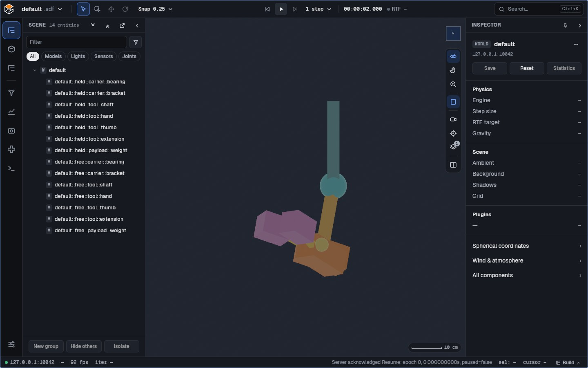

<!-- Copyright (C) 2026 Open Source Robotics Foundation -->
<!-- SPDX-License-Identifier: Apache-2.0 -->

# Recovering the orientation of a loaded wrist

Two identical wrists carried 3 kg each through the same 55° turn. Both received gravity and acceleration feedforward computed from their full inertia. During braking, both received an external world torque of (8, −12, 6) N·m on the welded payload from 450 through 470 ms, end exclusive. The feedback wrist used the shortest three-dimensional rotation from its measured orientation to the target and the difference between measured and requested angular velocity. The actuator bounded the norm of its entire torque at 5.2 N·m. [Robot](../../../examples/worlds/gravity_wrist.sdf) · [Measured inertia](composite-wrist-inertia.md)

| Measurement | Orientation and rate feedback | Feedforward alone |
|---|---:|---:|
| Peak angular error | 3.744° | 179.899° |
| Error at 2 seconds | 0.02134° | 25.820° |
| Residual angular speed at 2 seconds | 0.00456 rad/s | 3.784 rad/s |
| Actuator ticks at the torque limit | 401 | 222 |

Feedback gains were 24 N·m/rad and 2.4 N·m·s/rad. Every pose, measured torque and angular velocity repeated over 2,000 steps after a cold reset. The shared Rust drive accepts equivalent quaternion signs, uses a deterministic axis at half a turn and handles a vector large enough for its squared norm to overflow. Three shared-drive tests and seven robot-example tests passed. Scoped line and region coverage reached 54/54 and 59/59 in physics, and 49/50 and 125/130 in the CLI example. Chromium WebGPU verified all 201 frames and 2,814 poses and shapes. [Watch both wrists in gz-web-rs](http://127.0.0.1:8082/?backend=primitive&ui=full&quality=low&replay=1&lifecycle=1&url=ws%3A%2F%2F127.0.0.1%3A10042%2F) · [Machine readings](loaded-wrist-recovery.json) · [Portable recording](loaded-wrist-recovery.tar.xz)



Generate the recording in a fresh directory from the physics checkout.

```sh
RUSTC_WRAPPER= cargo run --locked --release --no-default-features -p gz-sim-cli --example gravity_wrist -- --stabilize wrist-recovery
RUSTC_WRAPPER= cargo run --locked --release --no-default-features -p gz-sim-cli --bin gz-sim-rs -- --server --replay --web-viewer 10042 wrist-recovery/replay
```
