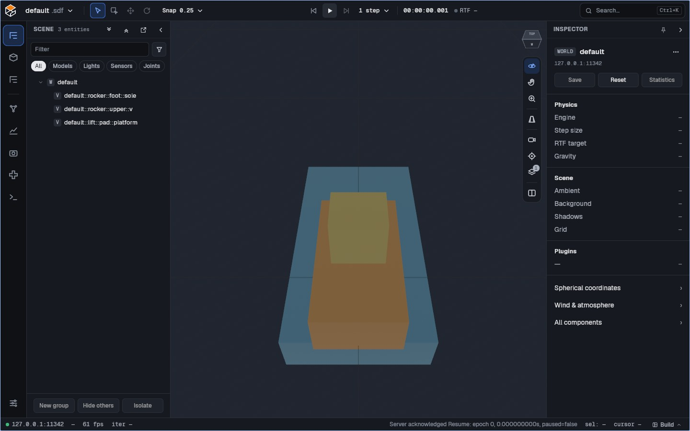

<!-- Copyright (C) 2026 Open Source Robotics Foundation -->
<!-- SPDX-License-Identifier: Apache-2.0 -->

# Recording the last local physics step

A local rocker struck a moving support 0.328543 ms into its first 0.5 ms step. On the frozen `84569c9` executable, the CLI printed the final link positions and exited successfully, but the recording contained only the initial frame. The 34 ms viewer publication interval had suppressed that last physics update.

A recording now checks the final committed scene and lifecycle catalog before writing the completion manifest. When either changed, it writes that frame after the physics loop, allowing the recorder queue to drain. An already recorded final state remains a single frame. Both running and paused closures carry the current clock, poses and catalog. Exceeding the recording bounds or losing the final scene or catalog leaves the archive incomplete.

| Observation | Old recording | Corrected recording |
|---|---:|---:|
| Frame times | 0 ms | 0 and 0.5 ms |
| Final foot height shown | 42.713737 mm | 42.572089 mm |
| Displayed drop during the impact step | 0 mm | 0.141648 mm |

A separate stopped-and-reopened CLI process served the corrected archive over its ordinary WebSocket. At both times, all three visual poses and rotations matched a separate run through the local Bevy scene loader. A rewind returned the initial pose tuple. The gz-web-rs WebGPU visualizer verified the six displayed poses and shapes, both lifecycle catalogs and rewind to zero. [Open the two-frame replay in gz-web-rs](http://127.0.0.1:8082/?backend=primitive&ui=full&quality=low&replay=1&lifecycle=1&url=ws%3A%2F%2F127.0.0.1%3A11342%2F)



All 154 ordinary CLI library tests passed. The separate native recorder/replay test also passed on the host and in the release Ubuntu image, along with strict Clippy on the CLI library and native test. Scoped LLVM coverage of the changed runtime was 23/23 lines and 59/62 regions. Tests also exercised an already-full 4,096-frame archive, oversized final geometry and catalogs, an invalid final model, and exhausted sequence numbers. The release-wide per-crate coverage target is tracked separately.

To reproduce the physical test, run the command from the workspace.

```sh
RUSTC_WRAPPER= cargo test --locked -p gz-sim-cli --test native \
  recorded_contact_poses_survive_real_cli_replay_and_rewind
```
