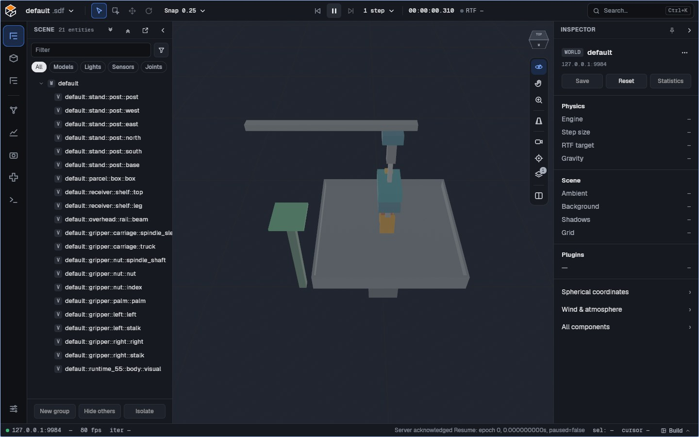

# Replaying the local serial robot from commands

The local CPU replay program rebuilt all 595 observations in fresh processes with one and eight Bevy compute threads. The gripper repeated the first 200 advancing steps exactly after reset. The second 200 g parcel struck the tray at 315 ms and settled at **1.96205 N** before removal. [Measured receipt](local-cpu-input-replay.json)



[Watch spawn, landing and removal in gz-web-rs](http://127.0.0.1:8082/?backend=primitive&ui=full&quality=low&replay=1&lifecycle=1&url=ws%3A%2F%2F127.0.0.1%3A9984%2F) · [Watch the run after reset](http://127.0.0.1:8082/?backend=primitive&ui=full&quality=low&replay=1&lifecycle=1&url=ws%3A%2F%2F127.0.0.1%3A9985%2F)

## Run it

Use the same executable for recording and verification. Supply new output paths when recording. The example below uses the release build without optional GPU or distributed features.

```sh
RUSTC_WRAPPER= cargo build --release --locked --no-default-features -p gz-sim-cli --bin gz-sim-local-replay
bin=target/release/gz-sim-local-replay
world=examples/worlds/local_robot_replay.sdf
journal=examples/replay/local_serial.json
"$bin" "$world" "$journal" --threads 1 --trace serial.jsonl --record serial-view
"$bin" "$world" "$journal" --threads 8 --verify serial.jsonl

RUSTC_WRAPPER= cargo run --release --locked --no-default-features -p gz-sim-cli --bin gz-sim-rs -- \
  --server --replay --web-viewer 9986 serial-view/epoch-0
```

The last command serves the first epoch at your own replay endpoint. [Open the local viewer on port 9986](http://127.0.0.1:8082/?backend=primitive&ui=full&quality=low&replay=1&lifecycle=1&url=ws%3A%2F%2F127.0.0.1%3A9986%2F)

## Execution contract

The `local-cpu-v1` header binds the executable, Cargo lockfile, original SDF and journal bytes with SHA-256. It includes the homogeneous Linux x86-64 CPU signature, stepping, microcode, instruction flags, package version, optional GPU/distributed build flags and authored step. Verification compares each header and observation in order and reports the first differing line. Qualification used a Ryzen 9 9950X3D, Rust 1.97.1 and Rapier 0.36.1 with f64 and enhanced determinism.

The ordinary loader constructs inline models and links in authored order and assigns public IDs. The serial Bevy schedule runs the native local owner. Native manifold and point order, geometric feature matching, contact reduction and floating-point accumulation are the pinned solver's. The profile preserves the order of persistent features when hashing them. Pose and motion records use sorted public IDs. The host helper pool can vary across runs of this small robot, whose native solve executes on one thread.

The JSON array sets the order of all input. A joint target remains held until another target or reset. Free-link forces and torques accumulate in caller order, survive paused ticks and are consumed on the next advancing tick. Spawn clones an eligible startup template at the supplied translation. A journal alias refers to that runtime model until removal or reset. Reset removes runtime models, restores the initial bodies and targets and cancels queued input. The profile reconstructs state by executing the journal from the original SDF. The gz-web archives contain display samples for each epoch.

The loader admits inline rigid boxes and spheres, the native position/velocity controller plugins, supported revolute, prismatic, screw and universal joints, and IMUs. Other numerical backends, external transport input, cameras, deformables, unrecorded application systems and arbitrary midrun checkpoints require separate qualification. This fixture uses the serial transfer gripper, adds a noisy carriage IMU and expresses the parcel's same initial pose on its model so it can serve as a native spawn template. [SDF fixture](../../../examples/worlds/local_robot_replay.sdf) · [Input journal](../../../examples/replay/local_serial.json)

## Physics and sensor evidence

| Check | Result |
| --- | --- |
| Same program, one and eight Bevy helper threads | All 596 lines, including the build header, matched. There were 580 advancing ticks across two epochs. |
| Paused at 180 ms | Two held targets, one queued wrench, 24 solved contact points, 0.0233023 N·s delivered during the previous step and 0.00291274 N·s stored in warm starts. |
| Matched zero-wrench control | At 180 ms the physical state, contacts and IMU still matched. Pending-input signatures differed immediately. Bodies and contacts first differed at 181 ms. |
| Spawn, landing and removal | One additional model and three child IDs entered. Its first tray reaction was 0.119228 N·s. By 380 ms the new pair carried 1.96205 N and disappeared on removal. |
| Reset with a live spawn and pending load | Initial 54 IDs returned. The pending wrench, per-point impulse history and IMU sample cleared. All 200 subsequent steps matched the first epoch across five state signatures. |
| Changed sensor seed | Every mechanical observation was identical. Only sampled IMU output changed. |
| gz-web-rs | Chromium/WebGPU checked 42 frames and 860 poses/shapes before reset and 21 frames and 420 poses/shapes afterward. The first replay includes distinct catalogs at the same physical time. Both rewound to zero. |

Each observation hashes bit patterns of poses, native body velocities and angular velocities, joint samples, held controller targets, accumulated free-link wrenches, delivered impulses and IMU data. The native history includes each retained feature, its two local anchors, frozen world-space lever arms, normal, gap, normal impulse seed, tangent components, world-space tangent seed and twist seed. The next-solve comparison exercises additional private state through the actual solver. The journal also reports delivered normal impulse by native body pair in N·s.

The named IMU seed encodes the UTF-8 journal seed, scoped sensor name and channel. ChaCha8 reserves stream zero for initial bias. Each advancing iteration selects its own stream, starting at draw zero. Dynamic bias retains its own history and actual sample interval. Reset reinitializes it. A second regression changed sensor creation order, sample rate and unrelated channel noise while reproducing the common white-noise samples. The ordinary port sensor loader retains its sequential stream and its native reference tests.

The frozen-source run passed 323 scene library tests, the five legacy noise tests, the named sensor test and the five new replay command/unit tests. Strict Clippy passed with defaults enabled and disabled. Changed runtime coverage was **499/506 lines (98.62%)** and **957/1,002 regions (95.51%)**. Including changed tests gave 850/858 lines and 1,719/1,766 regions. The complete trace hash, source hashes, archive hashes and exact physical values are in the [receipt](local-cpu-input-replay.json).
