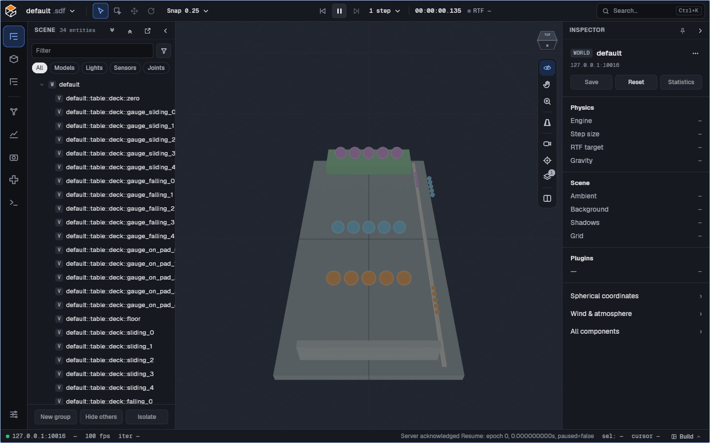

# Measuring the floor impulse on each material particle

Each local cable or cloth can request `plane_impulses="true"` in the Deformables SDF plugin. The Bevy sample's `last_plane_impulses()` reports signed world-space normal and tangential impulses **on the enrolled plane**, in N·s, for the last committed public tick. Each row identifies the original SDF boundary slot and construction particle. Missing pairs contributed zero net impulse. The observer runs in the same material advance, including one-way curved trajectories and coupled materials sharing moving receivers.

## Three cables and two supports

Five orange particles start in sliding contact, five blue particles fall onto the floor, and five purple particles rest on a jointed pad. Each small colored gauge at the edge of the table corresponds to a particle of the same color. It rises 0.8 m per N·s of downward floor impulse and shifts horizontally 3 m per N·s of signed friction impulse. The gauges are display elements. The larger spheres follow the actual simulated particles. At 135 ms, pause the replay to see the first impact. [Open in gz-web-rs](http://127.0.0.1:8082/?backend=primitive&ui=full&quality=low&replay=1&lifecycle=1&url=ws%3A%2F%2F127.0.0.1%3A10016%2F)



| Case | First or steady reading per particle | Total floor impulse over 500 ms |
|---|---|---|
| Falling, 0.20 kg per particle | −0.270 N·s vertically at 135 ms, then −0.010 N·s per settled 5 ms tick | −5.000 N·s vertically |
| Sliding, 0.12 kg per particle | −0.006 N·s vertically and +0.0015 N·s in X during sliding | −3.000 N·s vertically and +0.480 N·s in X |
| Separate pad, 0.06 kg per particle | Zero floor impulse. The settled pad carried −0.003 N·s per particle and tick | Zero |

For these initially straight, uniformly moving cables, the per-node momentum balance supplies an independent reference. For each of 1,500 observations we compared `m(v_before − v_after + g Δt)` with the sum of the floor and pad impulses. The largest vector error was 5.55 × 10⁻¹⁷ N·s. Enabling the floor readout reproduced the corresponding uninstrumented material positions, velocities, pad loads and accumulated boundary impulses exactly.

After removing the first authored boundary while paused, the floor retained slot 1 and the pad retained slot 2. Reset repeated all 50 tested ticks with the original identities and measurements. An independently advanced 1.25 ms world reproduced the per-particle sums and material positions at all 80 public ticks of a 5 ms world using four rigid/material exchanges. The tests also trigger a physical failure and exercise the numerical overflow accumulator. A failed physical advance retains the last published time and sample. A readout overflow yields an error for that sample while the physical solve can still commit. Construction and reset return an empty enabled reading. A paused tick retains its previous reading. Worker enrollment rejects an enabled floor probe because the local observer cannot see a remote material solve.

The browser played all 101 frames, verified 3,434 displayed poses and shapes and rewound to 0 ms. A separate archive check matched all 1,500 node positions and 1,500 gauge positions against the full-rate numerical trace, with zero coordinate difference. [Measurements and test coverage](local-floor-impulses.json)

Changed-code coverage reached 46/46 lines and 66/66 regions in gz-physics-xpbd, 126/128 lines and 184/187 regions in gz-sim-scene, and 138/140 lines and 308/317 regions in the CLI example. All four focused scene integration tests also passed with default features disabled.

## Run locally

From the workspace root, choose a fresh output directory under an existing parent. The example writes `impulses.jsonl`, `summary.json` and a native `replay/` archive.

```sh
mkdir -p artifacts
RUSTC_WRAPPER= cargo run --locked --no-default-features -p gz-sim-cli \
  --example local_floor_impulses -- artifacts/my-floor-impulses
```

The portable archive contains the original full-rate trace and its matching replay. Extract it to a fresh output directory to play the measured run directly. [Download the recording](local-floor-impulses-replay.tar.xz)

To serve a recording on an available port, use the same number in the gz-web-rs WebSocket URL.

```sh
RUSTC_WRAPPER= cargo run --locked --no-default-features -p gz-sim-cli \
  --bin gz-sim-rs -- --server --replay --web-viewer 10116 artifacts/my-floor-impulses/replay
```

The measured contacts here are authored XPBD planes. The pad has its own existing per-particle readout. [World fixture](../../../examples/worlds/local_floor_impulses.sdf) · [Rust example](../../../crates/gz-sim-cli/examples/local_floor_impulses.rs)
