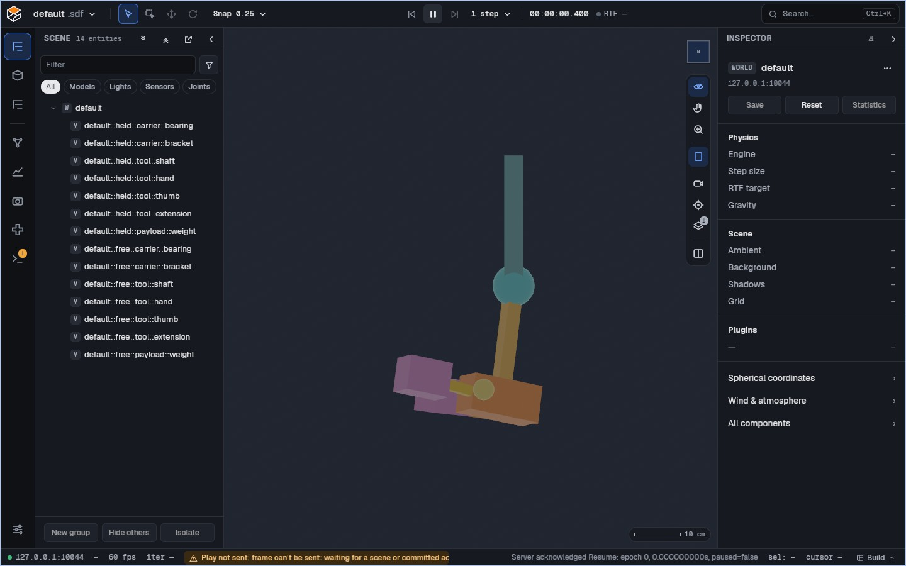

<!-- Copyright (C) 2026 Open Source Robotics Foundation -->
<!-- SPDX-License-Identifier: Apache-2.0 -->

# Local recording, playback credit and reconnect

Closing a replay viewer now returns the client's close code and reason. Previously, TCP shutdown discarded Tungstenite's queued closing frame, so a normal disconnect surfaced as a protocol reset. A second correction preserves the recording worker's original file-write error when the worker exits before it can accept the finish message. Both regressions failed on the preceding implementation. [Watch the verified wrist recording in gz-web-rs](http://127.0.0.1:8082/?backend=primitive&ui=full&quality=low&replay=1&lifecycle=1&url=ws%3A%2F%2F127.0.0.1%3A10044%2F)

Five Rust regressions exercise the ordinary local playback and archive implementation. Over a real loopback WebSocket, a client holds the current frame's publication credit, resumes playback, acknowledges one frame, pauses at the next frame and exchanges a ping and pong while that frame is outstanding. A clean reconnect returns the paused cursor and starts a fresh sequence of credit tokens and command IDs. Reset seeks to the first frame in a new presentation epoch. An arbitrary frame-seek request is rejected, and a further connection still sees the original frame in the reset epoch. A second client cannot displace the active viewer, and playback refuses a lifecycle mutation.

An actual recording worker attempted a frame write through a read-only file descriptor. Finalization returned that file's original OS error and left the archive without a complete manifest. Additional cases covered an excessive asset count, an invalid asset route, inconsistent scene/catalog ownership, duplicate and invalid templates, and the maximum catalog size. A valid export subsequently reopened successfully.

## Coverage

The local release binary was built from `5985958` plus this change, with the CLI feature set from the completed strict headless profile: default, distributed physics, RGB camera and landing audit. The first LLVM profile ran the 157 pre-existing library tests; one additional existing test was marked ignored. The second profile added the five regressions to the same exact binary. The archived receipt identifies the test executable, playback server, source revision, both merged profiles and the earlier strict profile by digest. [Exact per-file measurements](local-playback-reconnect.json)

| Production source | Additional executed lines | Additional executed regions |
|---|---:|---:|
| WebSocket handshake and live socket | 0 | 0 |
| Lifecycle catalog | 3 | 3 |
| Archive writer | 3 | 5 |
| Native replay endpoint | 7 | 9 |
| Playback presentation and clock | 0 | 0 |
| **Total** | **13** | **17** |

Ten of the newly hit lines were also uncovered in the last completed strict headless report (`bdef2518`), verified against unchanged source lines. The two fixes had **4/4 changed production lines and 5/5 regions covered**. This is a targeted gain. The repository-wide release gate requires its own full run. Strict release Clippy passed for the CLI library and tests.

The corrected server replayed the eccentric wrist through all 101 source frames, from 0 to 1,000 ms. The real gz-web-rs WebGPU renderer checked all 1,414 displayed poses and shapes and rewound to zero. The screenshot shows the wrist at the recorded peak-speed frame.



```sh
RUSTC_WRAPPER= cargo test --release --locked -p gz-sim-cli --lib \
  --features rgb-camera,landing-audit playback_session_
```
