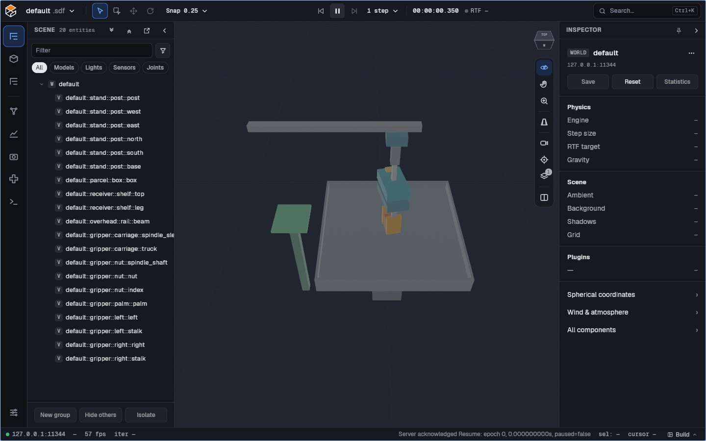
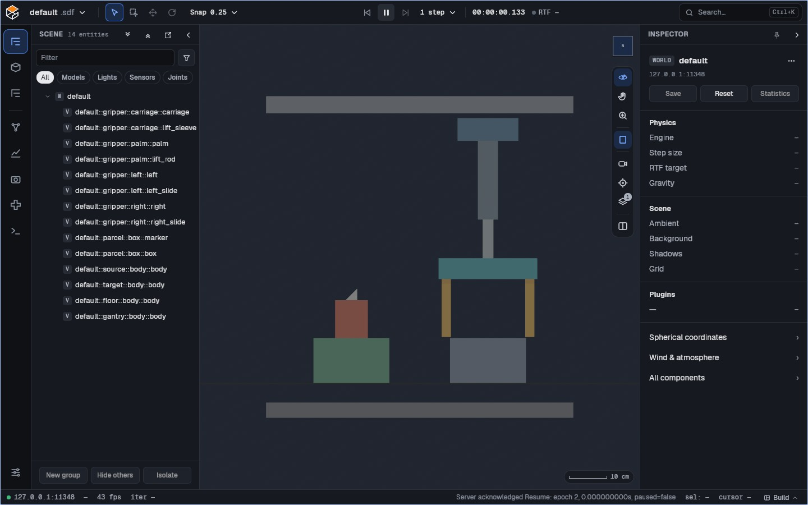

<!-- Copyright (C) 2026 Open Source Robotics Foundation -->
<!-- SPDX-License-Identifier: Apache-2.0 -->

# Live serial robot with a universal wrist

The same serial transfer SDF that worked in an ordinary Bevy application failed when started through the live Gazebo server. Server controller admission read a single scalar position, while the wrist exposes two angular coordinates. Admission now checks the coordinate selected by the installed actuator. It still verifies the original physics owner, public joint identity, native joint and child link. The screw and wrist can share the real transport server.

A local Zenoh publisher sent opposite position targets to the wrist's second-axis topic before and after resetting the server. After 100 one-millisecond updates, the axis reached −0.0098531102 and +0.0098587143 radians. Both coordinates and their rates matched an independently advanced ordinary local simulation on all 200 updates. The server applied each transport command exactly once while paused.

The shipped operator executable then opened a fresh WebSocket connection for each command. Across three checked steps, every rendered robot and parcel pose matched the ordinary solver, including rotations. Stale ticks, stale epochs and a recovery request without a parked worker were refused. Play advanced simulated time and pause held the acknowledged state when a fresh operator reconnected.

The native browser recording contains 1,200 milliseconds of the ordinary authored startup motion. The gz-web-rs WebGPU viewer verified 8,200 rendered poses and shapes over 410 captured frames and rewound to time zero. [Watch the serial robot in gz-web-rs](http://127.0.0.1:8082/?backend=primitive&ui=full&quality=low&replay=1&lifecycle=1&url=ws%3A%2F%2F127.0.0.1%3A11344%2F)



The seven Ubuntu transport and controller tests passed, including the existing C++ peers, admission and reset controls. The two native CLI tests passed. Instrumented execution covered all five changed executable lines and all 14 changed regions. The normal local command client reached 109 of its 146 regions, up from zero in the preceding combined headless report.

To drive the ordinary local SDF from two terminals, use a free local viewer port:

```sh
RUSTC_WRAPPER= cargo run --locked -p gz-sim-cli --bin gz-sim-rs -- \
  examples/worlds/local_robot_serial_transfer.sdf --physics-engine multifidelity \
  --server --web-viewer 9002
```

```sh
RUSTC_WRAPPER= cargo run --locked -p gz-sim-cli --bin gz-sim-convoy-control -- --port 9002 status
RUSTC_WRAPPER= cargo run --locked -p gz-sim-cli --bin gz-sim-convoy-control -- --port 9002 step 0 0
```

## Replay a mesh-marked parcel after the source files are gone

A 0.2 kg parcel falls 60 mm onto the receiving table beside the open gripper. A small gray OBJ marker rides on the parcel. Its collision box, mass and inertia come from the ordinary gripper SDF. The local CLI records the 180 ms drop and exits. The test deletes the source world and OBJ before opening the archive in a fresh CLI process.

The ordinary Bevy simulation measured a peak table impulse of 0.214335478 N·s at 111 ms. Every recorded position and rotation of the marker matched the ordinary run at the corresponding millisecond. The replay served the same 808 GLB bytes after rewind. Chromium independently requested that asset from the replay origin, received all 808 bytes, and checked 98 visual poses and shapes across seven WebGPU frames. The screenshot shows the marker above the red parcel on the green receiving table at 133 ms. [Watch the mesh and parcel in gz-web-rs](http://127.0.0.1:8082/?backend=primitive&ui=full&quality=low&replay=1&lifecycle=1&url=ws%3A%2F%2F127.0.0.1%3A11348%2F)



Both staged feature profiles passed, including the terminal 180 ms frame. Before the final-recording fix in `07941dd`, the same test reproduced a capture ending at 165 ms. Playing the complete archive with the original frozen `8c57ff6` CLI binaries added 32 lines and 60 regions to each profile's original CLI report. The browser processes matched their respective ELF build IDs. The before-and-after comparisons used the same owned object lists and preserved every original per-file denominator. The new browser mesh comparison covered all 45 of its instrumented regions. The native replay test covered 149/150 lines and 303/306 regions.

To make a fresh archive and open it through the ordinary local server, use a new capture path and a free port:

```sh
mkdir -p "$PWD/artifacts/local-mesh-demo"
GZ_LOCAL_MESH_REPLAY="$PWD/artifacts/local-mesh-demo/capture" RUSTC_WRAPPER= \
  cargo test --locked -p gz-sim-cli --test native \
  replay_serves_the_moving_robot_payload_after_source_retirement -- --nocapture
RUSTC_WRAPPER= cargo run --locked -p gz-sim-cli --bin gz-sim-rs -- \
  "$PWD/artifacts/local-mesh-demo/capture" --server --replay --web-viewer 9002
```
