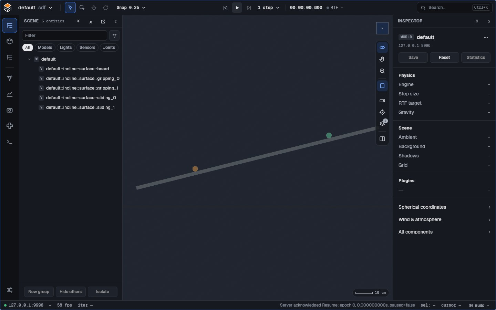

<!-- Copyright (C) 2026 Open Source Robotics Foundation -->
<!-- SPDX-License-Identifier: Apache-2.0 -->

# Static friction for material resting on a support

These measurements describe the first static-friction implementation. The current solver also corrects displacement during sliding. Its independent finite-board and sheet measurements include the revised travel and the finer holdout. [Current results and reproduction command](material-support-edge.md)

The green strip stayed in place on a 25% slope for 0.8 s. The orange strip slid 470.145 mm and reached 1.142052 m/s, within 4 × 10⁻¹⁵ m/s of the analytical speed. Both strips used the same mass, geometry, gravity and sliding coefficient of 0.1. Their static friction coefficients were 0.55 and 0.1. The ordinary SDF world advanced 80 ten-millisecond ticks and reproduced every position, velocity and support impulse after reset. The viewer checked all 324 particle positions. [Open the incline in gz-web-rs](http://127.0.0.1:8082/?backend=primitive&ui=full&quality=low&replay=1&lifecycle=1&url=ws%3A%2F%2F127.0.0.1%3A9996%2F) · [Measurements](material-incline.json)



The previous velocity-only model let a material point creep 0.200 mm in 100 ms under a load below breakaway. Rust material definitions and SDF can now specify `static_plane_friction` alongside the existing sliding coefficient. Sustained plane contact balances the applied load within the static limit. Sliding and new impacts use the kinetic limit. Coverage includes a moving belt, reversal from sliding to holding, invalid coefficients, signed support impulses and checkpoint identity. The analytical downhill distance was 456.821 mm. The 13.324 mm excess at a 10 ms step motivated a separate check of how the kinetic impulse changes travel within each step.

On the 8.4 g folded sheet, setting static plane friction to 0.7 reduced the largest sampled difference between the 500- and 1,000-exchange runs from 210.89 µm to 81.43 µm. The largest remaining difference occurred at 2.725 s after the fingers opened. At 16 and 250 exchanges the largest differences were 129.59 and 175.26 µm. The 500-exchange result met the 100 µm criterion and the 1% per-jaw weight tolerance against the 1,000-exchange reference. That comparison covers this fixture and its 25 ms recording cadence. At 16 exchanges all 3,400 public one-millisecond ticks reproduced the independent short-tick particle positions and velocities exactly. The high-resolution comparisons use short native steps and a fixed one-millisecond actuator clock. [Watch the 500-exchange grasp](http://127.0.0.1:8082/?backend=primitive&ui=full&quality=low&replay=1&lifecycle=1&url=ws%3A%2F%2F127.0.0.1%3A10001%2F) · [Previous release measurements](folded-sheet-release-contact.md)

| Exchanges per actuator tick | Maximum difference from 1,000 exchanges | p95 physics time per 1 ms actuator tick |
|---:|---:|---:|
| 16 | 129.59 µm | 4.05 ms |
| 250 | 175.26 µm | 64.88 ms |
| 500 | 81.43 µm | 172.74 ms |
| 1,000 | Reference | 292.23 ms |

A fifth run then tested the apparent agreement with an independent 2,000-exchange reference. Against that run, the 16-, 250-, 500- and 1,000-exchange runs differed by 348.64, 241.05, 325.12 and 367.66 µm. The 1,000-vs-2,000 maximum occurred at 2.725 s on node 6. The previously passing pair therefore does not establish convergence of the full released trajectory. The finer holdout is included in the numerical receipt.

The timings came from parallel CPU-affined runs on a shared workstation. The instrumented Rust runs covered 129/131 changed lines and 219/226 regions in the material solver, 105/107 and 253/263 in the CLI, and 5/5 and 14/14 in the scene loader. These denominators cover this phase's production changes. [Source world](../../../examples/worlds/local_material_incline.sdf)

Run the following from the physics checkout, choosing a fresh output directory.

```sh
RUSTC_WRAPPER= cargo run --release --locked --no-default-features -p gz-sim-cli --example local_robot_foundations -- material-incline artifacts/incline-demo
RUSTC_WRAPPER= cargo run --release --locked --no-default-features -p gz-sim-cli --bin gz-sim-rs -- --server --replay --web-viewer 9996 artifacts/incline-demo/replay
```

The replay appears at the incline link above when gz-web-rs is running on port 8082. To repeat the grasp comparison, add `--static-plane-friction 0.7` to the viscous-pad command and run it at each exchange count. The `sheet-jaw-convergence` command accepts the four output directories in any order. [Grasp fixture and commands](viscous-gripper-pads.md)
