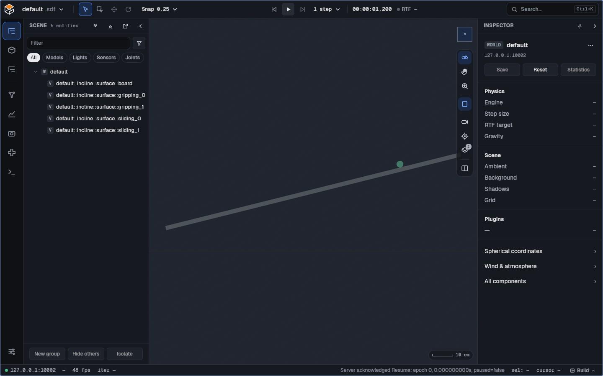

<!-- Copyright (C) 2026 Open Source Robotics Foundation -->
<!-- SPDX-License-Identifier: Apache-2.0 -->

# Sliding across a finite support and landing on the workbench

On a 25% slope the green strip held its position. The orange strip slid past the end of the board and its support reaction went to zero. Its velocity then changed by gravity alone. This uses a rotated finite collision box in the normal SDF scene. gz-web-rs checked 484 particle positions and 605 poses across 121 frames, including rewind. [Watch the board](http://127.0.0.1:8082/?backend=primitive&ui=full&quality=low&replay=1&lifecycle=1&url=ws%3A%2F%2F127.0.0.1%3A10002%2F) · [Numerical results](material-support-edge.json)



With an authored static coefficient, a sustained sliding contact now applies kinetic friction to displacement as well as velocity. Both corrections share one friction budget. Both ends of the movement must lie on the same flat face. Six face directions, an airborne endpoint, misaligned normals, and a particle sliding more than 150 ticks beyond a bench exercise the handoff to free motion. All four finite-board runs last felt support at 1.08 s. The next 12 public ticks had zero support and agreed with the expected change in free velocity to within 5.2 × 10⁻¹⁶ m/s.

| Material steps per 10 ms tick | Orange travel after 0.8 s | Excess over analytical travel |
|---:|---:|---:|
| 1 | 462.531 mm | 5.710 mm |
| 2 | 459.676 mm | 2.855 mm |
| 4 | 458.248 mm | 1.428 mm |
| 8 | 457.534 mm | 0.714 mm |

The analytical displacement is 456.821 mm. At the same 10 ms tick the previous velocity correction overshot by 13.324 mm with one material step. All four new runs matched the analytical final speed of 1.142052 m/s. All 121 finite-board states reproduced after reset. [Previous friction law](material-incline.md) · [Infinite-plane replay at eight steps](http://127.0.0.1:8082/?backend=primitive&ui=full&quality=low&replay=1&lifecycle=1&url=ws%3A%2F%2F127.0.0.1%3A9998%2F)

## Folded sheet landing after a grasp

The 8.4 g sheet retained its two-jaw hold. At 16 exchanges the public gripper reproduced the separately advanced material positions and velocities at all 3,400 one-millisecond endpoints. The maximum difference between the complete 1,000- and 2,000-exchange runs fell from 0.368 to 0.328 mm. The 500-vs-1,000 comparison grew from 0.081 to 0.195 mm. Neither result qualifies the full release to 0.1 mm. Differences use the 25 ms recording cadence. The receipt includes p95 physics cost for each run on this shared workstation.

A second experiment forked each law from its own 500-exchange state at 2.680 s and replayed exactly the same jaw paths through 2.710 s. Its baseline reproduced all 15,000 native intervals. In the new law the 2,000- and 4,000-exchange branches first loaded the table in the same two-microsecond interval. Their first normal impulses were 0.182337 and 0.182324 mN·s. Across 161 sampled times their largest corner separation was 0.0275 mm. The equivalent comparison for the earlier law was 0.0177 mm. The larger full-run discrepancy motivates measuring the incoming shape and velocity from pickup through release. [Watch the projected-friction landing](http://127.0.0.1:8082/?backend=primitive&ui=full&quality=low&replay=1&lifecycle=1&url=ws%3A%2F%2F127.0.0.1%3A10006%2F) · [Watch the earlier law](http://127.0.0.1:8082/?backend=primitive&ui=full&quality=low&replay=1&lifecycle=1&url=ws%3A%2F%2F127.0.0.1%3A10007%2F)

For the kinetic change LLVM exercised 11/11 production lines and 19/19 regions in XPBD and 14/14 lines and 60/60 regions in the CLI. For the finite support it exercised 33/33 lines and 62/62 regions in XPBD and 45/45 lines and 110/111 regions in the CLI.

To recreate the finite support with eight material steps, choose a fresh directory.

```sh
RUSTC_WRAPPER= cargo run --release --locked --no-default-features -p gz-sim-cli --example local_robot_foundations -- material-incline artifacts/my-board --substeps 8 --finite-board
RUSTC_WRAPPER= cargo run --release --locked --no-default-features -p gz-sim-cli --bin gz-sim-rs -- --server --replay --web-viewer 10002 artifacts/my-board/replay
```
