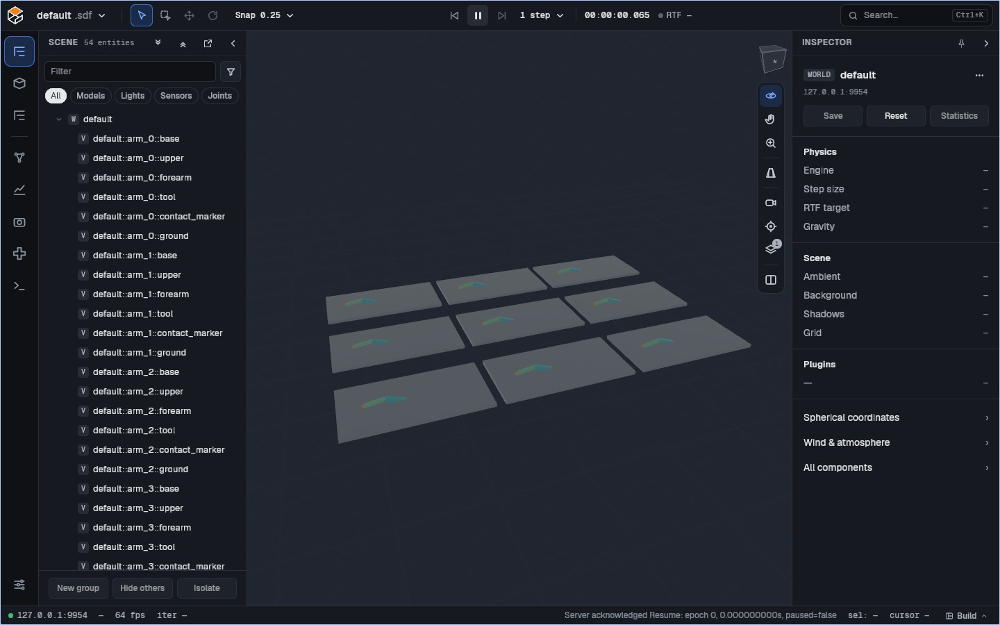

<!-- Copyright (C) 2026 Open Source Robotics Foundation -->
<!-- SPDX-License-Identifier: Apache-2.0 -->

# Why the native arm bounced on its first landing

At 64 ms the round tool was 0.8381 mm above the floor. Each solver received the same measured joint angles, joint velocities and motor commands. With one stabilization pass, the native Rapier reference left the landing tick moving upward at 56.38 mm/s. Four stabilization passes reduced that to 0.0121 mm/s. The remaining difference in the one-millisecond ground impulse between the GPU and native solutions was 0.00335%. [Matched measurements and continuous runs](native-landing-passes.json)

| Solver at the matched landing | First impact (N·s) | Full landing tick (N·s) |
|---|---:|---:|
| GPU with a step boundary at touchdown | Public tick total only | 0.30318960 |
| Independent Cartesian rigid-body reference, 512 steps | 0.29729368 | 0.30321932 |
| Native, 512 steps and one stabilization pass | 0.31614673 | 0.31614673 |
| Native, 512 steps and four stabilization passes | 0.29730298 | 0.30319976 |

Increasing the native contact iterations from one to sixteen with one stabilization pass produced the same excess impulse. The two settings act on different parts of the native contact solve. This experiment varied the independent reference. The stock runtime uses its original solver configuration. [GPU implementation, benchmark and original default reference](gpu-tool-impact.md)

Nine reference arms then ran continuously from rest using the 600 motor commands recorded by the ordinary server. The replay uses three rows of increasing native steps per millisecond (8, 16 and 32) and three columns of stabilization passes (1, 2 and 4). All nine touched on tick 65 and last carried load on tick 307. At sixteen native steps, their first loaded impulses were 0.316379, 0.302867 and 0.302867 N·s. Four passes kept the largest tip difference against the live GPU trajectory below 0.843 mm over the full run. The 32,454 rendered poses and shapes matched the source across all 601 frames. The red marker rises over a tool when the floor carries load. [Nine native arms in gz-web-rs](http://127.0.0.1:8082/?backend=primitive&ui=full&quality=low&replay=1&lifecycle=1&url=ws%3A%2F%2F127.0.0.1%3A9954%2F) · [Live GPU arm recording](http://127.0.0.1:8082/?backend=primitive&ui=full&quality=low&replay=1&lifecycle=1&url=ws%3A%2F%2F127.0.0.1%3A9939%2F)



To reproduce, start with the recorded commands from the [stock server probe](gpu-joint-stops.md). Use a fresh directory for the nine-arm replay.

```sh
export RUSTC_WRAPPER=
trace=artifacts/gpu-stop-run/trace.json
cargo run --release --locked -p gz-sim-scene --features gpu-batch --example gpu_sdf_tool -- \
  --landing "$trace" artifacts/gpu-stop-run/matched.json
cargo run --release --locked -p gz-sim-scene --features gpu-batch --example gpu_sdf_tool -- \
  --stops "$trace" artifacts/gpu-stop-run/continuous.json --stabilization-passes 4
cargo run --release --locked -p gz-physics-gpu --example planar_tool -- \
  --landing-iterations "$trace" artifacts/nine-native-arms
cargo run --release --locked -p gz-sim-cli --bin gz-sim-rs -- \
  --server --replay --web-viewer 9954 artifacts/nine-native-arms/replay
```

The matched-state and continuous reference changes at revision 1cbf03e covered 73/73 changed executable lines and 130/130 regions.
 The nine-arm replay and shared command code at 96b4969 covered 139/141 changed lines (98.58%) and 216/225 regions (96.00%).
