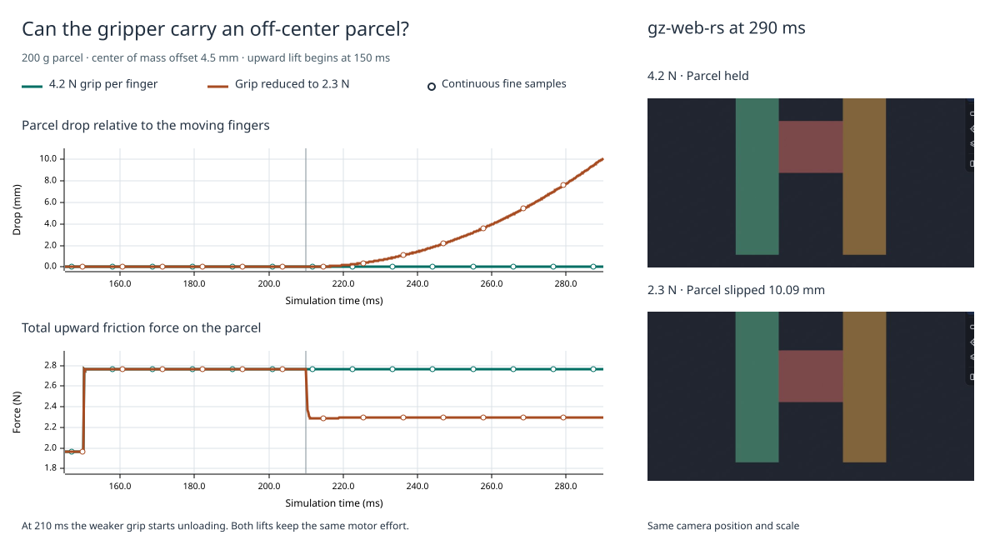

# Watch an off-center parcel lift and slip

Open the weaker-grip replay, press **3** over the viewport for a side view, then **Play**. Both fingers initially squeeze the 200 g parcel at 4.2 N each. The carriage starts rising at 150 ms. At 210 ms the grip drops to 2.3 N per finger. Pause at 290 ms to see where the block sits between the fingers. The strong-grip run keeps 4.2 N throughout. The parcel’s center of mass is 4.5 mm to the right of its geometric center. [Weaker grip](http://127.0.0.1:8082/?backend=primitive&ui=full&quality=low&replay=1&lifecycle=1&url=ws%3A%2F%2F127.0.0.1%3A11492%2F) · [Stronger grip](http://127.0.0.1:8082/?backend=primitive&ui=full&quality=low&replay=1&lifecycle=1&url=ws%3A%2F%2F127.0.0.1%3A11491%2F)



From 210 to 290 ms the weakly held parcel moved **10.08991 mm downward relative to the pads**. It still rose in world coordinates. The strong grip showed less than 0.000001 mm of relative drop. Under the weak grip the pads’ total measured upward friction settled near 2.30 N, below the 2.762 N required to accelerate the parcel with the carriage. Both smooth runs used one native solve per 200 µs public tick. The graph’s open circles show independent runs using 200 native solves per tick. [Fine weaker grip](http://127.0.0.1:8082/?backend=primitive&ui=full&quality=low&replay=1&lifecycle=1&url=ws%3A%2F%2F127.0.0.1%3A11494%2F) · [Fine stronger grip](http://127.0.0.1:8082/?backend=primitive&ui=full&quality=low&replay=1&lifecycle=1&url=ws%3A%2F%2F127.0.0.1%3A11493%2F)

The third run keeps the strong grip and applies a 7 N·m twist for one public tick at 210 ms. Pause at 220 ms to see the parcel tilted between the rising fingers. The parcel rocked 6.43° and finished 2.66935 mm lower relative to the fingers, against 2.67115 mm continuously fine. This carry selected eight native solves on 100 ticks and 200 solves on four. [Jostled carry](http://127.0.0.1:8082/?backend=primitive&ui=full&quality=low&replay=1&lifecycle=1&url=ws%3A%2F%2F127.0.0.1%3A11495%2F) · [Fine jostled carry](http://127.0.0.1:8082/?backend=primitive&ui=full&quality=low&replay=1&lifecycle=1&url=ws%3A%2F%2F127.0.0.1%3A11496%2F) · [Force balance and verification](offset-carry.md)

## Replay the recordings locally

The bundle contains the six recordings, native per-tick contact measurements, independent link poses, WebGPU checks, Rust sampler and Rust plotter. The browser verified all 1,746 recorded frames and 6,984 link poses within 1e−12 and rewound each recording to zero. The three public CLI recordings and complete traces matched byte for byte with one and eight Bevy threads. Across all 8,700 pad observations the signed vertical friction impulses matched the native observer exactly. [Portable replay and measurement bundle](offset-carry-view.tar.xz)

From the simulator checkout, unpack the bundle and serve the weaker grip. The directories `hold`, `rock`, `fine-hold`, `fine-slip` and `fine-rock` contain the other runs.

```sh
export RUSTC_WRAPPER=
study=target/offset-carry-view
mkdir -p "$study"
tar -xJf docs/measurements/local-manipulation/offset-carry-view.tar.xz -C "$study"
(cd "$study" && sha256sum --quiet --check SHA256SUMS)
cargo run --locked --release --no-default-features -p gz-sim-cli --bin gz-sim-rs -- \
  --server --replay --web-viewer 11499 "$study/slip/epoch-0"
```

With gz-web-rs on port 8082, open the local replay and press **Play**. [Open the portable replay](http://127.0.0.1:8082/?backend=primitive&ui=full&quality=low&replay=1&lifecycle=1&url=ws%3A%2F%2F127.0.0.1%3A11499%2F)

To regenerate the public recording and the comparison graph, run

```sh
cargo run --locked --release --no-default-features -p gz-sim-cli --bin gz-sim-local-replay -- \
  "$study/local_offset_gripper_carry.sdf" "$study/offset_carry_slip.json" \
  --threads 1 --record-every 5 --record "$study/fresh-slip"
cmp "$study/fresh-slip/epoch-0/frames.jsonl" "$study/slip/epoch-0/frames.jsonl"
cargo run --locked --release --manifest-path "$study/plot/Cargo.toml" -- \
  "$study" "$study/regenerated.svg" "$study/regenerated.json"
```

To regenerate the fine measurements, place the bundled `sampler/offset_carry_sampler.rs` in `crates/gz-sim-cli/examples/`, then run

```sh
cargo run --locked --release --no-default-features -p gz-sim-cli --example offset_carry_sampler -- \
  fine "$study/local_offset_gripper_carry.sdf" "$study/offset_carry_slip.json" "$study/fresh-fine" 1
```
