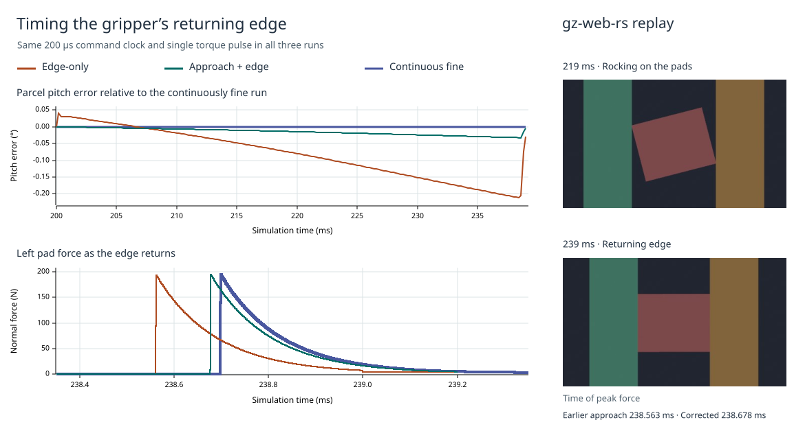

# A gripped parcel rocks back onto its pads

The orange and green fingers squeeze the red block. Press **3** over the gz-web-rs viewport for a side view, then press **Play**. At 200 ms a single twist rocks the block onto its edges. At 219 ms it is near maximum tilt. By 239 ms the opposite edges have returned. The recordings show poses every millisecond. The force graph below resolves the much shorter strike using measurements from the native solver. [Watch the corrected approach](http://127.0.0.1:8082/?backend=primitive&ui=full&quality=low&replay=1&lifecycle=1&url=ws%3A%2F%2F127.0.0.1%3A11481%2F) · [Watch the earlier edge-only policy](http://127.0.0.1:8082/?backend=primitive&ui=full&quality=low&replay=1&lifecycle=1&url=ws%3A%2F%2F127.0.0.1%3A11482%2F) · [Watch the continuous fine reference](http://127.0.0.1:8082/?backend=primitive&ui=full&quality=low&replay=1&lifecycle=1&url=ws%3A%2F%2F127.0.0.1%3A11483%2F)



All three runs received the same 200 µs torque pulse and the same jaw commands. As the pulse ended, the earlier angle was already 0.04075° ahead of the fine reference. The revised angle agreed within 0.000001° at that instant. Fine stepping on the pulse alone still left an early strike. Using eight native steps as the loaded block rocked brought its return within 22 µs of the fine reference. [Matched-state experiments and timing](pad-approach.md)

| Measurement | Edge only | Approach + edge | Continuously fine |
| --- | ---: | ---: | ---: |
| Peak time on both pads (ms) | 238.563 | 238.678 | 238.700 |
| Left / right peak force (N) | 193.404 / 193.392 | 194.822 / 194.822 | 193.915 / 193.915 |
| Maximum absolute pitch error from 200 to 239.2 ms (°) | 0.21125 | 0.03250 | Reference |
| Left normal impulse from 238 to 240 ms (mN·s) | 28.529 | 28.441 | 28.423 |
| Native solves during 450 ms | 2,847 | 4,390 | 450,000 |

The corrected run took one ordinary solve on 2,054 ticks, eight solves on 192 ticks and 200 solves on four ticks. Each plotted force is the measured normal impulse divided by that native solve’s duration. The reported peak time marks its end. gz-web-rs rendered 451 frames per case, checked 5,412 link poses across the three runs against independently read solver poses, and rewound each run to its start. The corrected command trace and recording reproduced byte for byte at one and eight Bevy threads. [Portable recordings, native samples, viewer checks and Rust tools](pad-approach-view.tar.xz)

## Run the replay locally

From the simulator checkout, unpack and serve the recording.

```sh
export RUSTC_WRAPPER=
study=target/pad-approach-view
mkdir -p "$study"
tar -xJf docs/measurements/local-manipulation/pad-approach-view.tar.xz -C "$study"
(cd "$study" && sha256sum --quiet --check SHA256SUMS)
cargo run --locked --release --no-default-features -p gz-sim-cli --bin gz-sim-rs -- \
  --server --replay --web-viewer 11489 "$study/approach/epoch-0"
```

With the local gz-web-rs frontend on port 8082, open the replay below. The `edge/epoch-0` and `fine/epoch-0` directories contain the earlier approach and fine reference. [Open the portable replay](http://127.0.0.1:8082/?backend=primitive&ui=full&quality=low&replay=1&lifecycle=1&url=ws%3A%2F%2F127.0.0.1%3A11489%2F)

To recreate the corrected recording in a fresh directory and regenerate the figure, use the same shell.

```sh
cargo run --locked --release --no-default-features -p gz-sim-cli --bin gz-sim-local-replay -- \
  "$study/approach.sdf" "$study/journal.json" --threads 1 --record-every 5 --record "$study/fresh"
cmp "$study/fresh/epoch-0/frames.jsonl" "$study/approach/epoch-0/frames.jsonl"
cargo run --locked --release --manifest-path "$study/plot/Cargo.toml" -- \
  "$study" "$study/recreated.svg" "$study/recreated.json"
```

To regenerate native measurements, place the included Rust sampler in the CLI examples directory and run it on the three enclosed worlds. Each run records the pitch and angular velocity every 200 µs, native force samples during launch and return, and a viewer pose every millisecond.

```sh
cp "$study/sampler/pad_impact_sampler.rs" crates/gz-sim-cli/examples/pad_approach_sampler.rs
for label in edge approach fine; do
  mode=adaptive
  if [ "$label" = fine ]; then mode=fine; fi
  cargo run --locked --release --no-default-features -p gz-sim-cli --example pad_approach_sampler -- \
    "$mode" "$study/$label.sdf" "$study/journal.json" "$study/sampled-$label" 1
done
```
