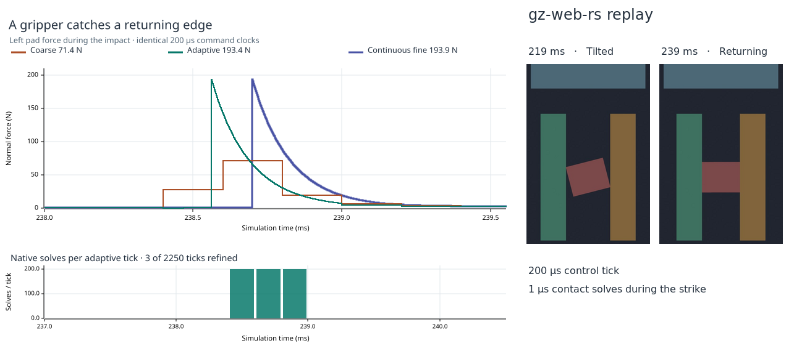

# Catching a returning edge between gripper pads

Open the adaptive recording, press **3** over the viewport for the side view, and play. At 200 ms a single 6 N·m torque pulse tips the block between two pads. Pause at 219 ms to see the tilt, then advance to 239 ms to see the block rock back. The three recordings share the same 200 µs command clock and one-millisecond display cadence. [Adaptive replay](http://127.0.0.1:8082/?backend=primitive&ui=full&quality=low&replay=1&lifecycle=1&url=ws%3A%2F%2F127.0.0.1%3A11471%2F) · [Coarse replay](http://127.0.0.1:8082/?backend=primitive&ui=full&quality=low&replay=1&lifecycle=1&url=ws%3A%2F%2F127.0.0.1%3A11472%2F) · [Continuous fine replay](http://127.0.0.1:8082/?backend=primitive&ui=full&quality=low&replay=1&lifecycle=1&url=ws%3A%2F%2F127.0.0.1%3A11473%2F)



| Physics step | Left peak | Right peak | Peak time | Native solves in 450 ms |
|---|---:|---:|---:|---:|
| 200 µs throughout | 71.364 N | 71.651 N | 238.800 ms | 2,250 |
| 1 µs near the returning edge | 193.404 N | 193.392 N | 238.563 ms | 2,847 |
| 1 µs throughout | 193.915 N | 193.915 N | 238.700 ms | 450,000 |

Each plotted force is the measured normal impulse divided by the duration of its native solve. The table timestamps mark the end of the peak solve. The adaptive run resolved both peaks within 0.53 N of the continuous fine run. Its impact arrived 137 µs early. The total left-pad impulse from 238 to 240 ms was 28.528 mN·s in the coarse run, 28.529 mN·s with refinement and 28.423 mN·s in the fine reference. The adaptive run stepped the local world at 1 µs for three consecutive public ticks from 238.400 to 239.000 ms.

## Replay and reproduce

The archive includes each recording, native samples, per-tick loads, solver link poses, viewer checks, two original screenshots and the Rust sampler and plotter. gz-web-rs rendered 451 frames per recording. All 5,412 link poses matched independently read solver poses within 1e−12, and each recording rewound to zero. The adaptive CLI recording and complete command trace matched byte for byte with one and eight Bevy threads. [Portable recordings and measurement tools](pad-impact-refinement-view.tar.xz)

From the simulator checkout, serve the adaptive recording with

```sh
export RUSTC_WRAPPER=
study=target/pad-impact-refinement-view
mkdir -p "$study"
tar -xJf docs/measurements/local-manipulation/pad-impact-refinement-view.tar.xz -C "$study"
(cd "$study" && sha256sum --check --quiet SHA256SUMS)
cargo run --locked --release --no-default-features -p gz-sim-cli --bin gz-sim-rs -- \
  --server --replay --web-viewer 11479 "$study/adaptive/epoch-0"
```

Open this link with the gz-web-rs frontend on port 8082. Use the `coarse/epoch-0` or `fine/epoch-0` directory to watch either reference. [Open the portable replay](http://127.0.0.1:8082/?backend=primitive&ui=full&quality=low&replay=1&lifecycle=1&url=ws%3A%2F%2F127.0.0.1%3A11479%2F)

To regenerate the adaptive archive and the comparison graph, run

```sh
cargo run --locked --release --no-default-features -p gz-sim-cli --bin gz-sim-local-replay -- \
  "$study/adaptive.sdf" "$study/journal.json" --threads 1 --record-every 5 --record "$study/fresh"
cmp "$study/fresh/epoch-0/frames.jsonl" "$study/adaptive/epoch-0/frames.jsonl"
cargo run --locked --release --manifest-path "$study/plot/Cargo.toml" -- \
  "$study/coarse" "$study/adaptive" "$study/fine" "$study/chart.svg" "$study/summary-new.json"
```

To regenerate fine-reference data, copy `sampler/pad_impact_sampler.rs` from the archive into `crates/gz-sim-cli/examples/` and run

```sh
cargo run --locked --release --no-default-features -p gz-sim-cli --example pad_impact_sampler -- \
  fine "$study/coarse.sdf" "$study/journal.json" "$study/fresh-fine" 1
```

The fine reference subdivides every physics tick into 200 solves while preserving the Bevy command and actuator clock. The adaptive sampler uses the configured scene’s observer. Both record every native force sample from 236 through 241 ms and one per millisecond elsewhere.
