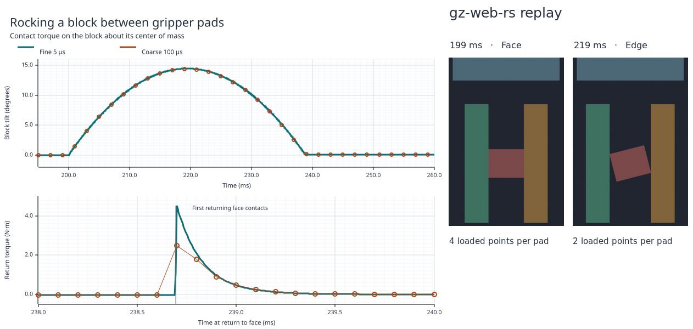
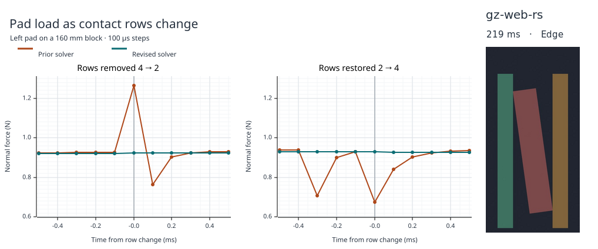

<!-- Copyright (C) 2026 Open Source Robotics Foundation -->
<!-- SPDX-License-Identifier: Apache-2.0 -->

# Watch a parcel rock from its faces onto its edges

A 0.2 kg rectangular block starts flat between two pads pressing at 3 N each. At 200 ms a 200 µs torque pulse tips the block. Two corners on each pad continue to carry load as the other two lift. Pad pressure turns the block back and all four corners on each face carry load again. Gravity and friction are set to zero to isolate the normal contact force and its turning moment. [Watch at 100 µs](http://127.0.0.1:8082/?backend=primitive&ui=full&quality=low&replay=1&lifecycle=1&url=ws%3A%2F%2F127.0.0.1%3A11461%2F) · [Watch at 5 µs](http://127.0.0.1:8082/?backend=primitive&ui=full&quality=low&replay=1&lifecycle=1&url=ws%3A%2F%2F127.0.0.1%3A11462%2F)



The 24 mm tall block reached 14.442° with a 100 µs step and 14.480° with a 5 µs step. The difference is clearest when the opposite corners strike at about 238.7 ms. The peak turning moment from both pads was 2.487 N·m at the coarse step and 4.528 N·m at the fine step. Peak force on a single pad rose from 103.64 N to 189.35 N. The short collision needs a finer clock than the overall motion. [World](../../../examples/worlds/local_rocking_pad_grasp.sdf) · [Motor and torque commands](../../../examples/replay/rocking_pad_grasp.json)

## When the solver drops two points

The 160 mm tall block and longer fingers let the trailing corners move far enough away for the solver to remove them from its contact calculation. The block continues to load two points on each pad through the change. The vertical lines in the two plots mark the first tick with the new count. Both recordings use a 100 µs step and the same 75 N·m pulse. [Watch the revised solver](http://127.0.0.1:8082/?backend=primitive&ui=full&quality=low&replay=1&lifecycle=1&url=ws%3A%2F%2F127.0.0.1%3A11465%2F) · [Watch the prior solver](http://127.0.0.1:8082/?backend=primitive&ui=full&quality=low&replay=1&lifecycle=1&url=ws%3A%2F%2F127.0.0.1%3A11464%2F)



| Change on the left pad | Time | Force change before | Force change after |
| --- | ---: | ---: | ---: |
| Selected points fall from four to two | 216.9 ms | +0.3370 N | +0.0004 N |
| Selected points return from two to four | 246.3 ms | −0.2538 N | −0.0004 N |

These values compare successive ticks at each selection change. The revised left-pad load decreased smoothly from 0.9298 to 0.92799 N between 246.0 and 246.5 ms. [Tall world](../../../examples/worlds/local_tall_rocking_pad_grasp.sdf) · [Motor and torque commands](../../../examples/replay/tall_rocking_pad_grasp.json)

## Replay or reproduce

With the local gz-web-rs frontend on port 8082, open a recording above, press **3** over the viewport for the side view, then press Play. The archive includes the native recordings and viewer checks, two Rust plotting tools, an independent Rust sampler, the physical inputs, and table values. The sampler measures normal impulse divided by the last physics step. It sums each point's impulse moment about the block's center of mass to obtain contact torque. The charts use native tick data and the viewer samples every millisecond. The sampler matched both pads’ independently published normal reactions over 103,500 native steps within 6e-14 N. All three revised recordings reproduced their entire command traces, frames and manifests with one and eight threads. Four WebGPU playback runs checked 7,216 link poses against independently stepped Bevy simulations, verified each shape and rewound to zero. [Portable recordings and measurement tools](pad-rocking-view.tar.xz)

To serve the archived tall block from the simulator checkout, run

```sh
export RUSTC_WRAPPER=
study=target/pad-rocking-view
mkdir -p "$study"
tar -xJf docs/measurements/local-manipulation/pad-rocking-view.tar.xz -C "$study"
cargo run --locked --release --no-default-features -p gz-sim-cli --bin gz-sim-rs -- \
  --server --replay --web-viewer 11466 "$study/tall-after/epoch-0"
```

The archive also contains `tall-before`, `after-100` and `after-5`. Select their `epoch-0` directories in the same command. [Open the portable recording](http://127.0.0.1:8082/?backend=primitive&ui=full&quality=low&replay=1&lifecycle=1&url=ws%3A%2F%2F127.0.0.1%3A11466%2F)

To record a new run with the ordinary SDF loader and regenerate the comparison plots from the archived samples, run

```sh
cargo run --locked --release --no-default-features -p gz-sim-cli --bin gz-sim-local-replay -- \
  "$study/world-100.sdf" "$study/journal-100.json" --threads 1 \
  --record-every 10 --record "$study/fresh-100"
cmp "$study/fresh-100/epoch-0/frames.jsonl" "$study/after-100/epoch-0/frames.jsonl"
cargo run --locked --release --manifest-path "$study/plot/Cargo.toml" --bin gz-physics-audit-checks -- \
  "$study/after-5/loads.jsonl" "$study/after-100/loads.jsonl" "$study/rocking.svg" "$study/rocking.json"
cargo run --locked --release --manifest-path "$study/plot/Cargo.toml" --bin row_weights -- \
  "$study/tall-before/loads.jsonl" "$study/tall-after/loads.jsonl" "$study/rows.svg" "$study/rows.json"
```

The portable sampler can run as a `gz-sim-scene` example. Its arguments are the SDF path, journal path, number of ticks per viewer frame and output directory. It emits the full native tick history. The archive retains every tick in the plotted time windows plus one observation per millisecond outside those windows.

The archive includes `timing/step_cost.rs`. Run it as a `gz-sim-scene` example with the 100 µs compact SDF and a pulse value of 6, or the tall SDF and a pulse value of 75. It prints median, p95 and p99 times in nanoseconds for the first 60 ms of motion and the complete 250 ms after preload.
