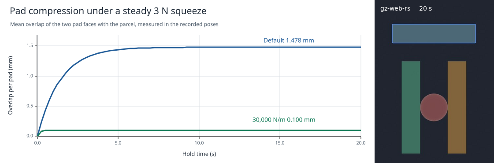

<!-- Copyright (C) 2026 Open Source Robotics Foundation -->
<!-- SPDX-License-Identifier: Apache-2.0 -->

# Gripping a sphere with a specified pad stiffness

Both 80 g fingers squeeze the same 200 g sphere with 3 N each. With a pad stiffness of 30,000 N/m, the expected compression is 3 ÷ 30,000 m, or **0.100 mm per pad**. The left and right contacts both settled at 0.100 mm. With the default contact, they settled at 1.478 mm. The graph follows the average overlap of the two pad faces with the sphere. The image beside it is the native gz-web-rs view of the authored pads at 20 s. [Open the authored hold](http://127.0.0.1:8082/?backend=primitive&ui=full&quality=low&replay=1&lifecycle=1&url=ws%3A%2F%2F127.0.0.1%3A11438%2F) · [Open the default hold](http://127.0.0.1:8082/?backend=primitive&ui=full&quality=low&replay=1&lifecycle=1&url=ws%3A%2F%2F127.0.0.1%3A11437%2F)



In the separate release recording, the motors reduce their squeeze to 1.5 N at 50 ms. The parcel drops 13.975051 mm over the next 110 ms, within 0.449 µm of the gravity-and-friction prediction. During this slip the pads supplied 0.75005 and 0.75001 N of upward friction on average. The fingers open at 160 ms, and at 240 ms they close again after the parcel has escaped. Press **3** in the viewport for the side view. [Watch the grip weaken and release in gz-web-rs](http://127.0.0.1:8082/?backend=primitive&ui=full&quality=low&replay=1&lifecycle=1&url=ws%3A%2F%2F127.0.0.1%3A11436%2F)

| Hold time | Default overlap, left / right (mm) | Authored overlap, left / right (mm) |
| ---: | ---: | ---: |
| 0.25 s | 0.26506 / 0.20896 | 0.08882 / 0.08640 |
| 1 s | 0.80664 / 0.68469 | 0.09998 / 0.09997 |
| 10 s | 1.47697 / 1.47611 | 0.10000 / 0.10000 |
| 20 s | 1.47760 / 1.47760 | 0.10000 / 0.10000 |

For each native frame, the measurement transforms the sphere center into each pad's local frame and computes the distance to its inner box face using the recorded shape dimensions. The graph shows this measurement directly even when the difference occupies less than one screen pixel. The independent Bevy sampler read each link pose from the physics backend with the same forces and clock. All 1,812 link poses matched the 453 displayed frames within 1e-12 per translation and quaternion component. The WebGPU audit also matched each shape and catalog and rewound each recording to zero. The default and authored holds compared 200,004 trace records each across one and eight compute threads. The release compared 2,910. The corresponding recording streams and manifests matched byte for byte. [Portable recordings, native pose samples, measurements, checksums and Rust comparison tools](pad-stiffness-view.tar.xz)

## Replay the recordings

From the simulator checkout, unpack the portable data and serve one of its three recordings. The viewer link uses a gz-web-rs frontend running on port 8082. [Open this replay](http://127.0.0.1:8082/?backend=primitive&ui=full&quality=low&replay=1&lifecycle=1&url=ws%3A%2F%2F127.0.0.1%3A11442%2F)

```sh
export RUSTC_WRAPPER=
study=target/pad-stiffness-view
mkdir -p "$study"
tar -xJf docs/measurements/local-manipulation/pad-stiffness-view.tar.xz -C "$study"
cargo run --locked --release --no-default-features -p gz-sim-cli --bin gz-sim-rs -- \
  --server --replay --web-viewer 11442 "$study/release/epoch-0"
```

Use `$study/default/epoch-0` or `$study/material/epoch-0` in the last command for a twenty-second hold. The release was recorded every tenth native tick (1 ms) and each hold every 2,500 ticks (250 ms).

## Reproduce the comparison

The native recordings use the ordinary SDF loader and Rust command journals. Use fresh output paths for each new capture.

```sh
export RUSTC_WRAPPER=
study=target/pad-stiffness-view
cargo build --locked --release --no-default-features -p gz-sim-cli --bin gz-sim-local-replay
for world in local_two_finger_load local_stiff_pad_grasp; do
  target/release/gz-sim-local-replay "examples/worlds/$world.sdf" \
    examples/replay/pad_stiffness_hold.json --threads 1 --record-every 2500 \
    --record "$study/fresh-$world" > /dev/null
done
target/release/gz-sim-local-replay examples/worlds/local_stiff_pad_grasp.sdf \
  examples/replay/two_finger_load.json --threads 1 --record-every 10 \
  --trace "$study/fresh-slip.jsonl" --record "$study/fresh-slip"
cargo run --locked --release --manifest-path "$study/plot/Cargo.toml" -- \
  "$study/fresh-local_two_finger_load/epoch-0" "$study/fresh-local_stiff_pad_grasp/epoch-0" \
  "$study/fresh-compression.svg" "$study/fresh-compression.json"
cargo run --locked --release --manifest-path tools/physics-audit/numerics/Cargo.toml \
  --bin two_finger_view -- "$study/fresh-slip.jsonl" "$study/fresh-slip/epoch-0"
```

The portable `sampler/pad_stiffness_sampler.rs` can run as a `gz-sim-scene` example. It takes a world path and `hold` or `release`, and writes the independent per-frame poses to standard output. The portable `hold-index.json` and `release-index.json` select the matching camera and observation clocks. [Rust WebGPU replay checker](../../../tools/physics-audit/browser/src/main.rs)
