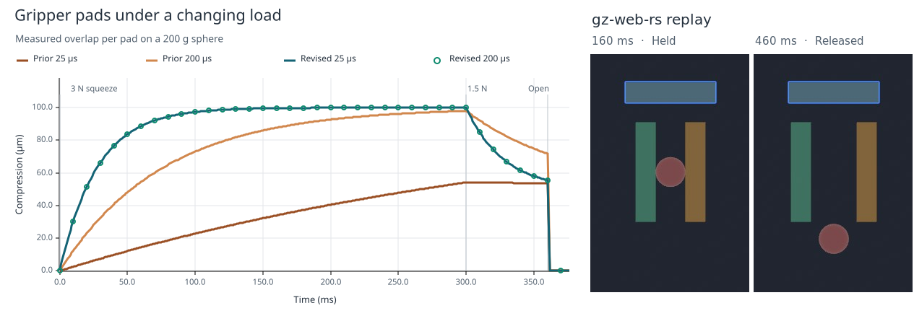

<!-- Copyright (C) 2026 Open Source Robotics Foundation -->
<!-- SPDX-License-Identifier: Apache-2.0 -->

# Watch the gripper load and release

The motors press two 30,000 N/m pads onto a 200 g sphere with 3 N each. After 300 ms the squeeze drops to 1.5 N, and the sphere starts slipping. At 360 ms the fingers open. The revised solver reaches 95% of the expected 100 µm compression on **both fingers at 83 ms** with either a 25 or 200 µs step, sampled once per millisecond. In the previous solver the same two step sizes took 1,224 and 230 ms in a sustained grip. [Earlier sustained-grip results](pad-stiffness.md) · [Watch the revised 25 µs run](http://127.0.0.1:8082/?backend=primitive&ui=full&quality=low&replay=1&lifecycle=1&url=ws%3A%2F%2F127.0.0.1%3A11451%2F) · [Watch the revised 200 µs run](http://127.0.0.1:8082/?backend=primitive&ui=full&quality=low&replay=1&lifecycle=1&url=ws%3A%2F%2F127.0.0.1%3A11452%2F)



Each curve shows the mean of the left and right pad overlaps, calculated from the recorded sphere center, radius, oriented pad boxes and dimensions. Where the sphere clears a pad the overlap is zero. The green circles sample the coarser revised run every 10 ms so that both revised traces are visible. The native views show the 25 µs run at its actual geometric scale. [Watch the prior 25 µs run](http://127.0.0.1:8082/?backend=primitive&ui=full&quality=low&replay=1&lifecycle=1&url=ws%3A%2F%2F127.0.0.1%3A11450%2F) · [Watch the prior 200 µs run](http://127.0.0.1:8082/?backend=primitive&ui=full&quality=low&replay=1&lifecycle=1&url=ws%3A%2F%2F127.0.0.1%3A11453%2F)

| Measurement | Prior 25 µs | Prior 200 µs | Revised 25 µs | Revised 200 µs |
| --- | ---: | ---: | ---: | ---: |
| Mean pad compression at 100 ms (µm) | 22.847 | 73.061 | 97.353 | 97.345 |
| Mean pad compression at 350 ms (µm) | 53.786 | 74.939 | 58.149 | 58.160 |
| Sphere drop at 460 ms (mm) | 67.070 | 67.092 | 67.070 | 67.099 |

The Rust sampler independently stepped the Bevy simulation and read all four link poses every millisecond. The WebGPU viewer checked all 7,376 link poses across the four 461-frame recordings within 1e-12 per translation or quaternion component, verified each shape and rewound each run to zero. Repeating each revised run with one and eight compute threads produced byte-identical command traces, frames and manifests. [Portable recordings, checksums, browser receipts and Rust measurement tools](pad-transient-view.tar.xz)

## Replay and reproduce

From the simulator checkout, unpack the data and run the Rust replay server. With the gz-web-rs frontend on port 8082, open the replay, press **3** over the viewport for the side view and press Play. The three other native recordings are named `after-200`, `before-25` and `before-200`. [Open the portable replay](http://127.0.0.1:8082/?backend=primitive&ui=full&quality=low&replay=1&lifecycle=1&url=ws%3A%2F%2F127.0.0.1%3A11455%2F)

```sh
export RUSTC_WRAPPER=
study=target/pad-transient-view
mkdir -p "$study"
tar -xJf docs/measurements/local-manipulation/pad-transient-view.tar.xz -C "$study"
cargo run --locked --release --no-default-features -p gz-sim-cli --bin gz-sim-rs -- \
  --server --replay --web-viewer 11455 "$study/after-25/epoch-0"
```

To repeat the qualified capture, use a fresh output path. The 200 µs world uses five native steps per recorded millisecond, and the 25 µs world uses forty. The plot tool accepts a directory containing the four named recordings.

```sh
cargo run --locked --release --no-default-features -p gz-sim-cli --bin gz-sim-local-replay -- \
  "$study/pad-25.sdf" "$study/journal-25.json" --threads 1 \
  --record-every 40 --record "$study/fresh-25" --trace "$study/fresh-25.jsonl"
cmp "$study/fresh-25/epoch-0/frames.jsonl" "$study/after-25/epoch-0/frames.jsonl"
cargo run --locked --release --manifest-path "$study/plot/Cargo.toml" -- \
  "$study" "$study/grip.svg" "$study/grip.json"
```
