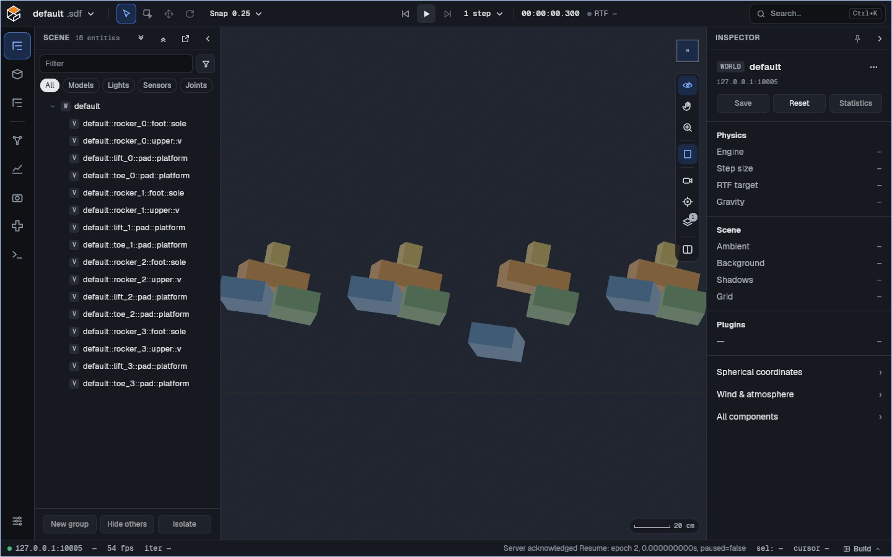

<!-- Copyright (C) 2026 Open Source Robotics Foundation -->
<!-- SPDX-License-Identifier: Apache-2.0 -->

# Withdrawing a support beneath four parked feet

Four two-link feet began sliding at different speeds on separate pairs of finite pads. Each foot weighed 2 kg. Once settled, its two measured normal impulses summed to 0.009810 N·s per 0.5 ms tick, corresponding to its 19.62 N weight. The local scene's shared tier policy parked all four feet at 142.5 ms after the configured 140 ms cooldown and 2 ms eligibility interval.

At 150 ms, while paused, the test queued a 1.8 m/s withdrawal along the second foot's blue pad normal. The paused tick held the clock and every rigid body. At 150.5 ms the second foot woke and its green pad supplied 0.009907980 N·s. The withdrawing blue pad supplied zero. Both pad impulses and all four body states at that station matched the continuously dynamic control exactly on all 300 subsequent ticks. By 300 ms the blue pad had traveled 270 mm.

The three neighboring feet stayed parked and their bodies remained stationary. Their always-dynamic counterparts drifted by up to 0.049 mm and 0.000021 rad. After a world reset, all 601 recorded states, tier decisions and affected-foot impulses repeated exactly. The cold simulator refused a request to remove a foot from the recording, presented all 65 frames and rewound to time zero. The gz-web-rs WebGPU viewer checked 1,040 visual poses against native body observations in each of two camera views. Select the right face of the view cube to see the blue pad move away. [Open the recording in gz-web-rs](http://127.0.0.1:8082/?backend=primitive&ui=full&quality=low&replay=1&lifecycle=1&url=ws%3A%2F%2F127.0.0.1%3A10005%2F)



## Coverage

The completed independent headless profile at `8c57ff69ca13` had missed the cohort eligibility and commit path in `fidelity_zone.rs`. On both frozen feature configurations this case exercised another 63 regions there and 19 in `articulation.rs`. Each cold replay ran the original retained simulator executable. The new Rust test harness ran against that profile's existing Cargo library configuration. We matched each process counter file to the executing ELF build ID, merged into a separate copy of the corresponding profile, and checked every original project source denominator for equality. The CLI figures count only the cold simulator's counters. The scene figures include the physical regression harness. [Executable identities and measurements](parked-foot-cohort.json)

| Profile | Crate | Previously covered lines → after / original total | Previously covered regions → after / original total |
|---|---|---:|---:|
| Headless | CLI | 7,058 → 7,068 / 7,852 | 11,941 → 11,958 / 13,427 |
| Headless | Scene | 26,842 → 26,884 / 28,981 | 40,732 → 40,814 / 44,764 |
| Renderer | CLI | 6,260 → 6,271 / 7,857 | 10,468 → 10,486 / 13,430 |
| Renderer | Scene | 23,953 → 23,995 / 31,027 | 36,657 → 36,739 / 48,023 |

The new regression covered 336 of 336 lines and 652 of 653 regions on each profile. The integration run without default features passed, strict Clippy passed, and the archive frame bytes and physical measurements matched across all three configurations. Full CLI and scene release coverage still falls below 95%. These counts supplement each original profile independently.

To recreate the recording from the repository root, choose a new output directory and a free viewer port.

```sh
GZ_FOOT_COHORT_REPLAY="$PWD/artifacts/foot-cohort-demo" RUSTC_WRAPPER= cargo test --locked \
  --release --no-default-features -p gz-sim-cli --test native contact_cohort
RUSTC_WRAPPER= cargo run --locked --release --no-default-features -p gz-sim-cli --bin gz-sim-rs -- \
  artifacts/foot-cohort-demo/replay --server --replay --web-viewer 9002
```
