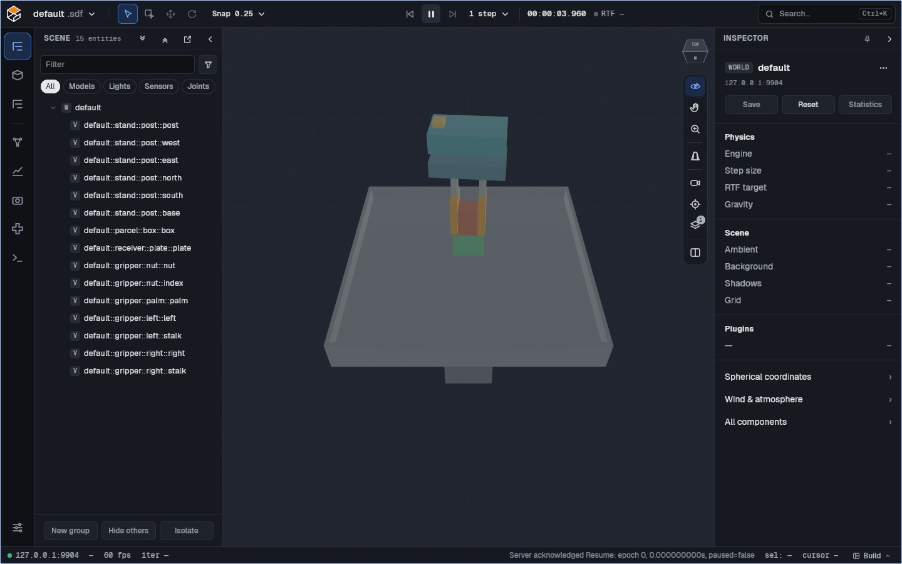

<!-- Copyright (C) 2026 Open Source Robotics Foundation -->
<!-- SPDX-License-Identifier: Apache-2.0 -->

# Parking the screw-driven gripper between lifts

Both runs lifted a free 200 g parcel 126.7 mm, tilted the universal wrist under load, and put the parcel on the green plate. The switched run held the unloaded arm still for 750 ms and woke on the first commanded solve both times. The jaws first touched the parcel at 1.274 s in both runs. [Play the switched run](http://127.0.0.1:8082/?backend=primitive&ui=full&quality=low&replay=1&lifecycle=1&url=ws%3A%2F%2F127.0.0.1%3A9904%2F) · [Play the always-dynamic run](http://127.0.0.1:8082/?backend=primitive&ui=full&quality=low&replay=1&lifecycle=1&url=ws%3A%2F%2F127.0.0.1%3A9905%2F)



| Measured over 10,000 steps of 1 ms | Always dynamic | Switched |
|---|---:|---:|
| First left jaw impulse (N·s) | 0.0973864 | 0.0973742 |
| First right jaw impulse (N·s) | 0.1011831 | 0.1011791 |
| Height gained (mm) | 126.705 | 126.696 |
| Ticks with two loaded jaws and no tray or plate contact in the 1.05 s carry window | 1,050 | 1,050 |
| Peak measured wrist excursion during carry (rad) | 0.009780 | 0.009783 |
| Plate impulse immediately before jaw opening (N·s) | 0.011327 | 0.011243 |
| Final mean plate load (N) | 1.962000 | 1.962003 |
| p95 step during 750 parked-window ticks (µs) | 611.9 | 5.65 |
| p95 step over the complete cycle (µs) | 606.3 | 606.1 |

At 1.000 s the unloaded robot parked. Two persistent 12 N closing commands woke it on the 1.251 s solve. At 4.000 s a parking request preserved both jaw targets and the 2 N·m spindle target. Clearing the three commands at the same instant exposed the independent external-contact guard. Both jaw impulses, the five coordinates and their rates remained identical through the refusal. Restoring the commands preceded the next solve. The plate traveled under the parcel during lift and carried a measured load before the jaws opened at 8.351 s. At 9.000 s the unloaded robot parked again. A single −0.45 N·m wrist command woke it on the 9.501 s solve.

Across all five moving bodies, the largest relative position error was 0.897 mm and the largest rotation error was 0.00723 rad. The largest linear and angular speed differences were 0.0740 m/s and 1.133 rad/s. The first jaw impulse differences were 0.0000123 and 0.0000041 N·s. The largest left and right jaw differences anywhere in the cycle were 0.00106 and 0.00349 N·s. The machine-readable results include coordinate rates, linear and angular momentum about the world origin, kinetic plus gravitational energy, and the native stream checksums. These differences compare trajectories under identical inputs. The robot and parcel exchange momentum with their mount and supports. [Measured results](parked-spindle.json)

The mounted parking check now projects gravity and passive spring load onto the screw coordinate and each independent wrist axis. A screw contributes axial force times signed lead as well as torque about its axis. The wrist uses its parent first axis and moving second axis. Each coordinate needs zero net load or a matching active stop. External contacts, pending inputs, wrist motors, and moving native speed-limit references keep the robot dynamic. The measured gripper uses physical spindle damping and position stops. An earlier trial that slept the visible links while speed-limit reference bodies kept moving woke immediately and ejected the parcel. The regression covers that refused profile and both screw pitch directions.

Three consecutive release pairs ran on logical CPU 7 of a Ryzen 9 9950X3D, with the dynamic run first in each pair. The table reports the median of the three p95s for each window. Timings bracket one public Bevy step and exclude recording and diagnostic readback. Each pair reproduced both native streams byte-for-byte. Reset reproduced every moving-body pose and twist, joint sample, and measured normal impulse on all 10,001 observations. Chromium verified 251 frames and 3,765 visual poses and shapes per replay with the WebGPU renderer, then rewound to zero.

Three example regressions and nine native parking tests passed. Changed solver lines and regions reached 75/75 and 150/150. The example reached 308/315 production lines (97.78%) and 583/611 production regions (95.42%). The counts combine executions by source coordinate, with each profile exported against its matching binary.

## Reproduce

Run from the integration checkout with the gz-web-rs frontend on port 8082. Choose a fresh recording directory.

```sh
RUSTC_WRAPPER= cargo run --release --locked --no-default-features -p gz-sim-cli \
  --example parked_spindle -- target/my-parked-spindle
RUSTC_WRAPPER= cargo run --release --locked --no-default-features -p gz-sim-cli \
  --bin gz-sim-rs -- --server --replay --web-viewer 9904 target/my-parked-spindle/switched
```

Use the sibling `dynamic` archive on port 9905 to replay the control. The next step is to qualify parking for robots with active angular speed-limit references by handing off the entire native constraint island and checking the first resumed contact.
