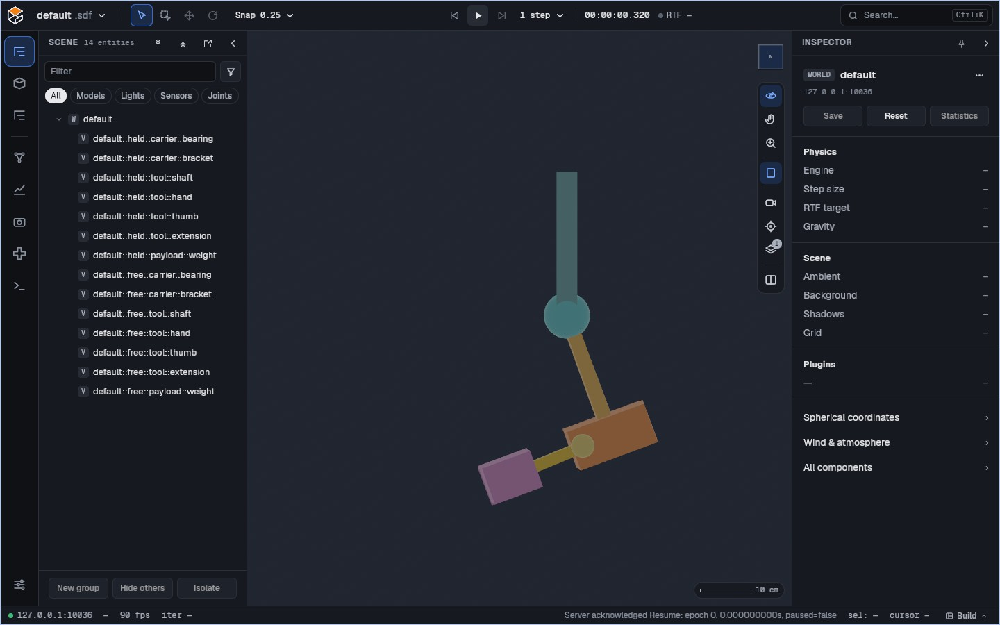

<!-- Copyright (C) 2026 Open Source Robotics Foundation -->
<!-- SPDX-License-Identifier: Apache-2.0 -->

# Replaying a push on a moving robot link

A 1 kg wrist payload received a world force of (40, 24, −16) N at a point (100, −100, 50) mm from its center of mass in link coordinates. The initial turning moment was (0.4, 3.6, 6.4) N·m. After the wrist had rotated for 160 ms, an identical push on the same material point produced (0.518, 3.407, 6.405) N·m. Applying the force directly at the center produced zero moment about the center. The independent equivalent-wrench test reproduced the point-force state trace. [World](../../../examples/worlds/gravity_wrist.sdf) · [Point-force commands](../../../examples/replay/off_center_wrist_load.json) · [Off-center push in gz-web-rs](http://127.0.0.1:8082/?backend=primitive&ui=full&quality=low&replay=1&lifecycle=1&url=ws%3A%2F%2F127.0.0.1%3A10036%2F) · [Centered control](http://127.0.0.1:8082/?backend=primitive&ui=full&quality=low&replay=1&lifecycle=1&url=ws%3A%2F%2F127.0.0.1%3A10037%2F)

A second wrist hung under gravity at the prescribed tier for 250 ms. A 120 N off-center push survived a pause and reached the first dynamic solve exactly once. With automatic promotion its first measured angular velocity matched the continuously dynamic control to within 2 × 10⁻¹⁵ rad/s per axis. Explicit promotion gave the same first response. Reset reproduced the subsequent 180 solves. The journal reports which tier owns the model and the world force and torque still queued for each link. [Hanging wrist](../../../examples/worlds/local_hanging_ball_wrist.sdf) · [Tier commands](../../../examples/replay/parked_wrist_load.json) · [Watch the parked wrist resume](http://127.0.0.1:8082/?backend=primitive&ui=full&quality=low&replay=1&lifecycle=1&url=ws%3A%2F%2F127.0.0.1%3A10038%2F)

All eight CPU journal tests passed. Changed executable line coverage reached 100% in each of the four crates. Changed region coverage was 22/23 in native physics, 5/5 in multifidelity, 81/82 in the CLI and 29/30 in scene loading. The browser checked every displayed frame from all three recordings. [Measurements and coverage](point-load-replay.json) · [Portable recordings and controls](point-load-replays.tar.xz)



Run from the physics checkout with a fresh recording path.

```sh
RUSTC_WRAPPER= cargo run --locked --release -p gz-sim-cli --no-default-features --bin gz-sim-local-replay -- examples/worlds/gravity_wrist.sdf examples/replay/off_center_wrist_load.json --threads 1 --trace wrist.jsonl --record wrist-view
RUSTC_WRAPPER= cargo run --locked --release -p gz-sim-cli --no-default-features --bin gz-sim-rs -- --server --replay --web-viewer 10036 wrist-view/epoch-0
```
