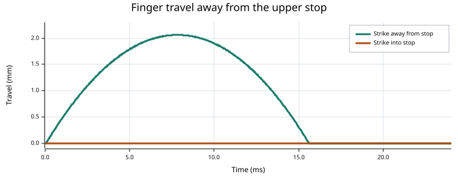

<!-- Copyright (C) 2026 Open Source Robotics Foundation -->
<!-- SPDX-License-Identifier: Apache-2.0 -->

# A powered finger strikes its travel stop

The orange finger slides along a guide on the blue wrist. A steady 2 N command presses it against the upper travel stop. A 200 g sphere strikes the finger 20 mm off center at 0.75 m/s. In one recording the sphere pushes the finger into the stop and turns the wrist. In the other it knocks the finger away, then the same actuator force brings it back. [Open the strike into the stop](http://127.0.0.1:8082/?backend=primitive&ui=full&quality=low&replay=1&lifecycle=1&url=ws%3A%2F%2F127.0.0.1%3A11426%2F) · [Open the release and return](http://127.0.0.1:8082/?backend=primitive&ui=full&quality=low&replay=1&lifecycle=1&url=ws%3A%2F%2F127.0.0.1%3A11427%2F)

The first positive impulse arrived at 67 µs in all three recordings. The strike into the upper stop delivered 72.99319 mN·s, rotated the wrist 9.54° in 24 ms, and kept the slider within 0.118 µm of the stop on its permitted side. The strike from the opposite side delivered 65.31748 mN·s. The slider reached 2.064 mm of clearance at 7.835 ms and returned to within 1 µm of the stop at 15.602 ms.



From the top view, watch the orange finger relative to the blue guide. Press Play, or use Step to advance one recorded frame. The UI displays the original simulation timestamps. Each recording includes time zero, the first load and the 24 ms endpoint. The portable set also includes a reflected lower-stop strike with a −2 N command. [Recordings, SDF worlds, command journals and browser captures](powered-slider-replays.tar.xz) · [Measured values and release checks](powered-slider-view.json)

## Reproduce a recording

From the review checkout, unpack the portable set into a fresh directory. The journal sends `set_joint_force` to the ordinary model’s `ApplyJointForce` system, ticks once while paused and then advances 24,000 times at the SDF’s 1 µs timestep. The command persists until the run ends. The viewer reads each recording through the ordinary Gazebo websocket replay service.

```sh
export RUSTC_WRAPPER=
mkdir -p target/powered-slider-study
tar -xJf docs/measurements/local-manipulation/powered-slider-replays.tar.xz \
  -C target/powered-slider-study
study=target/powered-slider-study
cargo run --locked --release --no-default-features -p gz-sim-cli --bin gz-sim-local-replay -- \
  "$study/inputs/away.sdf" "$study/inputs/away.json" --trace "$study/away.trace.jsonl" \
  --record "$study/new-away" --record-every 67
cargo run --locked --release --no-default-features -p gz-sim-cli --bin gz-sim-local-replay -- \
  "$study/inputs/away.sdf" "$study/inputs/away.json" --verify "$study/away.trace.jsonl" \
  --threads 4 > /dev/null
cargo run --locked --release --manifest-path tools/physics-audit/numerics/Cargo.toml \
  --bin powered_slider_view -- "$study/away.trace.jsonl" "$study/new-away/epoch-0" "$study/readback"
cargo run --locked --release --no-default-features -p gz-sim-cli --bin gz-sim-rs -- \
  --server --replay --web-viewer 11428 "$study/new-away/epoch-0"
```

With gz-web-rs running on port 8082, open the local recording. To view the portable captures directly, point the final command at `"$study/replay/left"`, `"$study/replay/away"` or `"$study/replay/right"`. [Open the reproduced recording](http://127.0.0.1:8082/?backend=primitive&ui=full&quality=low&replay=1&lifecycle=1&url=ws%3A%2F%2F127.0.0.1%3A11428%2F)

To start the web frontend on a fresh Linux machine, use the gz-web-rs checkout with primitive replay support. In a separate terminal, build its Rust/WASM viewer and serve the checkout on the port used by the links above.

```sh
export RUSTC_WRAPPER=
./build.sh
printf '.mjs:application/javascript\n.wasm:application/wasm\n' > target/replay-mime.conf
busybox httpd -f -c "$PWD/target/replay-mime.conf" -p 127.0.0.1:8082 -h "$PWD"
```

## What the checks measure

For every recorded time, the numerical checker reconstructs the hub, guide and finger from the public hinge angle, slider position and authored offsets. It independently integrates sphere momentum from the one measured normal impulse on the rotating face. Applying the impulse at the end of a native tick leaves a one-tick position uncertainty. These recordings cover one frictionless planar impact against a finger on a reduced-coordinate wrist with finite slider travel. The companion physics qualification derives the two impact responses independently. [Impact mechanics](powered-slider-impact.md) · [Verification code](../../../tools/physics-audit/numerics/src/bin/powered_slider_view.rs)

Across the three 360-frame recordings, WebGPU playback compared 4,320 visual poses and shapes, visited the first-contact frame and reset to time zero. The largest encoder-to-recording position difference was 5.59e-17 m across the rigid links and guide. The largest sphere-path difference was 19.06 nm. A fresh four-thread run reproduced every one-thread observation and both archive files byte for byte. A separate in-process reset cleared the held effort, then repeating the command reproduced all 24,000 advancing observations in every scene. On the dedicated Rust readback executable, the native traces and deliberate rejection cases covered 217/220 lines and 408/424 code regions.
