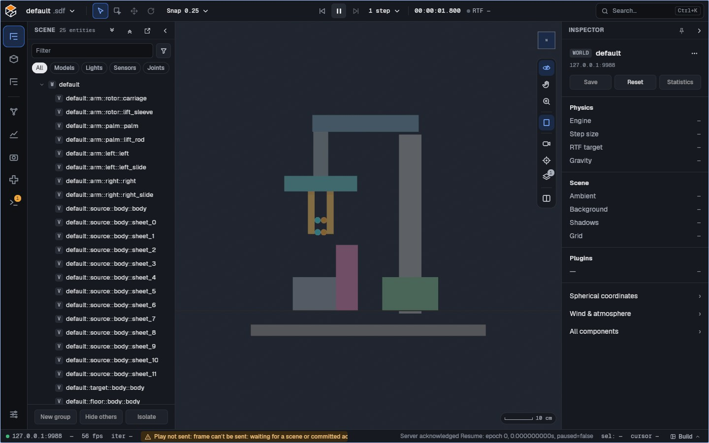

<!-- Copyright (C) 2026 Open Source Robotics Foundation -->
<!-- SPDX-License-Identifier: Apache-2.0 -->

# A 1 ms public clock for a folded-sheet grasp

A real articulated gripper picked up an 8.4 g folded sheet, held it 150 mm clear of the bench, and put it down. Its two jaws carried 41.20 and 41.21 mN during the hold. The controller, Bevy systems and public state advanced 3,400 times during the 3.4 s transfer. Rapier and the cloth solver exchanged contact loads 54,400 times. [Watch the 16-exchange grasp](http://127.0.0.1:8082/?backend=primitive&ui=full&quality=low&replay=1&lifecycle=1&url=ws%3A%2F%2F127.0.0.1%3A9988%2F) · [Stiffer grasp at 64 exchanges](http://127.0.0.1:8082/?backend=primitive&ui=full&quality=low&replay=1&lifecycle=1&url=ws%3A%2F%2F127.0.0.1%3A9989%2F) · [One exchange per millisecond](http://127.0.0.1:8082/?backend=primitive&ui=full&quality=low&replay=1&lifecycle=1&url=ws%3A%2F%2F127.0.0.1%3A9990%2F)

| Grasp | Public step | Rigid and material exchanges per ms | Left jaw upward | Right jaw upward | Lowest compressive squeeze |
|---|---:|---:|---:|---:|---:|
| Original pad | 1 ms | 1 | 26.09 mN | 56.31 mN | 0.653 N |
| Original pad | 1 ms | 16 | 41.20 mN | 41.21 mN | 0.652 N |
| Same pad, independently stepped reference | 62.5 µs | 16 | 41.20 mN | 41.21 mN | 0.652 N |
| Lightweight stiff pad | 1 ms | 64 | 47.91 mN | 34.50 mN | 0.825 N |

The independent reference re-evaluates contact at every short native step and holds the actuator command for 1 ms. At both tested exchange rates, every particle position, velocity and measured nodal constraint impulse matched at every public barrier. Differences in integrated finger impulses were below 5 × 10⁻¹⁹ N·s, and the end-of-tick torque differed by less than 4 × 10⁻¹⁶ N·m. Integrating the torque without transporting each impulse to a common point would have introduced up to 0.546 mN·m of error. The lightweight pads retained the unequal load sharing seen in the finer-public-clock study.

## Input and measurement contract

Set the world Deformables plugin attribute `rigid_exchanges="16"` on an ordinary local multi-fidelity scene. The supported range is 1–256, with 1 as the default. The nested clock accepts one cable or cloth, jointed cuboid pads using `coupling="articulated_wrench"`, and optional static bounded boxes or planes. Each interval must contain at least one nanosecond per authored material substep. Incompatible worker controls, free two-way material receivers, or independently clocked native motion fail admission. Each native interval owns a positive portion of the original tick, including when the durations differ by one nanosecond.

The rigid solver runs first on each interval. It applies the previous interval’s measured pad impulse through the real joints. XPBD then follows the two native pad endpoints, measures the next reaction, and queues it for the following interval. A public body wrench and joint effort last for the full advancing tick. Previously applied impulses and velocity changes keep their single application. A queued material force remains active across all the exchanges and expires at the public barrier. Pausing preserves pending inputs and reactions. Reset clears them. Published observations include boundary impulses about the public start, pad wrenches about the public end, per-particle pad and shell loads, internal constraint impulses, and the normal impulse of each rigid contact pair. Instantaneous pose, energy and elastic force queries report the final state of each public tick.

A separate rigid-body test accumulated native normal impulses and the final loaded state of a real resting box against four independently stepped intervals. The same trial applied an initial angular/linear impulse, a single-tick body wrench, a retained joint effort and a single-tick material force. A three-exchange test checked that rounding interval lengths delivers the complete force. Another reset with both jaws loaded, an outstanding material force and two pending pad reactions reproduced the pickup.

The measured p95 cost per 1 ms actuator period was 0.37 ms for a single solve, 3.16 ms for 16 internal exchanges, 2.43 ms for 16 separate Bevy steps, and 19.57 ms for the 64-exchange stiff grasp. These are individual release runs on a shared host.

332 scene tests and 90 robot example tests passed. The existing opt-in long cost test was skipped. Strict Clippy passed, and LLVM exercised 474/489 changed production lines (96.93%) and 883/924 regions (95.56%). Chromium verified 411 WebGPU frames and 4,932 independently sampled material positions. [Measurements, input and coverage evidence](public-gripper-exchanges.json)

## Reproduce

~~~sh
export RUSTC_WRAPPER=
cargo run --release --locked --no-default-features -p gz-sim-cli --example local_robot_foundations -- \
  sheet-jaws target/public-gripper-exchanges --exchanges-per-ms 16 --public-exchange-clock \
  --substeps 1 --panel-balance --bend-damping 0.001
cargo run --release --locked --no-default-features -p gz-sim-cli --bin gz-sim-rs -- \
  --server --replay --web-viewer 9988 target/public-gripper-exchanges/replay
~~~

The generated `world.sdf` runs through the ordinary loader. The Rust example supplies the jaw and lift commands at 1 ms intervals and writes an independent `exchange-audit.json`. Omitting `--public-exchange-clock` selects the earlier fine-public-clock reference. The comparison example requires an exchange count which exactly divides one millisecond in nanoseconds.
