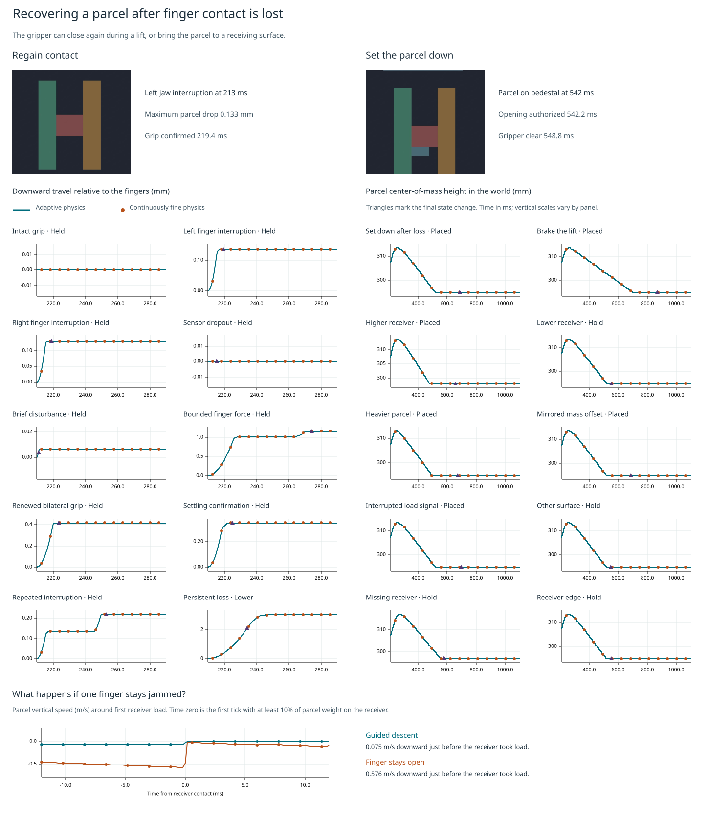

# Watch the gripper recover or set the parcel down

Open the left-finger replay, place the pointer over the viewport and press **3** for the side view. Select the red parcel in the scene tree and press **F** to frame it. Play through 210 ms, when an external force pushes one finger outward during the lift. The controller confirms a renewed grip at 219.4 ms. Compare that with the longer interruption, which triggers lowering at 234.2 ms. [Brief loss during a lift](http://127.0.0.1:8082/?backend=primitive&ui=full&quality=low&replay=1&lifecycle=1&url=ws%3A%2F%2F127.0.0.1%3A11531%2F) · [Prolonged loss](http://127.0.0.1:8082/?backend=primitive&ui=full&quality=low&replay=1&lifecycle=1&url=ws%3A%2F%2F127.0.0.1%3A11532%2F)

The set-down replay follows a separate run from the initial lift. At 542.2 ms the gripper commands opening over the selected pedestal. When an unrelated obstacle is in that position, it keeps the fingers closed. Both runs include the subsequent motion through 1.1 s. [Successful placement](http://127.0.0.1:8082/?backend=primitive&ui=full&quality=low&replay=1&lifecycle=1&url=ws%3A%2F%2F127.0.0.1%3A11533%2F) · [Wrong receiving surface](http://127.0.0.1:8082/?backend=primitive&ui=full&quality=low&replay=1&lifecycle=1&url=ws%3A%2F%2F127.0.0.1%3A11534%2F)



## Recordings by phase

The names in the two columns are directory prefixes inside the portable bundle. Its `plot-data.json` index gives the archive path, final controller state and frame count for every phase. Use `-adaptive` or `-fine` to choose the physics run. Every adaptive directory also contains a gz-web-rs image called `comparison.jpg`. [Portable recordings and measurements](regrasp-setdown-view.tar.xz) · [Mechanical measurements and acceptance checks](regrasp-setdown.md)

| Phase | Regrasp run | What to watch | Phase | Set-down run | What to watch |
| ---: | --- | --- | ---: | --- | --- |
| 1 | `baseline` | Both fingers stay in contact during the lift. | 11 | `nominal` | The parcel loads the pedestal and the fingers open and retreat. |
| 2 | `left` | A left-finger interruption lets the parcel slip 0.133 mm. | 12 | `brake` | A slower descent delays opening to 722.6 ms. |
| 3 | `right` | The right finger recovers contact and grip is confirmed at 218.8 ms. | 13 | `high` | The higher receiver supports the parcel earlier. |
| 4 | `dropout` | A five-millisecond sensor interruption leaves the physical grasp intact. | 14 | `low` | The lower receiver lies beyond the loaded rail’s available stroke. |
| 5 | `brief` | A 0.4 ms outward force ends before loss is confirmed. | 15 | `heavy` | The pedestal ends up carrying the heavier parcel’s 2.551 N weight. |
| 6 | `bounded` | The fingers reclose gradually after a longer disturbance. | 16 | `mirror` | The parcel’s mass offset and the disturbed finger switch sides. |
| 7 | `reacquire` | Tracking restarts when both loaded contacts return. | 17 | `dropout` | A missing support reading delays opening until a fresh dwell completes. |
| 8 | `settling` | A second nudge interrupts settling and starts another reclosure. | 18 | `wrong` | Contact with the other surface keeps the fingers closed. |
| 9 | `repeat` | The gripper confirms its second recovery at 253.0 ms. | 19 | `missing` | Without a receiver under the parcel, the fingers remain closed. |
| 10 | `prolonged` | Continued loss transfers control to lowering. | 20 | `edge` | Insufficient margin at the edge prevents opening. |

### A jaw that remains jammed

In the additional phase 11 control, one finger stays physically open through the descent. The parcel reaches the pedestal at 312.6 ms with a downward speed of about 0.576 m/s, compared with 0.075 m/s for the guided descent. The support ends up bearing the dropped parcel. The controller classifies the landing as unguided and never issues a successful placement. The extra recording is `setdown/jammed-adaptive`, with its continuous reference in `setdown/jammed-fine`. The bottom panel aligns both maneuvers at the first receiver reaction above one tenth of parcel weight. [Watch the jammed finger](http://127.0.0.1:8082/?backend=primitive&ui=full&quality=low&replay=1&lifecycle=1&url=ws%3A%2F%2F127.0.0.1%3A11535%2F)

The viewer played all 21 adaptive recordings to the end and rewound each to zero. Across 8,971 WebGPU frames it matched 42,496 visual poses and shapes. The plotter independently reconstructed the parcel and pad heights at all 17,900 shared nonzero archive clocks across the 42 adaptive and continuously fine recordings.

## Play a portable recording

From the simulator checkout, extract the bundle into an unused directory. The command below plays the repeated regrasp. Change `regrasp/repeat-adaptive` to any listed run, such as `setdown/edge-fine`. Use an available replay port.

```sh
export RUSTC_WRAPPER=
study=target/regrasp-setdown-recordings
mkdir -p "$study"
tar -xJf docs/measurements/local-manipulation/regrasp-setdown-view.tar.xz -C "$study"
(cd "$study" && sha256sum --quiet --check SHA256SUMS)
cargo run --release --locked --no-default-features -p gz-sim-cli --bin gz-sim-rs -- \
  --server --replay --web-viewer 11538 "$study/regrasp/repeat-adaptive/epoch-0"
```

With gz-web-rs on port 8082, open the portable recording and press **Play**. The Rust plotter included in the bundle also checks the recorded parcel and pad heights against the native measurements before drawing the graph. [Open the portable recording](http://127.0.0.1:8082/?backend=primitive&ui=full&quality=low&replay=1&lifecycle=1&url=ws%3A%2F%2F127.0.0.1%3A11538%2F) · [Starting the local frontend](../../LOCAL_RIGID_ROBOT.md#watch-the-current-local-robot-experiments)

```sh
cargo run --release --locked --manifest-path "$study/plot/Cargo.toml" -- \
  "$study" "$study/regenerated.svg" "$study/regenerated.json"
```

To regenerate either native recording with Rust, choose fresh output directories.

```sh
cargo run --release --locked --no-default-features -p gz-sim-cli --example local_regrasp -- \
  left adaptive target/my-left-regrasp
cargo run --release --locked --no-default-features -p gz-sim-cli --example regrasp_setdown -- \
  nominal adaptive target/my-supported-setdown
```
