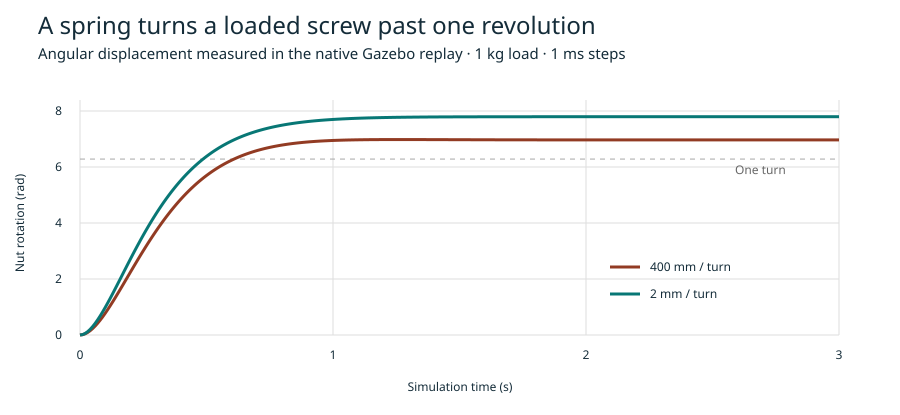

<!-- Copyright (C) 2026 Open Source Robotics Foundation -->
<!-- SPDX-License-Identifier: Apache-2.0 -->

# A passive screw drive under load

A 1 kg nut rotates through more than one revolution and lifts its own weight using an authored torsional spring. The screw's public coordinate is continuous angle in radians. The SDF axis accepts spring stiffness in N·m/rad, damping in N·m·s/rad and reference angle in radians. The passive torque acts independently of commanded effort and physical stops. [Release the spring in gz-web-rs](http://127.0.0.1:8082/?backend=primitive&ui=full&quality=low&replay=1&lifecycle=1&url=ws%3A%2F%2F127.0.0.1%3A9805%2F)



Both curves were read from the native replay's nut orientation, unwrapped one frame at a time. The driven row uses the accumulated twist of the rotating nut. At each rigid step of duration h, a force-based angular velocity row applies the linearized spring torque k(qref − q) − (d + hk)ω, with the next angular velocity solved alongside thread, contact and stop reactions. An initial axial-coordinate spring lost 4.79 rad of rotation after three seconds on the 2 mm lead. Applying torque directly on the angular axis avoids dividing its gains by the square of a small lead.

## Numerical checks

The nut has axial inertia 0.020 kg·m². The spring has k = 0.75 N·m/rad, d = 0.24 N·m·s/rad and a reference of 7.8 rad. With signed lead L equal to pitch divided by 2π and upward-positive travel, the independent oscillator has inertia I + mL² and equilibrium angle qref − mgL/k. Each 1 ms simulation ran for three seconds twice with a loaded-world reset. Every repeat reproduced the final native position exactly. The table compares the measured angle against the analytical step response at 300 observation times.

| Pitch (m/turn) | Exact equilibrium (rad) | Angle at 3 s (rad) | Peak trajectory error (rad) |
|---:|---:|---:|---:|
| +0.400 | 6.967301 | 6.967289 | 0.005480 |
| −0.400 | 8.632699 | 8.632700 | 0.006808 |
| +0.002 | 7.795837 | 7.795837 | 0.005970 |
| 0 | 7.800000 | 7.800000 | 0.005973 |

Additional tests cover an undamped fine thread reversing after half a period, a preloaded screw pressing against its angular stop, and a damper balancing constant external torque and gravity. With 0.15 N·m·s/rad damping, 1.2 N·m torque and 0.25 ms steps, the two handed threads reached 3.836506 and 12.163490 rad/s. The maximum disagreement between measured axial speed and lead times measured angular speed was 1.78 µm/s. Zero pitch reached 8 rad/s with negligible axial motion.

All 11 scene tests and six native spring tests passed, as did strict release Clippy. LLVM exercised all 17 changed executable solver lines and 28 code regions. The SDF admission change adds match alternatives that have no distinct emitted LLVM counters. The authored scene test exercises that admission through the standard loader. gz-web-rs played and rewound 301 frames, checking 1,204 native poses and shapes.

## Reproduce the recording

Run from the simulation workspace with gz-web-rs serving the front end on port 8082. The first command takes an unused output directory. The second serves that archive for the viewer.

```sh
RUSTC_WRAPPER= cargo run --locked --release --no-default-features -p gz-sim-cli \
  --example local_robot_foundations -- record examples/worlds/local_robot_screw_spring.sdf \
  3000 10 target/my-screw-spring
RUSTC_WRAPPER= cargo run --locked --release --no-default-features -p gz-sim-cli \
  --bin gz-sim-rs -- --server --replay --web-viewer 9805 target/my-screw-spring/replay
```

[Authored SDF](../../../examples/worlds/local_robot_screw_spring.sdf) · [Physical regressions](../../../crates/gz-sim-scene/tests/local_robot_screw.rs)
