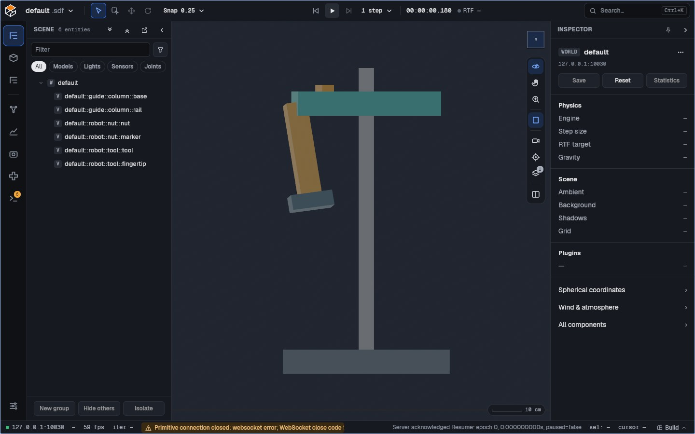

<!-- Copyright (C) 2026 Open Source Robotics Foundation -->
<!-- SPDX-License-Identifier: Apache-2.0 -->

# Replay the screw drive and both axes of a moving wrist

The robot turns a screw while its attached universal wrist bends. The Rust CPU journal can now apply a one-step effort to a hinge, slider or screw, or separate torques around the two moving axes of a universal joint. Each encoder reports its position, speed and total effort waiting in the native solver. The two-axis and ball-joint readouts check the actual joint type, including when both use the same native angular input buffer. [Robot](../../../examples/worlds/local_robot_screw_wrist.sdf) · [Commands](../../../examples/replay/screw_universal.json)

The screw received 2 N·m. Two wrist commands summed to (0.8, −1.25) N·m before the first step. Pausing preserved all three inputs. Ordinary position controllers and gravity stayed active in the zero-effort control. After one 1 ms step, all three queues were empty and every measured axis responded.

| Encoder speed in rad/s at 1 ms | Applied efforts | Zero-effort control |
|---|---:|---:|
| Screw | 0.11038 | 0.07428 |
| Wrist, parent axis | −0.02216 | −0.03473 |
| Wrist, child axis | 0.03424 | 0.10934 |

The 374 profile and state records matched between independent one- and eight-thread processes. Reset discarded explicitly queued zeros and reproduced all 180 repeated solves, including the poses, encoders, contacts and pending inputs. The native browser checked all 114 displayed poses and shapes in each 19-frame recording and rewound both runs to zero. [Driven wrist in gz-web-rs](http://127.0.0.1:8082/?backend=primitive&ui=full&quality=low&replay=1&lifecycle=1&url=ws%3A%2F%2F127.0.0.1%3A10030%2F) · [Zero-effort control](http://127.0.0.1:8082/?backend=primitive&ui=full&quality=low&replay=1&lifecycle=1&url=ws%3A%2F%2F127.0.0.1%3A10031%2F)

Five CLI replay tests and 17 mounted robot tests passed. Wrong joint types and excessive wrist effort were rejected. LLVM exercised every changed executable line and region in all three crates, including 11 lines and 22 regions in native physics, 3 and 5 in multifidelity, and 34 and 71 in the CLI. [Native readings and coverage](screw-universal-replay.json) · [Portable recordings and control commands](screw-universal-replays.tar.xz)



From the repository root, generate a new recording and check it in a second process.

```sh
export RUSTC_WRAPPER=
cargo build --locked --release --no-default-features -p gz-sim-cli --bin gz-sim-local-replay
bin=target/release/gz-sim-local-replay
world=examples/worlds/local_robot_screw_wrist.sdf
commands=examples/replay/screw_universal.json
"$bin" "$world" "$commands" --threads 1 --trace screw.jsonl --record screw-view
"$bin" "$world" "$commands" --threads 8 --verify screw.jsonl
cargo run --locked --release --no-default-features -p gz-sim-cli --bin gz-sim-rs -- \
  --server --replay --web-viewer 10030 screw-view/epoch-0
```
