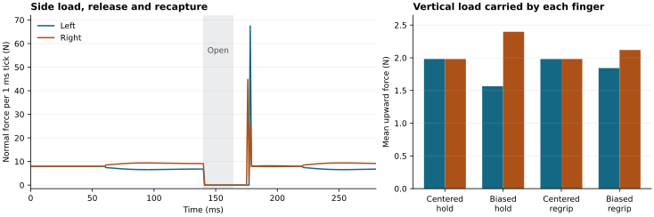
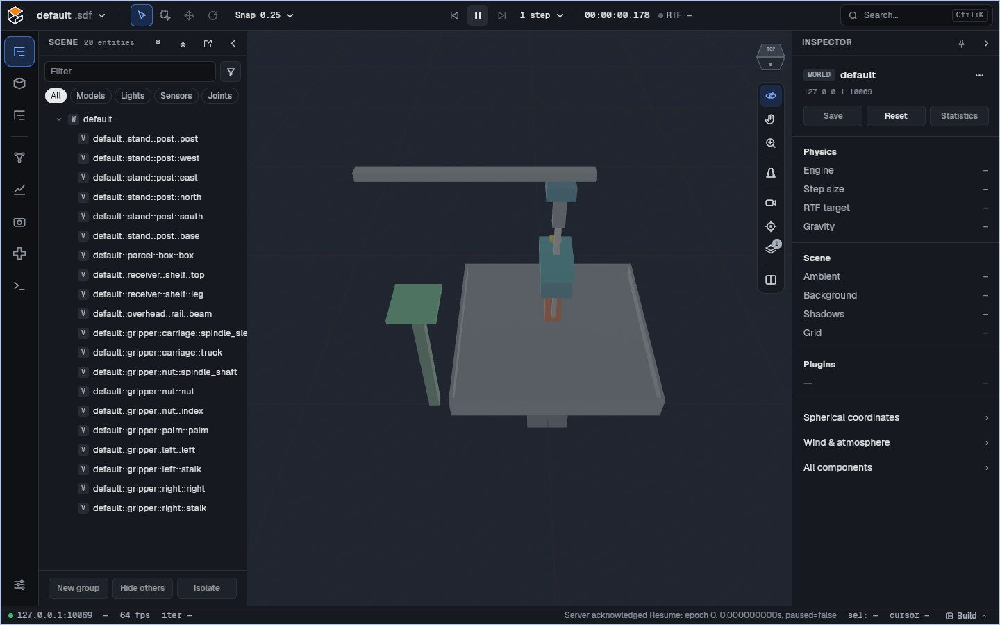

<!-- Copyright (C) 2026 Open Source Robotics Foundation -->
<!-- SPDX-License-Identifier: Apache-2.0 -->

# Measuring both fingers of the serial gripper

The complete robot held a 200 g parcel, opened both jaws, and caught it again before it reached the stand. Two 9 mm round fingertips shared a centered downward load nearly equally. Adding a side force and a pitching torque made the right finger carry more of the load, as predicted from the parcel's dimensions. The native replays follow the robot for 280 ms. [Centered load in gz-web-rs](http://127.0.0.1:8082/?backend=primitive&ui=full&quality=low&replay=1&lifecycle=1&url=ws%3A%2F%2F127.0.0.1%3A10068%2F) · [Biased load in gz-web-rs](http://127.0.0.1:8082/?backend=primitive&ui=full&quality=low&replay=1&lifecycle=1&url=ws%3A%2F%2F127.0.0.1%3A10069%2F)

In gz-web-rs, place the pointer over the parcel and press **F** to frame it. The jaws open at 140 ms and the second jaw returns at 178 ms.

| Measured reaction, left / right | Centered hold | Biased hold | Centered regrip | Biased regrip |
|---|---:|---:|---:|---:|
| Normal force (N) | 7.969 / 7.969 | 6.725 / 9.213 | 7.978 / 7.977 | 6.636 / 9.319 |
| Upward force (N) | 1.981 / 1.981 | 1.564 / 2.398 | 1.981 / 1.981 | 1.843 / 2.119 |
| Finest upward reference (N) | 1.981 / 1.981 | 1.564 / 2.398 | 1.990 / 1.972 | 1.826 / 2.136 |

The table gives means over ticks ending at 101–140 ms and 246–280 ms. All branches start from the same SDF, with the two links of the screw joint, universal wrist, prismatic fingers and free parcel responding to the solver. Each jaw receives a closing effort of 8 N against a 1,000 N/m centering spring and 12 N·s/m damper. The first load begins at 60 ms. The jaws open under −8 N at 140 ms and close at 164 ms. The load resumes at 220 ms. [Authored world](../../../examples/worlds/local_robot_serial_bilateral.sdf)



## Balance against the known load

The hold adds 2 N downward to 1.962 N of gravity. The biased case also applies 2.4 N to the right and a positive 0.025 N·m pitching torque about the parcel COM. Initially the opposed contacts are 30 mm to either side of that center. The simple two-point balance predicts a vertical difference of 0.025/0.030 = 0.833 N between the fingers, giving 1.564 and 2.398 N. After the parcel drops, its contact lever arms change, so the same external wrench produces a different split.

The study opts into native per-point Coulomb friction. At each solver cut it accumulates the signed normal and friction impulse on the parcel and their moments about its center of mass. Independently, each public tick compares those impulses with the change in parcel linear momentum and with the change in world angular momentum using the authored inertia tensor and measured orientation. Gravity and the applied force and couple enter those balances explicitly. The biased hold's summed contact torque was −0.02500000004 N·m. Across both round-tip trials at 64 native calls per tick, the worst linear residual was 2.52 × 10⁻¹⁵ N·s and the worst angular residual was 1.81 × 10⁻¹⁰ N·m·s. Every grip and regrip completed without stand contact.

Both controlled grasps lost contact at 141 ms. The centered pair regained contact together at 178 ms. The biased parcel met the right jaw at 176 ms and the left at 178 ms. Over the 24 ms opening interval gravity changed its vertical speed by −0.23544 m/s. The centered parcel dropped 6.824 mm and the biased parcel dropped 6.860 mm. Holding the fingers open instead left them unloaded and caused the parcel to touch the stand at 262 ms, after falling about 81 mm. The open control matched every centered state through the end of the opening command.

## Step size and contact geometry

Commands and measurements run at 1 ms throughout. One solver call uses the ordinary Bevy physics system. The finer runs replace that single system with the existing measured native contact schedule, preserving the same controller and held-force cadence. All 22 cases start independently. References using 1,024 and 2,048 native calls per public tick run at approximately 0.977 and 0.488 µs.

* Across both held windows and both round-tip cases, the largest per-finger normal-force error against the finest reference fell from 1.096 N at one call to 0.036 N at 64. The two finest references agreed within 0.008 N. Per-finger vertical-force differences at 64 calls were below 0.00015 N before release and 0.018 N after recapture. The two finest references differed by up to 0.012 N after recapture.
* Integrating each jaw's normal reaction from 165 through 205 ms captures both the transient and the returning squeeze. In the biased run the measured impulses were 0.28737 and 0.28552 N·s, compared with 0.28797 and 0.28567 N·s on the finest clock. Peak pose differences at 64 calls were 0.133 mm and 0.328° across both round-tip cases. The two finest histories still differed by up to 0.132 mm and 0.193° through recapture.
* Replacing the round tips with 18 × 67 × 100 mm flat box pads at the same opening reproduced the combined vertical load of 3.962 N. After the biased regrip, the two finest flat-pad runs assigned 2.778 and 1.744 N respectively to the left finger, a 1.034 N difference. This bounds the current flat-pad model's ability to predict how sticking contacts share the load. The round-tip results qualify this specific robot, parcel, contact law and command trace.

[Numeric comparisons and executable identities](serial-bilateral.json) · [Both grasps and open-jaw native recordings](serial-bilateral.tar.xz)

## Reproduce

```sh
RUSTC_WRAPPER= cargo run --locked --release --no-default-features -p gz-sim-cli --example serial_bilateral -- --biased --substeps 64 --repeat --summary --replay bilateral-replay
RUSTC_WRAPPER= cargo test --locked --release --no-default-features -p gz-sim-cli --example serial_bilateral
```

Omit `--biased` for the centered load. Use `--stay-open` for the dropped parcel or `--flat-pads` for the flat-contact comparison. Omit `--summary` to export per-tick reactions, poses, velocities, applied wrench and momentum residuals. The example sends the jaw and parcel commands after loading the SDF.

The three regression tests and strict release Clippy passed. The final executable repeated all 22 numeric traces and three recording streams byte for byte. The centered, biased and open runs each reproduced every row after a world reset at 64 calls. Both live recordings passed all 141 displayed frames and rewound to zero, checking 5,640 displayed visual poses and shapes across the two recordings. The archive also matched independent parcel poses and both fingertip translations at every displayed time. Exact instrumented binaries covered 263/267 changed executable lines and 459/476 changed regions in the Rust study. Four I/O error checks verified that invalid archive/world destinations and full output streams report failure.


