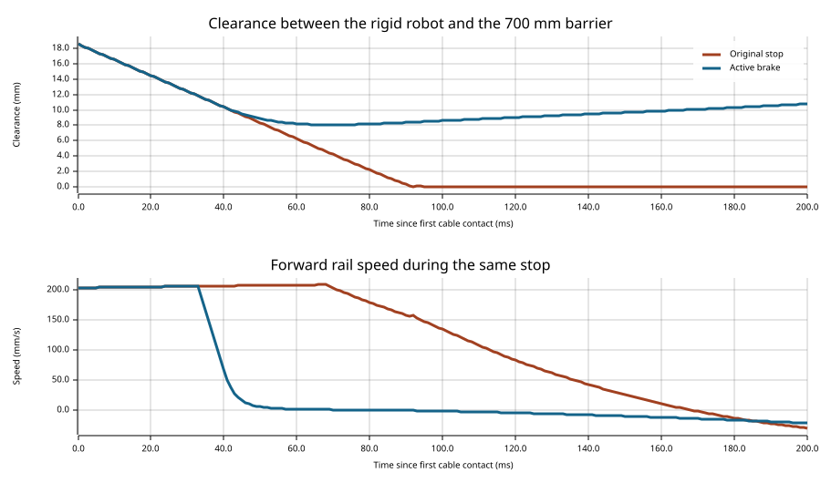
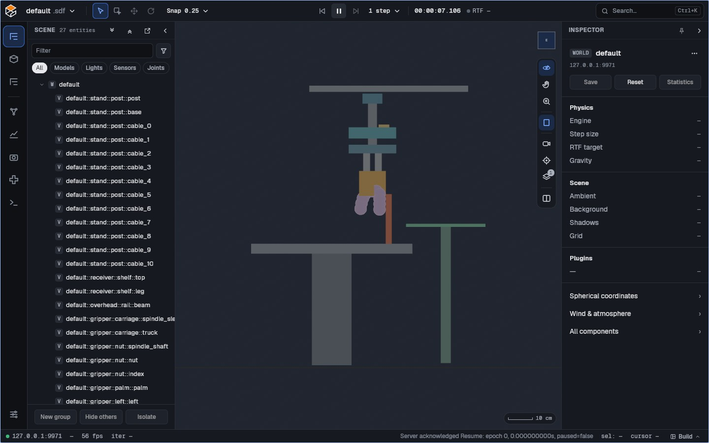

<!-- Copyright (C) 2026 Open Source Robotics Foundation -->
<!-- SPDX-License-Identifier: Apache-2.0 -->

# Braking before a rigid jaw hits the barrier

The gripper carrying a 22 g cable stopped 8.05 mm clear of a 700 mm barrier at normal speed and 3.47 mm clear at twice the commanded speed. In both cases it attempted one higher lift, felt a second snag, and returned the cable to the pickup table. [Play the guarded stop](http://127.0.0.1:8082/?backend=primitive&ui=full&quality=low&replay=1&lifecycle=1&url=ws%3A%2F%2F127.0.0.1%3A9970%2F) · [Play the original impact](http://127.0.0.1:8082/?backend=primitive&ui=full&quality=low&replay=1&lifecycle=1&url=ws%3A%2F%2F127.0.0.1%3A9971%2F) · [Play the faster guarded stop](http://127.0.0.1:8082/?backend=primitive&ui=full&quality=low&replay=1&lifecycle=1&url=ws%3A%2F%2F127.0.0.1%3A9972%2F)

| First encounter | Original | Guarded | Faster original | Faster guarded |
|---|---:|---:|---:|---:|
| Speed when tripped | 0.209 m/s | 0.206 m/s | 0.433 m/s | 0.426 m/s |
| Delay after cable contact | 68 ms | 33 ms | 28 ms | 8 ms |
| Clearance when tripped | 4.60 mm | 11.82 mm | 4.98 mm | 13.59 mm |
| First commanded slider force | −5.84 N | −45 N | −12.11 N | −45 N |
| Forward carriage travel after trip | 9.45 mm | 1.23 mm | 17.70 mm | 4.85 mm |
| Closest rigid robot clearance over entire route | 0 mm | 8.05 mm | 0 mm | 3.47 mm |
| Total normal impulse on right jaw | 0.17355 N·s | 0 | 0.49970 N·s | 0 |

The ordinary SDF/Bevy scene contains a lead screw, a universal wrist, two prismatic jaws, a native rail actuator and a free eleven-particle cable. At 1 ms intervals the controller reads the jaw contact wrenches and rail encoder. It begins braking when the jaws lose at least a quarter of the known weight, both still squeeze above 0.3 N, and the filtered forward drag exceeds 3 mN across 0.7 mm of uninterrupted forward travel. The existing 40 mN drag trigger also remains active. The rail applies up to 45 N opposite forward travel, tapering the command with measured speed until the encoder reports a stop. The normal retreat trajectory then continues. Independent checks query the solved rigid jaw/bar impulses and the distances between the actual collision boxes. [Controller](../../../crates/gz-sim-cli/examples/serial_cable/snag/controller.rs) · [Guard and matched controls](../../../crates/gz-sim-cli/examples/serial_cable/snag/tactile/braking.rs)

The original right jaw took its first normal impulse at 7.106 s. With the guard enabled, both rigid jaws accumulated zero barrier impulse. All actuator readings, particle states and contact observations matched the original through the tick that triggered the guarded stop. The 645 mm obstacle still allowed a successful retry with 7.48 mm of cable clearance. A failed jaw drive stopped the carriage within 0.27 mm while the detached cable fell onto the source table. Across the normal and faster 700 mm guarded retreats, the least measured bilateral squeeze was above 2.1 N.

The clear route, faster clear route and light 153 ms rub produced identical commands and physics records with either braking policy. A full clear route took 13.107 simulated seconds either way. The host benchmark timed each native solve, public joint commands, gripper sensor read and controller decision, excluding plotting, replay output and independent checks. It warmed the system once, then interleaved four runs per policy. The pinned release run measured 289.6 µs p95 with the original stop and 216.5 µs with active braking (-25.3%). Individual run p95 values ranged from 184.9 to 305.7 µs on the shared host. In two unpinned runs the active policy instead measured 1.4% and 12.2% slower at p95. The results establish a timing range on this machine; they leave the effect on wall-clock speed unresolved.

All nine qualification runs matched every one of their 148,250 per-tick observations after reset. A separate test paused with a −45 N brake command pending, reset the scene, and reproduced the same measured trip and safe return. Twenty-one release tests passed. LLVM exercised 395/403 changed production lines (98.01%) and 818/857 regions (95.45%). Chromium checked 670 WebGPU frames and 7,370 independent particle positions. These measurements cover a known 22 g payload with ideal feedback. They establish clearance at the tested speeds and geometry. [Full findings, timing samples, coverage and browser receipts](serial-cable-braking.json)

## Reproduce

~~~sh
RUSTC_WRAPPER= cargo run --release --locked --no-default-features -p gz-sim-cli \
  --example serial_cable -- --braking target/serial-cable-braking
RUSTC_WRAPPER= cargo run --release --locked --no-default-features -p gz-sim-cli \
  --bin gz-sim-rs -- --server --replay --web-viewer 9970 target/serial-cable-braking/tall/replay
~~~

Use a fresh output directory. The comparable original recording is in `original/replay` and the faster guarded trial is in `fast-tall/replay`. The generated `timing.json` holds host-specific measurements.
