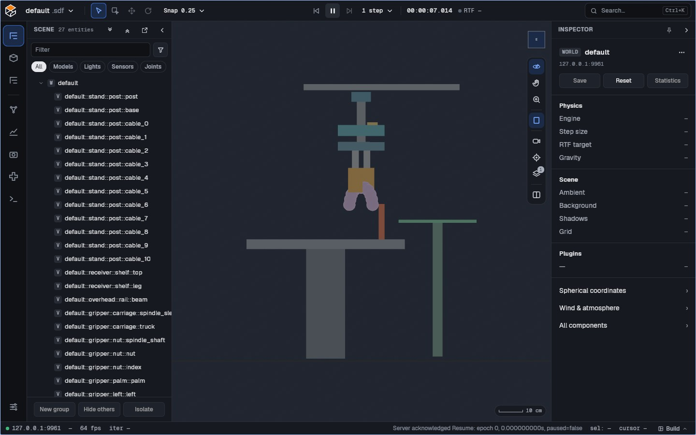

<!-- Copyright (C) 2026 Open Source Robotics Foundation -->
<!-- SPDX-License-Identifier: Apache-2.0 -->

# Recovering a snagged cable

The 22 g cable caught a barrier during transport. Its measured 0.447 N reaction triggered a retreat on the next 1 ms actuator tick. The gripper backed up 103 mm, raised the screw by another 0.45 rad, and carried the cable over the same barrier with 7.15 mm to spare. [Play the recovered snag](http://127.0.0.1:8082/?backend=primitive&ui=full&quality=low&replay=1&lifecycle=1&url=ws%3A%2F%2F127.0.0.1%3A9961%2F) · [Play the clear route](http://127.0.0.1:8082/?backend=primitive&ui=full&quality=low&replay=1&lifecycle=1&url=ws%3A%2F%2F127.0.0.1%3A9962%2F) · [Play the return at the lift limit](http://127.0.0.1:8082/?backend=primitive&ui=full&quality=low&replay=1&lifecycle=1&url=ws%3A%2F%2F127.0.0.1%3A9963%2F)

All three scenes use the same free eleven-particle cable, spring-loaded prismatic jaws, lead screw, universal wrist and two finite work surfaces. The nominal screw command is 2.35 rad. The controller knows the locations of the pickup and receiving stations. It reads the cable’s solved contact impulse on the instrumented obstacle, each pad’s load, the station loads, and joint feedback. The fixture fixes the obstacle before loading the SDF. Its position and dimensions are withheld from the controller. The clear-route control places the bar 600 mm to one side. [Robot and cable SDF](../../../examples/worlds/local_serial_cable.sdf) · [Recovery controller](../../../crates/gz-sim-cli/examples/serial_cable/snag/controller.rs)

| Measurement | Clear route | 645 mm barrier | 700 mm barrier |
|---|---:|---:|---:|
| First snag | — | 7.014 s | 7.014 s |
| First braking command | — | 7.015 s | 7.015 s |
| Peak force on the barrier | 0 N | 0.447 N | 0.447 N |
| Maximum forward travel after first detection | — | 12.01 mm | 11.98 mm |
| Final loaded tick of the first snag | — | 7.356 s | 7.352 s |
| Second snag | — | — | 10.825 s |
| Closest rigid robot collision box to bar | 419.2 mm | 48.5 mm | 5.16 mm |
| Maximum cable segment strain | 0.0831% | 0.0839% | 0.0957% |
| First jaw opening command | 10.228 s | 14.988 s | 18.821 s |
| Final loaded support | Receiving shelf | Receiving shelf | Pickup table |
| Final support reaction | 0.21582 N | 0.21582 N | 0.21582 N |

Every particle position and velocity in the obstructed runs matched the clear control through 7.013 s. When the barrier reaction exceeded 0.03237 N, the controller issued a smooth reverse rail trajectory. The cable remained in contact as the carriage decelerated. It had to unload before the next lift. All motion used public Bevy joint commands and the same native 1 ms clock. The normal and tangential impulse from each pad fed back into the articulated robot on the next native solve.

The taller barrier caught the cable again after the additional lift. At the configured 2.80 rad command ceiling, the controller retreated, returned the cable to the pickup table, and lowered it. The screw’s physical upper limit is 2.90 rad. Recorded spindle motion peaked at 2.80067 rad across the trials. Both jaws retained at least 2.14 N of squeeze throughout transport and retreat. The controller required 30 consecutive ticks with the receiving surface carrying over 90% of the cable weight before opening. The final 500 ms showed zero particle speed and zero jaw load in all cases.

Reset reproduced all 52,659 measured advances across the three paths, including the event sequence and every particle state checksum. A separate test reset the world at the first loaded snag. A missing shelf kept the gripper closed and prevented the experiment from reporting a successful placement. This recovery policy covers a cable contacting an instrumented static box while both pads still retain the grasp. Eleven release tests and strict Clippy passed. LLVM exercised 367/374 changed production lines and 647/678 regions. Chromium verified 547 WebGPU frames, including 6,017 independently sampled particle positions. [Measurements and replay verification](serial-cable-snag.json)

## Reproduce

~~~sh
RUSTC_WRAPPER= cargo run --release --locked --no-default-features -p gz-sim-cli \
  --example serial_cable -- --snag target/serial-cable-snag
RUSTC_WRAPPER= cargo run --release --locked --no-default-features -p gz-sim-cli \
  --bin gz-sim-rs -- --server --replay --web-viewer 9961 target/serial-cable-snag/snag/replay
~~~

Use a fresh output directory. The controls are in `clear/replay` and `limit/replay` under the same output directory.
