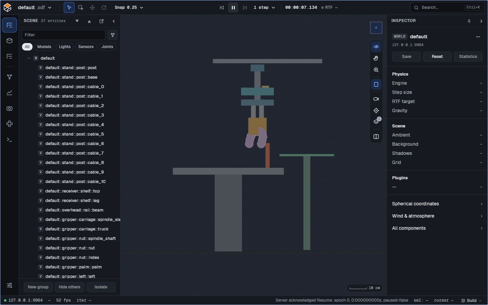
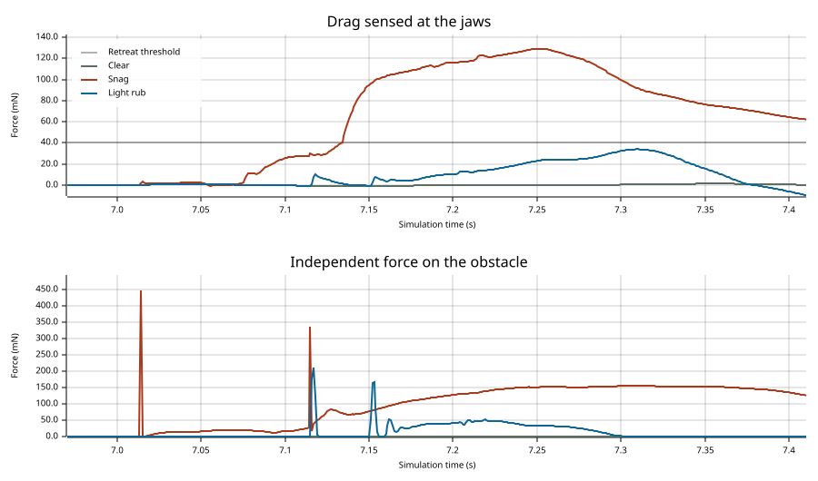

<!-- Copyright (C) 2026 Open Source Robotics Foundation -->
<!-- SPDX-License-Identifier: Apache-2.0 -->

# Feeling a cable snag at the gripper

A lead-screw gripper carrying a 22 g cable felt the cable catch, reversed, raised it, and cleared the barrier by 7.31 mm. The same controller allowed a lighter 153 ms rub to pass and held its course when the carriage accelerated twice as fast. [Watch the snag and recovery](http://127.0.0.1:8082/?backend=primitive&ui=full&quality=low&replay=1&lifecycle=1&url=ws%3A%2F%2F127.0.0.1%3A9964%2F) · [Watch the light rub](http://127.0.0.1:8082/?backend=primitive&ui=full&quality=low&replay=1&lifecycle=1&url=ws%3A%2F%2F127.0.0.1%3A9965%2F) · [Watch a jaw lose its grip](http://127.0.0.1:8082/?backend=primitive&ui=full&quality=low&replay=1&lifecycle=1&url=ws%3A%2F%2F127.0.0.1%3A9966%2F)

Both articulated pads expose a world-frame force and moment from deformable contact over the last completed native step. The moment is about the pad’s end-of-step center of mass. Each sensor sums all enrolled materials, including friction, and exposes the same wrench that the native joint solver consumes next tick. A fresh or reset scene first needs an advancing step. Pausing holds the measurement. Removing the pad or faulting the simulation invalidates it. [Sensor implementation](../../../crates/gz-sim-scene/src/deformable.rs) · [Two-material off-center load regression](../../../crates/gz-sim-scene/tests/articulated_cable_wrench.rs)

During forward travel the controller subtracts the expected force from the known cable mass and measured rail acceleration. It filters the remaining jaw drag at 1 kHz with an exponential weight of 0.08. A reading above 40 mN commands braking on the next tick. The controller reads rail and screw encoders, jaw orientations, and jaw forces. Only the independent evaluator reads the cable state and the obstacle and support reactions. Replaying the recorded gripper feedback after removing all obstacle loads reproduces every motion decision. [Observer](../../../crates/gz-sim-cli/examples/serial_cable/snag/tactile/sensor.rs) · [Route and interlock](../../../crates/gz-sim-cli/examples/serial_cable/snag/controller.rs)

| Trial | Measured response | Outcome |
|---|---|---|
| Clear route | Peak filtered transport drag 6.01 mN at up to 0.220 m/s | Placed on shelf |
| Fast clear route | Peak drag 5.99 mN at 0.461 m/s and 1.22 m/s² | Placed on shelf |
| 616.5 mm barrier top | 153 loaded ticks, 5.77 mN·s summed contact magnitude, peak drag 33.93 mN | Rubbed past and placed on shelf |
| 645 mm barrier top | Contact at 7.014 s, detection at 7.134 s, first retreat command at 7.135 s | Retried above barrier and placed on shelf |
| 660 mm barrier top | First and second snags detected after 71 and 124 ms | Reached lift ceiling and returned cable to pickup table |
| Failed left jaw drive | Low squeeze at 6.054 s, halt command at 6.062 s, 3.71 mm forward stopping distance | Cable fell onto pickup table |

During the initial lift, positive filtered drag peaked at 12.55 mN and the two pads together supported 0.21522 N against the cable's 0.21582 N weight. The release policy waits for 30 consecutive readings with both pads still squeezing and upward jaw load below 8% of the known weight. Each successful placement had an independent mean support reaction above 90% of the weight during that interval. The failed-jaw case kept the closing command on and stopped rail travel after eight low-squeeze readings. The cable had already detached. A missing receiving shelf kept a retained cable in the placement stage. [Play the faster route](http://127.0.0.1:8082/?backend=primitive&ui=full&quality=low&replay=1&lifecycle=1&url=ws%3A%2F%2F127.0.0.1%3A10065%2F) · [Play the return at the lift ceiling](http://127.0.0.1:8082/?backend=primitive&ui=full&quality=low&replay=1&lifecycle=1&url=ws%3A%2F%2F127.0.0.1%3A10066%2F) · [Play the clear route](http://127.0.0.1:8082/?backend=primitive&ui=full&quality=low&replay=1&lifecycle=1&url=ws%3A%2F%2F127.0.0.1%3A10064%2F)

All six trials ran on the ordinary Bevy SDF scene and matched all 86,037 per-tick records after reset. Cable trajectories matched the unobstructed route through the tick preceding first contact. The 660 mm barrier stayed at least 33.0 mm from the robot’s rigid colliders. In a separate 700 mm stress test, the rigid robot reached the bar during braking, so that case fails the cable-only recovery criterion. The maximum axial strain across all trials was 0.138%. Every trial settled with its receiving surface carrying 0.21582 N. The earlier instrumented-obstacle mode reproduced its previous measurements and per-tick trajectories byte for byte. Twenty-eight Rust tests passed and strict Clippy passed on both changed targets. LLVM exercised 456/464 changed production lines (98.28%) and 854/895 regions (95.42%). Chromium checked all 890 native frames and 9,790 independent particle positions. These bounds cover the calibrated cable, the positive rail direction, ideal pad and encoder readings, and these finite support geometries. [Measurements, exact coverage and native browser checks](serial-cable-tactile.json)

## Reproduce

~~~sh
RUSTC_WRAPPER= cargo run --release --locked --no-default-features -p gz-sim-cli \
  --example serial_cable -- --tactile target/serial-cable-tactile
RUSTC_WRAPPER= cargo run --release --locked --no-default-features -p gz-sim-cli \
  --bin gz-sim-rs -- --server --replay --web-viewer 9964 target/serial-cable-tactile/snag/replay
~~~

Use a fresh output directory. Each named case contains the native replay, independent particle coordinates, and a 1 ms trace with the robot readings, controller decision inputs, and physics observations.
