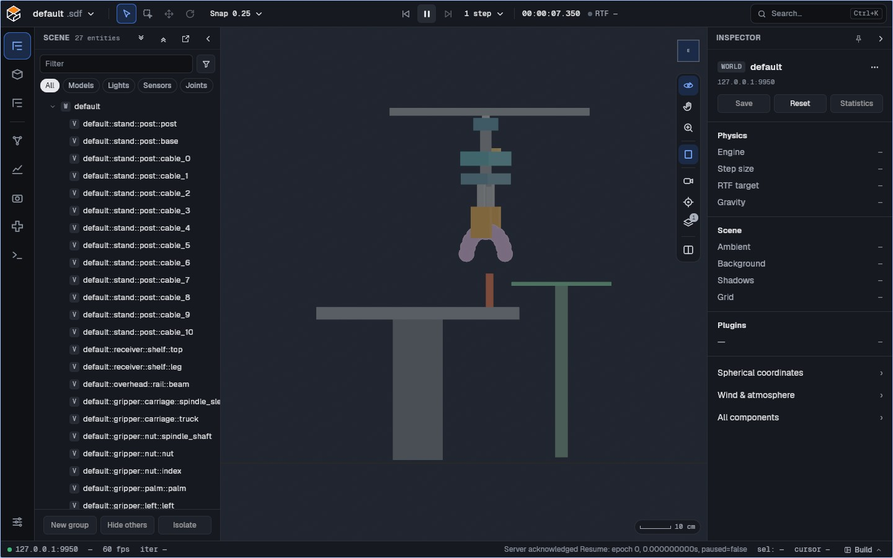

<!-- Copyright (C) 2026 Open Source Robotics Foundation -->
<!-- SPDX-License-Identifier: Apache-2.0 -->

# Carrying a loose cable over an obstacle

The serial gripper lifted a 22 g cable by 186 mm, carried it over the red barrier with 37.6 mm of clearance, and placed it on the green shelf. After the jaws opened and withdrew, the shelf carried the full 0.21582 N weight and all eleven particles came to rest. The open-jaw control left the cable on the pickup table. [Play the transfer](http://127.0.0.1:8082/?backend=primitive&ui=full&quality=low&replay=1&lifecycle=1&url=ws%3A%2F%2F127.0.0.1%3A9950%2F) · [Play the open-jaw control](http://127.0.0.1:8082/?backend=primitive&ui=full&quality=low&replay=1&lifecycle=1&url=ws%3A%2F%2F127.0.0.1%3A9951%2F) · [Play the short lift](http://127.0.0.1:8082/?backend=primitive&ui=full&quality=low&replay=1&lifecycle=1&url=ws%3A%2F%2F127.0.0.1%3A9952%2F)

The static SDF defines the world-mounted rail, rotating lead screw, universal wrist, two spring-loaded prismatic jaws, and a free cable with eleven overlapping 25 mm-radius particle spheres at 22 mm spacing. The cable has stretch constraints and second-neighbor bending constraints. Self-contact is disabled for this overlapping-particle model. The two articulated pads, flat pickup table, obstacle and shelf provide five bounded SDF contact surfaces. The remaining three robot links and overhead rail had at least 113.6 mm of measured clearance from the cable during the complete high-stroke trial. [World file](../../../examples/worlds/local_serial_cable.sdf)

The robot retains the serial obstacle fixture’s masses, inertias, screw pitch, wrist limits, jaw springs and 1 ms Bevy clock. The cable hangs below the jaws. This workcell raises the carriage and overhead rail by 80 mm, provides 2.90 radians of usable screw travel, and uses a 320 × 320 mm shelf to receive the full footprint. The bar’s 607 mm top height stays fixed. A public joint force command moves the rail and controls the spring-loaded jaws. The spindle and wrist use the ordinary SDF joint controllers. The native joints receive the measured pad impulses as wrenches on their next solve.

| Measured over a 14 s cycle | Clear transfer | Open jaws | Short lift |
|---|---:|---:|---:|
| Lift command | 2.70 rad | 2.70 rad | 1.90 rad |
| Cable center rise before travel | 186.2 mm | 0 | 122.8 mm |
| Cable center at end of rail travel | 462.3 mm | 0 | 458.4 mm |
| Lowest measured clearance while crossing | 37.6 mm | Cable stayed at pickup | 0 mm |
| Peak cable force on obstacle | 0 N | 0 N | 0.403 N |
| Maximum cable segment strain | 0.0831% | <10⁻¹²% | 0.1112% |
| Final shelf reaction | 0.21582 N | 0 N | 0.21582 N |
| First open command after shelf dwell | 10.941 s | — | 9.771 s |
| Final maximum particle speed | 0 m/s | 0 m/s | 0 m/s |

The clear transfer applied mean side loads of 2.1815 N and 2.1825 N at the left and right pads during the four-second traverse. Their upward forces averaged 0.09747 N and 0.11833 N, summing to within 0.008% of the cable’s weight. The table, shelf and obstacle carried zero load during that traverse. The tangential pad forces stayed inside the 0.7 friction bound. The cable tips hung up to 70.7 mm below the middle particle during the pre-travel hold. Whole-cable momentum reconstructed from particle velocities, gravity and all five independently reported reactions balanced to 4.95 × 10⁻¹⁸ N·s per tick.

The release controller requires 30 consecutive milliseconds of shelf reaction above 90% of the cable’s weight during lowering. The measured mean was 0.22051 N over this dwell. The jaws then opened and withdrew. All cable particles remained at least 28.5 mm inside the shelf footprint during the final 500 ms. The short lift also released onto the shelf, but the red barrier physically loaded the sagging cable during travel. Each trial used the same robot, shelf and obstacle. [Rust controller and experiment](../../../crates/gz-sim-cli/examples/serial_cable.rs)

Each cold run matched its post-reset repeat across all 14,000 physical observations, including checksums of every particle position and velocity. A separate regression reset the robot during the airborne grasp with both jaws still carrying load. Six release regressions and strict Clippy passed. LLVM exercised 412/418 changed production lines and 819/848 regions. Browser playback matched all 201 frames, 5,427 visual poses and shapes, and 2,211 independently sampled particle centers per case. [Measurements, coverage and replay checks](serial-cable-transfer.json)

## Reproduce

~~~sh
RUSTC_WRAPPER= cargo run --release --locked --no-default-features -p gz-sim-cli \
  --example serial_cable -- target/serial-cable
RUSTC_WRAPPER= cargo run --release --locked --no-default-features -p gz-sim-cli \
  --bin gz-sim-rs -- --server --replay --web-viewer 9950 target/serial-cable/clear/replay
~~~

Use a fresh output directory. The open and short-lift controls are in `target/serial-cable/open/replay` and `target/serial-cable/low/replay`. The current controller uses a fixed route for this cable, with measured contact controlling release. A practical next step is detecting a snag during travel and increasing clearance before continuing.
