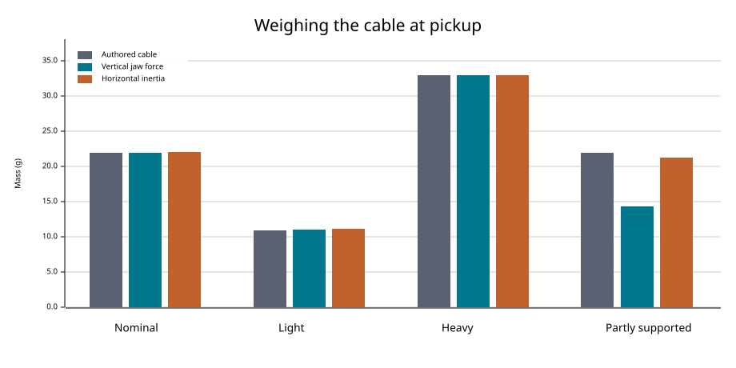
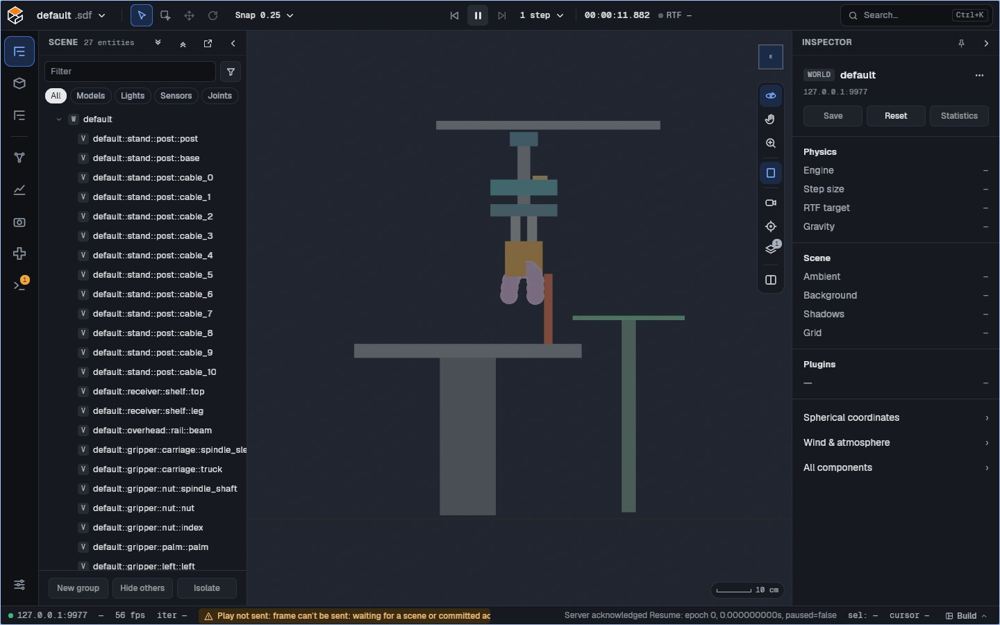

<!-- Copyright (C) 2026 Open Source Robotics Foundation -->
<!-- SPDX-License-Identifier: Apache-2.0 -->

# Weighing a cable at pickup

The serial gripper weighed an unknown 11, 22 or 33 g cable with less than 0.02 g error in each suspended pickup. It slowed down for the 33 g cable, stopped short of the 700 mm barrier twice, then set the cable back on the pickup table. A partly supported cable gave contradictory readings, so the robot held position. [Heavy cable and barrier](http://127.0.0.1:8082/?backend=primitive&ui=full&quality=low&replay=1&lifecycle=1&url=ws%3A%2F%2F127.0.0.1%3A9977%2F) · [Partly supported pickup](http://127.0.0.1:8082/?backend=primitive&ui=full&quality=low&replay=1&lifecycle=1&url=ws%3A%2F%2F127.0.0.1%3A9978%2F) · [Fast delivery of the light cable](http://127.0.0.1:8082/?backend=primitive&ui=full&quality=low&replay=1&lifecycle=1&url=ws%3A%2F%2F127.0.0.1%3A9979%2F)

| Cable and setting | Vertical estimate | Inertial estimate | Measured outcome |
|---|---:|---:|---|
| 11 g, friction 0.50 | 11.019 g | 11.193 g | Reached shelf on 2 s and 4 s rail commands |
| 22 g, friction 0.70 | 21.982 g | 22.088 g | Returned to table with 7.62 mm minimum rigid clearance |
| 33 g, friction 0.65 | 32.988 g | 32.979 g | Extended the 2 s command to 5.928 s and returned with 2.21 mm clearance |
| 22 g, 0.075 N upward assistance | 14.348 g | 21.221 g | Refused transport at 9.400 s |

## What the robot measures

A lead screw lifts the free eleven-particle cable in two sliding jaws below a universal wrist. The ordinary Bevy scene publishes jaw contact wrenches, jaw poses, rail position and speed, and screw angle. The robot sums the two jaw forces on the cable in world coordinates. Three stationary 400 ms windows measure vertical force at home, at the end of a 35 mm sideways movement, and back at home. The two probe legs include time to settle and add four simulated seconds before transport.

The sideways force gives a separate mass estimate. At 1 ms intervals, a triangular integration of the measured force gives mass times the centered second difference of rail position. This cancels constant initial velocity. The position proxy assumes the gripped cable follows the rail between settled endpoints. The check requires both jaws to squeeze above 0.3 N, stable lift and rail readings, sufficiently quiet and consistent vertical force, measured travel within 2 mm of each target, and agreement between the two mass estimates within 12% of the vertical result. The accepted vertical estimate feeds both the acceleration compensation and the supported-weight threshold. The rail limits the commanded peak payload momentum to 4.8 mN·s. [Calibration](../../../crates/gz-sim-cli/examples/serial_cable/snag/tactile/weighing/identify.rs) · [Actuator and decision path](../../../crates/gz-sim-cli/examples/serial_cable/snag/tactile/weighing.rs)

The fast light cable reached 1.22 m/s² carriage acceleration and landed at rest on the receiving shelf. A 22 g cable rubbed a 616.9 mm barrier for 123 measured ticks and still reached the shelf. Both 700 mm return trips ended with the full cable weight on the source and zero jaw/barrier impulse. Peak segment strain across all twelve trials was 0.115%. The greatest residual between material momentum change and all applied impulses was 1.20 × 10⁻¹⁷ N·s.

## When a weight cannot be identified

| Physical disturbance | Decision |
|---|---|
| Zero friction, or one jaw drive failed during the probe | Refused carry at 5.400 s or 6.011 s respectively |
| Lift drive held at zero | Refused at 5.400 s, before sideways motion |
| External vertical force alternated by ±0.12 N during the first window | Refused the unstable reading at 5.400 s |
| Rail effort suppressed throughout the probe | Refused the incomplete movement at 9.400 s |
| Steady upward assistance during pickup | Detected disagreement with measured horizontal inertia |
| One jaw drive failed during an accepted carry | Stopped the rail, and the detached cable landed on the pickup table |

On an identification failure the controller holds the carriage and commands closed jaws. The frictionless cable continued to slide on its source. The 0.075 N assisted cable remained suspended. The physically unassisted stationary pickups used ideal wrench sensors and known Earth gravity. A disturbance that mimics both weight and the sideways acceleration can still bias the estimate. Different payload shapes, sensor bias and long-lived external lateral forces need their own qualification.

Every reported estimate and action was reproduced using only the recorded gripper channels, with the applied force, authored mass, obstacle and particle states withheld. A native reset reproduced **173,525** per-tick records. A separate test reset partway through the probe and reproduced the rail position, pad wrenches, partial moments and absence of a completed mass decision. Twenty-seven release tests and strict Clippy passed. LLVM exercised 571/580 changed production lines (98.45%) and 1029/1080 regions (95.28%). Chromium checked 573 native WebGPU frames against 6,303 independently sampled particle positions. All six original tactile recordings remained byte-identical. [Full measurements and verification](serial-cable-weigh.json)

## Reproduce

~~~sh
RUSTC_WRAPPER= cargo run --release --locked --no-default-features -p gz-sim-cli \
  --example serial_cable -- --weigh target/serial-cable-weigh
RUSTC_WRAPPER= cargo run --release --locked --no-default-features -p gz-sim-cli \
  --bin gz-sim-rs -- --server --replay --web-viewer 9977 target/serial-cable-weigh/heavy/replay
~~~

Use a fresh output directory. Each case includes its native replay, per-tick physical observations and a calibration report. The top-level comparison includes all twelve outcomes.
