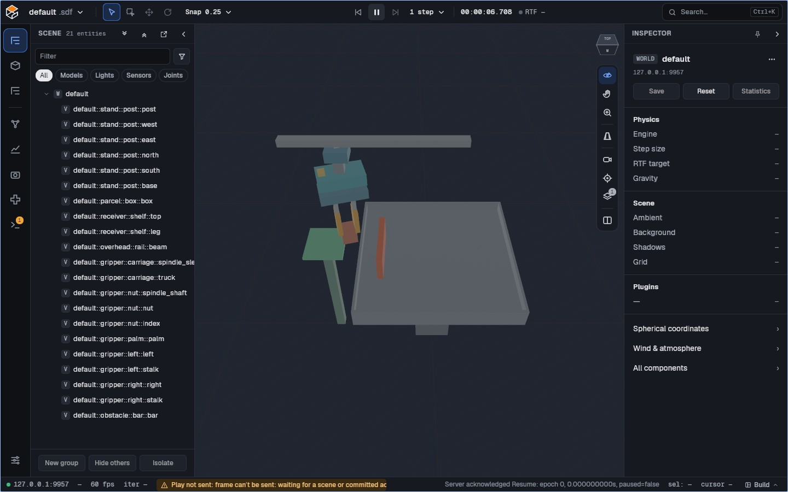
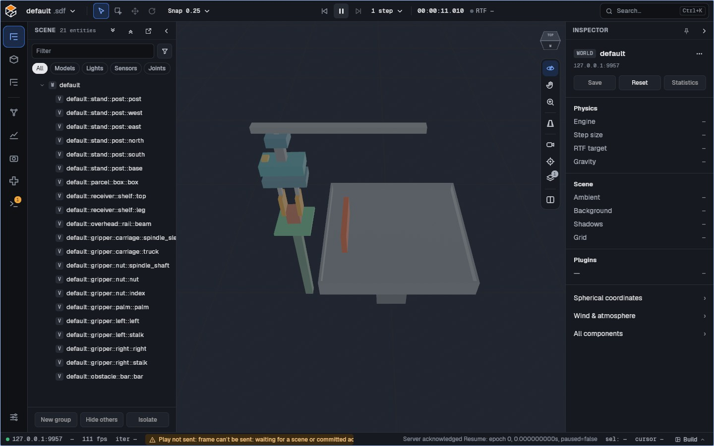

# Serial set-down across physics timesteps

The gripper now recognizes when the shelf touches a corner but the parcel's center of mass still overhangs the edge. The change reduced the spread in 8 N release time across the original three physics steps from **4.850 s to 0.134 s**. Their largest difference in parcel position fell from 45.76 mm to 2.73 mm against the 0.5 ms run. A finer 0.25 ms holdout also completed the transfer. [Native measurements](serial-convergence.json)

| Physics step | Earlier release | Current release | Current peak position difference vs 0.5 ms | Mean shelf force at opening | p95 cost per 2 ms control update |
|---|---:|---:|---:|---:|---:|
| 0.25 ms | Outside the earlier qualified range | 11.010 s | 0.296 mm | 3.68868 N | 1,240 µs |
| 0.5 ms | 10.640 s | 10.602 s | Reference | 3.68942 N | 617 µs |
| 1 ms | 13.962 s | 10.486 s | 0.733 mm | 3.68880 N | 327 µs |
| 2 ms | 9.112 s | 10.620 s | 2.733 mm | 3.68869 N | 166 µs |

The 400 g parcel has a +10/+8 mm horizontal inertial offset and friction coefficient 0.28 at the parcel and pads. All actuator setpoints and the slip supervisor update every 2 ms. All clocks receive the same 8 N downward pull for 64 ms, starting at 6.200 s. Opening requires at least 30 ms of qualified shelf support. The independent point-impulse audit covered 120, 60, 30 and 15 native solves in those windows. The jaws carried zero at the end of every successful placement and the shelf carried 3.924 N.

## Where the paths separate

For each probe, the ordinary 0.5 ms world advanced the complete robot to the same landmark. The next Bevy preparation stage queued the actual joint efforts, motor commands and parcel wrench. Before advancing physics again, the test took the initialized native solver and advanced it over exactly 2 ms on four different grids. The 10 body states, warm contact points and input commands matched across each group. The prepared native state and pending inputs stayed together in each disposable solver. The complete fixed-rate runs supplied the gz-web-rs poses.

The first measurable difference preceded shelf contact. At 6.2005 s, the 0.5 ms solve and two 0.25 ms solves differed by 0.17 µm. At the first common 2 ms boundary the 2 ms solve differed from the fine probe by 5.90 µm. At shelf impact, the corresponding position difference reached 18.86 µm and the integrated upward impulses ranged from 96.77 to 100.77 mN·s. [All 32 native branches and their contact fingerprints](serial-convergence.json)

| Start time and state | 0.25 ms | 0.5 ms | 1 ms | 2 ms |
|---|---:|---:|---:|---:|
| 6.200 s, held in the air | 0 | 0 | 0 | 0 |
| 6.308 s, first edge impact | 96.765 | 97.444 | 99.038 | 100.771 |
| 6.710 s, cleared edge | 0 | 0 | 0 | 0 |
| 8.746 s, lowering begins | 0 | 0 | 0 | 0 |
| 9.128 s, first placement load | 30.313 | 29.608 | 31.278 | 34.208 |
| 9.400 s, partially supported | 5.495 | 3.939 | 4.540 | 6.530 |

Values are upward shelf impulse in mN·s during each prepared 2 ms interval. The residual landing and settled-force differences vary nonmonotonically with the step size. The 0.25 ms full-route holdout opened 408 ms later than the 0.5 ms run. Full-route release timing therefore remains less consistent than parcel motion and the measured opening force.

## Why small physical errors changed the route

1. On the previous controller, a nearly vertical edge reaction counted as a possible shelf-top load while the parcel was still moving sideways. Some clocks initiated an edge-clearance lift, while others attempted to keep traversing in sustained contact. The controller now tests the vertical line through the SDF-resolved center of mass against the actual oriented shelf. Each first edge reaction in the corrected full runs was vertical with the center of mass still **15.77–17.25 mm outside** the shelf. All four clocks lifted, and the all-orientation clearance and loaded-jaw checks still governed resumption.
2. During set-down, a continuous but weak shelf load could fill the sensor's dwell buffer before the shelf carried enough weight. That stopped relief of the extra jaw preload at some timesteps. The controller now uses the measured load deficit for relief. The normal force, direction, speed and dwell checks for opening still run at every physics step.
3. The two local position-controlled joints converted position error to a velocity using the physics timestep. Shortening that timestep also increased their control gain. The screw and universal wrist now use the monitored workcell's 2 ms command period for that conversion, with feedback and native effort limits applied on each native solve. The optional setting is validated for the complete set of local joints and survives loaded-world reset. Other scenes retain their existing response unless they select a period.

Comparing 1 and 2 ms physics against 0.5 ms, the largest cumulative shelf-impulse error during the edge approach fell from **2.89 and 2.56 N·s** to **0.114 and 0.146 N·s**. During placement it fell from **10.85 and 4.56 N·s** to **0.343 and 0.617 N·s**. These comparisons use common 2 ms observation boundaries across the full independently advancing routes. The machine-readable receipt also includes comparisons against 0.25 ms. [Force and trajectory comparisons](serial-convergence.json)

## Worklog and viewing

- Ran 0, 6, 8 and 12 N at four physics rates through the complete local robot. Every sham, 6 N and 8 N trial released on verified support. Every 12 N trial lost its grasp and withheld opening. The loaded reset reproduced all 16 outcomes and every recorded visual pose bit for bit.
- Replayed 80 earlier obstacle and carry routes. All retained their terminal decisions and 70 retained every recorded pose. Of 57 additional pressure runs, 52 retained their decisions, including every guarded run. Two direct and three observation-only controls that previously withheld opening now delivered after the change in joint response. [Historical comparisons](serial-convergence.json)
- The 27 regular serial-transfer tests, four scene controller tests and strict release Clippy checks passed. LLVM covered 93/94 changed production lines (98.94%) and 166/170 changed regions (97.65%).
- Timed 2,001 complete 2 ms control intervals around the disturbance in each of four interleaved runs per clock, pinned to CPU 9 on the Ryzen 9 9950X3D. The table gives the median p95 including normal Bevy work, commands and native frame capture. [Per-run timings](serial-convergence.json)
- Verified all 1,371 frames and 28,791 displayed poses and shapes in gz-web-rs, including rewind to zero on all three recordings. [0.25 ms placement](http://127.0.0.1:8082/?backend=primitive&ui=full&quality=low&replay=1&lifecycle=1&url=ws%3A%2F%2F127.0.0.1%3A9957%2F) · [2 ms placement](http://127.0.0.1:8082/?backend=primitive&ui=full&quality=low&replay=1&lifecycle=1&url=ws%3A%2F%2F127.0.0.1%3A9958%2F) · [12 N overload](http://127.0.0.1:8082/?backend=primitive&ui=full&quality=low&replay=1&lifecycle=1&url=ws%3A%2F%2F127.0.0.1%3A9959%2F)




## Reproduce

Run from the workspace root. The reset study writes self-contained SDF fixtures. The trace study writes the complete 2 ms material trajectories and audited opening windows, and the matched study writes independent native impulse histories.

```bash
export RUSTC_WRAPPER=
export GZ_SERIAL_CONVERGENCE_RESETS="$PWD/artifacts/serial-convergence-resets"
cargo test --release --locked --no-default-features -p gz-sim-cli \
  --example serial_transfer -- --ignored serial_convergence_reset --test-threads=4
cargo run --release --locked --no-default-features -p gz-sim-cli \
  --example serial_transfer -- guarded-carry artifacts/serial-convergence-replay \
  --world "$GZ_SERIAL_CONVERGENCE_RESETS/p250.sdf" --control-ms 2 --pull 6201,64,8

GZ_SERIAL_MATCHED_OUTPUT="$PWD/artifacts/serial-prepared.json" \
  cargo test --release --locked --no-default-features -p gz-sim-cli \
  --example serial_transfer -- --ignored serial_convergence_matched
GZ_SERIAL_CONVERGENCE_TRACES="$PWD/artifacts/serial-traces" \
  cargo test --release --locked --no-default-features -p gz-sim-cli \
  --example serial_transfer -- --ignored serial_convergence_traces
GZ_SERIAL_CONVERGENCE_COST="$PWD/artifacts/serial-control-cost.json" \
  taskset -c 9 cargo test --release --locked --no-default-features -p gz-sim-cli \
  --example serial_transfer -- --ignored serial_convergence_cost
```
