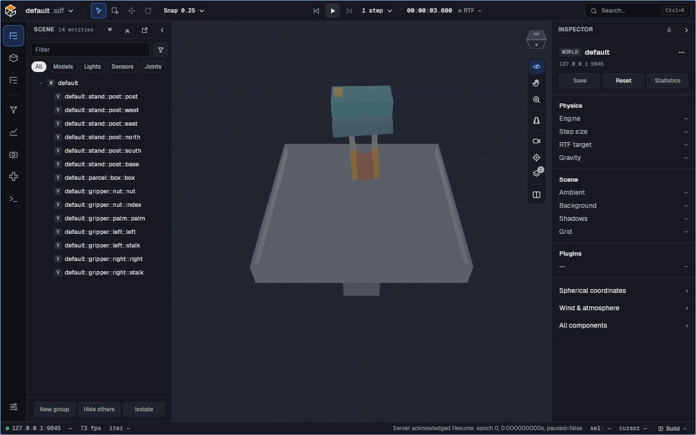

<!-- Copyright (C) 2026 Open Source Robotics Foundation -->
<!-- SPDX-License-Identifier: Apache-2.0 -->

# A serial gripper lifts a free parcel

A screw raises and rotates a universal wrist, while two spring-loaded prismatic jaws grip a separate 200 g parcel. Both SDF position controllers reach their targets on all three runs. Changing the jaws or the contact friction changes whether the parcel rises. [Play the grasp](http://127.0.0.1:8082/?backend=primitive&ui=full&quality=low&replay=1&lifecycle=1&url=ws%3A%2F%2F127.0.0.1%3A9845%2F) · [Play with open jaws](http://127.0.0.1:8082/?backend=primitive&ui=full&quality=low&replay=1&lifecycle=1&url=ws%3A%2F%2F127.0.0.1%3A9846%2F) · [Play with smooth faces](http://127.0.0.1:8082/?backend=primitive&ui=full&quality=low&replay=1&lifecycle=1&url=ws%3A%2F%2F127.0.0.1%3A9847%2F)



| Measured on a 1 ms step | Gripping jaws | Open jaws | Smooth faces |
|---|---:|---:|---:|
| First simultaneous loaded pad contact | 22 ms | None | 23 ms |
| Peak parcel rise | 126.49 mm | 1.69 mm | 0.80 mm |
| Final parcel height above its start | 126.07 mm | −0.06 mm | −0.06 mm |
| Loaded pad pair during final 1.8 s | 1,800/1,800 steps | 0/1,800 | 0/1,800 |
| Loaded tray during final 1.8 s | 0/1,800 steps | 1,800/1,800 | 1,800/1,800 |
| Left / right pad normal impulse during final 1.8 s | 12.93 / 13.13 N·s | 0 / 0 | 0 / 0 |

The palm rose 127.40 mm while the screw rotated 1.6 rad and the wrist tipped 0.06 rad. Maximum parcel displacement relative to the palm during the last 1.8 s was 1.47 mm. The open-jaw control changes only the two spring references. The smooth-face control preserves the closing springs and sets pad and parcel friction to zero. The empty tool still completes its lift, and the tray's rim keeps the sliding parcel on the work surface.

The ordinary SDF loading path now admits a jaw joint attached to a moving wrist that has private governor bearings. It still rejects mixed authored reduced-coordinate and impulse joints on the same body. Seventeen release tests passed, including both solver-order cases. A loaded-world reset reproduced every reported measurement for all three variants. Strict Clippy passed and LLVM exercised all 11 changed production lines and all 17 regions. WebGPU playback and rewind checked 181 native frames and 2,534 poses and shapes per variant.

## Reproduce

Run from the repository root. The record command writes to a new directory. Use the standard gz-web-rs frontend on port 8082 and the grasp link above.

```sh
RUSTC_WRAPPER= cargo test --locked --release --no-default-features -p gz-sim-scene \
  --test local_robot_serial_grasp -- --nocapture
RUSTC_WRAPPER= cargo run --locked --release --no-default-features -p gz-sim-cli \
  --example local_robot_foundations -- record examples/worlds/local_robot_serial_grasp.sdf \
  3600 20 target/my-serial-grasp
RUSTC_WRAPPER= cargo run --locked --release --no-default-features -p gz-sim-cli \
  --bin gz-sim-rs -- --server --replay --web-viewer 9845 target/my-serial-grasp/replay
```

To replay the controls, copy the SDF and set both jaw spring references to zero for open jaws, or replace the six 0.85 friction coefficients with zero for smooth faces. Record each modified SDF using the same arguments and serve on ports 9846 and 9847, respectively. [Authored robot](../../../examples/worlds/local_robot_serial_grasp.sdf) · [Physics checks and control variants](../../../crates/gz-sim-scene/tests/local_robot_serial_grasp.rs)
