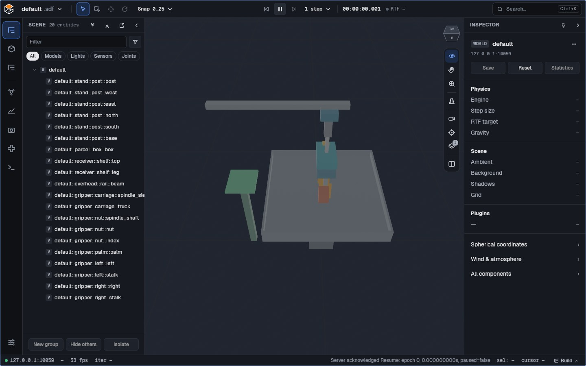

<!-- Copyright (C) 2026 Open Source Robotics Foundation -->
<!-- SPDX-License-Identifier: Apache-2.0 -->

# Wall time for an automatically refined jaw strike

The serial gripper spent about 60 ms on its expensive 1 ms impact step with a 500-call budget. Applying that grid only at contact cut median time for the complete left strike from 1,365 ms to 59.6 ms. A passing parcel triggered zero fine steps and completed in 2.87 ms. The continuously fine and selective runs each reproduced their own independently observed six-body trajectory. [Watch the measured left-jaw impact](http://127.0.0.1:8082/?backend=primitive&ui=full&quality=low&replay=1&lifecycle=1&url=ws%3A%2F%2F127.0.0.1%3A10059%2F) · [Raw samples for both jaws and the miss](serial-impact-cost.json)

The time window spans all 24 public steps, with the strike in the first. Three process blocks each timed five newly loaded worlds after one warm-up. Process order rotated and reversed across blocks. Each process ran on logical CPU 18 of the same Ryzen 9 9950X3D under a shared workload. Times include the normal Bevy controller, solve and publication, with scheduling initialized before tick one. Loading, validation reads and archive writing are outside the timed interval. For uniform fine time the runner used the unobserved native interval solver. Each of the 4,320 timed public steps matched its independently loaded, instrumented control for position, orientation and both velocities on all six bodies. [Rust benchmark](../../../crates/gz-sim-cli/examples/serial_impact_inertia/timing.rs)

| Left-jaw configuration | All-step p95 | All-step p99 | First-step p95 | Median 24-step run |
|---|---:|---:|---:|---:|
| Ordinary | 0.165 ms | 0.208 ms | 0.221 ms | 3.04 ms |
| Automatic, 500 calls | 0.154 ms | 58.84 ms | 58.98 ms | 59.64 ms |
| Automatic, 1,000 calls | 0.160 ms | 116.91 ms | 118.83 ms | 115.87 ms |
| Continuous, 500 calls | 58.53 ms | 59.48 ms | 58.97 ms | 1,365.19 ms |

One refined tick accounts for 4.17% of this trajectory, so the largest costs appear beyond the overall 95th percentile. Right-jaw first-step p95 was 59.97 ms at 500 calls and 119.85 ms at 1,000. At 500 calls, the previously measured impulse errors against the 125 ns reference were 2.08% on the left and 3.54% on the right. The 1,000-call policy reached 1.22% and 2.22%. A subsequent measured solver brought the initially touching strikes to 1.34–1.35 ms at p95. Separated approaches still use the larger impact budget. [Conditional solver and finer controls](serial-touching-solver.md) [Contact comparison and controls](serial-incoming-impact.md)

Eleven example tests exercised ordinary, adaptive, uniform and failed solves. The change covered 65/65 executable lines and 138/145 regions. The native browser checked 500 shapes and poses across 25 frames and rewound to zero. [Portable recording](serial-impact-cost.tar.xz)



To time five fresh runs after warm-up, use the release build. Use the same machine, CPU affinity and controller step for comparisons. Add `--right` or `--miss` for the other approaches. Omitting `--automatic` with `--substeps 500` selects the continuous grid.

```sh
RUSTC_WRAPPER= cargo run --release --locked --no-default-features -p gz-sim-cli \
  --example serial_impact_inertia -- --divisor 1.75 --automatic --substeps 500 --timing-runs 5
```
