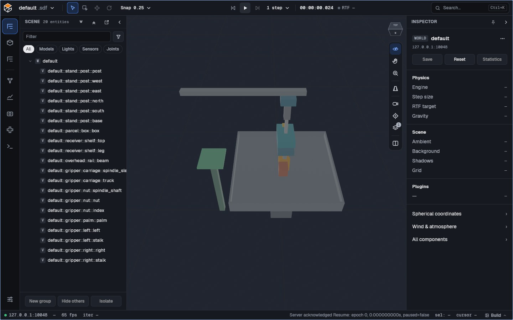

<!-- Copyright (C) 2026 Open Source Robotics Foundation -->
<!-- SPDX-License-Identifier: Apache-2.0 -->

# Link inertia during a jaw impact on the full serial robot

The 2.46 kg robot took an off-center hit from a free 200 g parcel traveling at 0.75 m/s. With the ordinary 1 ms solver, four tested mass distributions between 64% and 100% of the solid-link inertia met this trial's limits of 5% impulse error, 1 mm translation error and 1° rotation error. The next tested distribution, 59.17%, crossed the rotation limit. [Nominal impact in gz-web-rs](http://127.0.0.1:8082/?backend=primitive&ui=full&quality=low&replay=1&lifecycle=1&url=ws%3A%2F%2F127.0.0.1%3A10048%2F) · [Concentrated mass control](http://127.0.0.1:8082/?backend=primitive&ui=full&quality=low&replay=1&lifecycle=1&url=ws%3A%2F%2F127.0.0.1%3A10049%2F)

| Link inertia relative to a uniform solid | Ordinary left jaw impulse (mN·s) | Fine impulse (mN·s) | Impulse error | Worst position error | Worst rotation error |
|---:|---:|---:|---:|---:|---:|
| 100% | 44.389 | 45.481 | 2.40% | 0.203 mm | 0.363° |
| 79.01% | 45.482 | 45.735 | 0.55% | 0.241 mm | 0.703° |
| 69.44% | 46.009 | 45.940 | 0.15% | 0.253 mm | 0.857° |
| 64% | 46.287 | 46.045 | 0.52% | 0.260 mm | 0.961° |
| 59.17% | 46.50 | 46.13 | 0.80% | 0.267 mm | 1.064° |
| 44.44% | 46.655 | 46.184 | 1.02% | 0.280 mm | 1.440° |
| 32.65% | 49.241 | 45.561 | 8.08% | 0.682 mm | 2.574° |

The rail, screw, two-axis wrist and both spring-loaded prismatic jaws kept their original constraints, controllers and collision geometry. Each link's mass was modeled as a centered uniform cuboid inside its outer collision shape. Scaling the core dimensions by a common factor scaled each principal moment by its square while keeping mass, center of mass and outline fixed. Across the four passing samples the actual principal moments ranged from 2.054 × 10⁻⁵ to 2.269 × 10⁻³ kg·m². The native mass query verified the total robot mass and the struck jaw's inertia. The earlier loaded-chain timings, rigid parcel carries and welded-wrist torque measurements exercise different loads. [Serial robot](serial-transfer.md) · [Prior jaw impacts](capped-spindle.md) · [Wrist inertia](composite-wrist-inertia.md)

Each branch started with exactly the same six moving-body poses and twists and an empty contact cache. The parcel began touching the outer left face with its center offset 10 mm along Y and 13 mm upward from the jaw center. Three independent SDF loads ran the default 1 ms solver, 250 ns native steps, and 125 ns native steps. Commands and public observations remained at 1 ms. The table sums positive normal impulses over 24 ms and compares the world poses of all five links and the parcel at every public tick. Both fine clocks used native Rapier with the ordinary iteration count. Their comparison measures resolution sensitivity and supplies no independent physical ground truth.

At 64% inertia, halving the fine step changed the impulse by 0.180%, the worst position by 0.021 mm and the worst orientation by 0.052°. The 0.961° rotation result is close to the chosen 1° boundary. At 32.65%, the two fine clocks differed by 0.239%, 0.020 mm and 0.080°. Using a 1 µs native step at that mass distribution brought the ordinary comparison's 8.08% impulse error down to 1.22%, with 0.148 mm and 0.376° trajectory differences. Reducing inertia further produced nonmonotonic results, including a 9.42% difference between the two fine impulses at 6.25% inertia. The measurements support the sampled range for this posture, impact speed and loading direction. [All thirteen mass distributions, controls and reference differences](serial-impact-inertia.json)

The parcel touched only the left jaw. Its independent change in X momentum agreed with the accumulated X normal impulse to within 1.6 × 10⁻¹³ N·s on the four passing distributions and three clocks. Shifting the incoming parcel sideways by 150 mm produced zero contact impulse at every resolution, and its horizontal velocity stayed at 0.75 m/s. Fresh production processes repeated all 24 nominal and concentrated-control public body states and joint samples exactly.

The spindle and driven wrist axis have motor effort limits of 3 and 2 N·m, physical speed limits of 0.8 and 0.6 rad/s, and controller speed commands clipped at 0.65 and 0.1 rad/s. The four passing distributions peaked at 0.65117 and 0.100213 rad/s in public samples, with all six coordinates inside their positional travel. The extreme 1/256-inertia case reached 0.8237 rad/s on the spindle and reported left contact through 7 ms on the ordinary clock. The fine run peaked at 0.6498 rad/s and last reported contact in the first millisecond. Effort limits are authored inputs. The trial measured joint speeds and positions, without a torque sensor or an intra-step speed bound.



Both native replays verified all 25 public frames, 500 displayed shapes and poses each, and rewind to zero on WebGPU. All 300 principal dynamic visual poses in the two archives matched native body states exactly. The five focused Rust regressions and release Clippy check passed. The new qualification example exercised 314/319 executable lines (98.43%) and 475/491 regions (96.74%) on its exact instrumented headless binary. [Portable recordings](serial-impact-inertia.tar.xz) · [Coverage and browser receipts](serial-impact-inertia.json)

To run the ordinary trial, compare it with both fine clocks and open a fresh native recording:

```sh
RUSTC_WRAPPER= cargo run --locked --release --no-default-features -p gz-sim-cli --example serial_impact_inertia -- --divisor 1 --compare --replay serial-impact-replay
RUSTC_WRAPPER= cargo run --locked --release --no-default-features -p gz-sim-cli --bin gz-sim-rs -- --server --replay --web-viewer 10050 serial-impact-replay
```

Open [gz-web-rs on the new recording](http://127.0.0.1:8082/?backend=primitive&ui=full&quality=low&replay=1&lifecycle=1&url=ws%3A%2F%2F127.0.0.1%3A10050%2F) with the local frontend running on 8082. Use `--divisor 1.75` for the 32.65% inertia control, `--substeps 1000` for its 1 µs recovery, or `--miss` for the separated control. Omitting `--compare` prints the complete per-tick trace.
