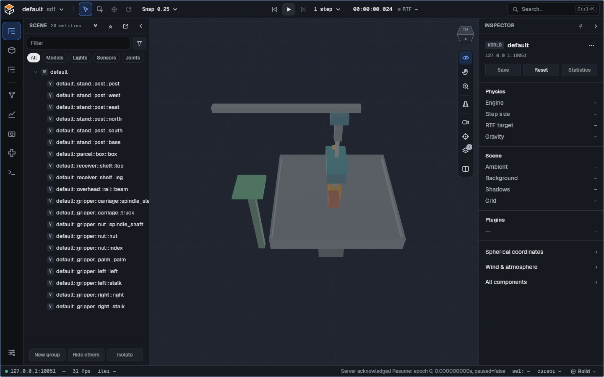

<!-- Copyright (C) 2026 Open Source Robotics Foundation -->
<!-- SPDX-License-Identifier: Apache-2.0 -->

# Automatically refining a parcel strike on either jaw

The serial robot now selects a finer native solve when an approaching parcel will reach a registered jaw face. In the 32.65%-inertia robot, this reduced the left strike's impulse error from 8.08% to 1.22%. It brought the maximum pose error below 0.22 mm and 0.60° on both jaws. The right strike's ordinary impulse was unusually close to the fine reference, and refinement raised its error from 0.31% to 2.22%. [Left jaw in gz-web-rs](http://127.0.0.1:8082/?backend=primitive&ui=full&quality=low&replay=1&lifecycle=1&url=ws%3A%2F%2F127.0.0.1%3A10051%2F) · [Right jaw in gz-web-rs](http://127.0.0.1:8082/?backend=primitive&ui=full&quality=low&replay=1&lifecycle=1&url=ws%3A%2F%2F127.0.0.1%3A10052%2F)

| Parcel approach | Ordinary → selected impulse error | Ordinary → selected peak translation | Ordinary → selected peak rotation | Refined public ticks |
|---|---:|---:|---:|---|
| Touching left face at start | 8.08 → 1.22% | 0.682 → 0.178 mm | 2.574 → 0.376° | 1 |
| Touching right face at start | 0.31 → 2.22% | 0.489 → 0.218 mm | 1.392 → 0.592° | 1 |
| Initially 0.30 mm from left face | 9.39 → 0.65% | 1.076 → 0.165 mm | 3.288 → 0.187° | 1 |
| Initially 1.20 mm from left face | 12.59 → 0.69% | 0.807 → 0.299 mm | 1.064 → 0.268° | 2 and 3 |
| Passing 150 mm sideways | Both zero impulse | Both 0.176 mm | Both 0.105° | None |

The SDF world plugin accepts an optional `incoming_face` on a finite box pair. The sign and axis belong to the receiver link's local frame. The detector checks whether the incident box currently overlaps the finite face's footprint and whether its lower hull closes through that face during the next public tick. It advances both measured twists around their actual mass centers, including receiver rotation. One shared refinement advances the ordinary native world and its pending forces. Remaining ticks use the existing ordinary solver. The detector admits cold tangency and rearms after a measured gap. When an anticipated collision produces no impulse, another incoming strike can qualify on the next tick. This occurred in the 1.20 mm trial. A subsequent phase added intermediate crossings for boxes in constant translation. Rotating paths still use endpoint checks. [Sorting-pad crossing](sorter-crossing.md)

Each branch loaded the same full rail/screw/wrist/gripper robot. A 200 g parcel approached at 0.75 m/s, with fixed masses, jaw geometry and 1 ms actuator and observation cadence. The 24 ms comparisons used independently initialized continuous 125 ns native references. Halving the check step from 250 ns to 125 ns changed the left and right reference impulses by 0.24% and 0.43%, respectively. Position and rotation errors are maxima over the parcel and all five links at every public sample. The separated run never loaded either jaw. [Matched inertia fixture and original limits](serial-impact-inertia.md) · [Measured runs, joint extrema and refinement budgets](serial-incoming-impact.json)

The 1 µs configuration used 1,023 native calls for a one-tick strike, versus 24,000 with that grid active throughout. With budgets of 4, 16, 64, 125, 250, 500 and 1,000 calls per selected tick, 500 was the first tested budget to meet 5% impulse, 1 mm position and 1° rotation on **both** touching strikes. It used 523 total calls with 2.08% and 3.54% impulse error. These are solver call counts. The 500-call left-jaw step later measured 58.98 ms at p95. [Measured wall-clock costs](serial-impact-cost.md)

## The spindle speed stop

Both passive controls removed the spindle velocity-controller plugin and applied the same 3 N·m joint effort for 24 ms. With the 0.8 rad/s speed stop present, the spindle peaked at 0.80272 rad/s under the single-strike policy. Removing the stop let it reach 5.10339 rad/s. Applying 64 native solves on every tick brought the capped result to 0.800058 rad/s. The speed limit is a physical solver constraint, distinct from the 0.65 rad/s velocity-command clamp. Its finite solve has a measurable residual under load.

For the extreme 1/256-inertia robot with its original controllers, one refined strike reduced impulse error from 69.02% to 2.06%. The later ordinary ticks still reached 0.8230 rad/s, 3.05 mm and 1.50° trajectory differences. Ongoing speed-stop and trajectory accuracy at that mass distribution require additional work after contact.

## Reproduce the impact

The qualification example can export its complete SDF. The ordinary simulator CLI independently loaded each exported world and matched all six moving bodies' final positions exactly. Both WebGPU replays matched all 25 frames and 500 displayed poses/shapes apiece and rewound to zero. Nine executable regressions, three geometry tests, nineteen existing contact-policy tests and release Clippy passed. Changed coverage was 99/100 lines and 171/172 regions in the scene crate and 115/115 lines and 199/201 regions in the example. [Portable SDF worlds and recordings](serial-incoming-impact.tar.xz)

```sh
RUSTC_WRAPPER= cargo run --locked --release --no-default-features -p gz-sim-cli --example serial_impact_inertia -- --divisor 1.75 --automatic --substeps 1000 --compare --write-world incoming.sdf --replay incoming-replay
RUSTC_WRAPPER= cargo run --locked --release --no-default-features -p gz-sim-cli --bin gz-sim-rs -- incoming.sdf --physics-engine multifidelity --iterations 24
```

Add `--right` to strike the other jaw, `--gap-um 1200` to start 1.20 mm away, or `--miss` to bypass both fingers. The exact SDF for each jaw is included in the portable recording.


