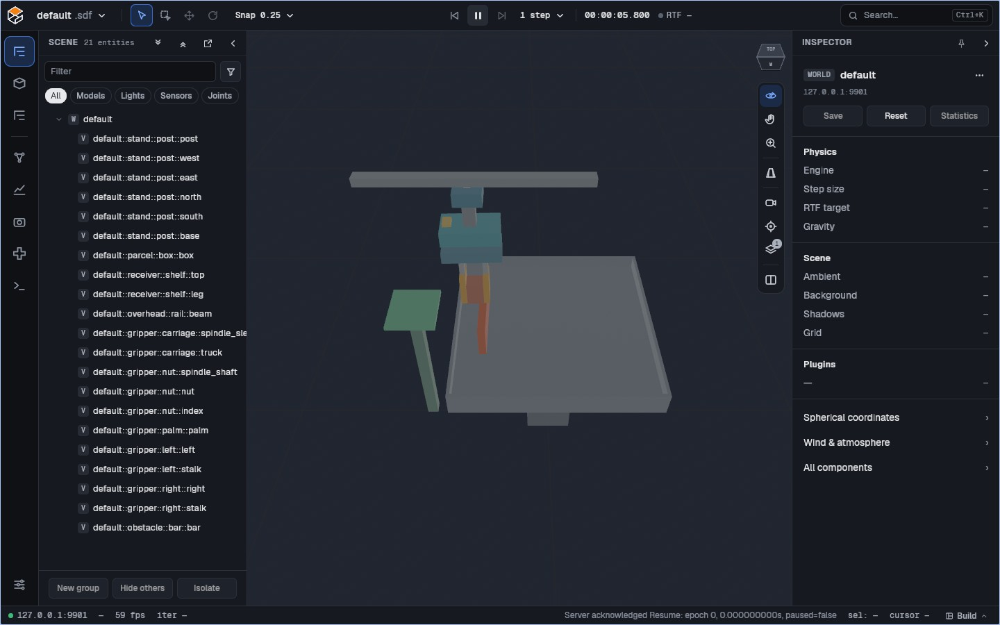
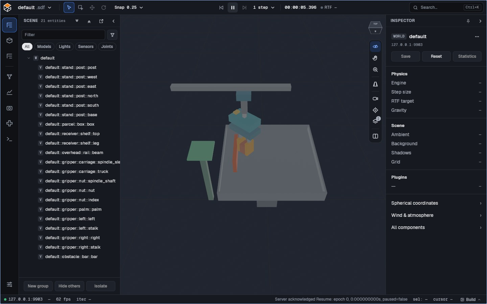

<!-- Copyright (C) 2026 Open Source Robotics Foundation -->
<!-- SPDX-License-Identifier: Apache-2.0 -->

# Carrying a free parcel across a fixed barrier

The serial gripper raised the 200 g parcel 126.07 mm, passed a fixed barrier with 18.75 mm minimum clearance, and released it on the receiving shelf at 14.074 s. With a 66.37 mm lift, the controller detected a blocked route before commanding travel. Both pads held the parcel until the simulation ended. [Successful passage in gz-web-rs](http://127.0.0.1:8082/?backend=primitive&ui=full&quality=low&replay=1&lifecycle=1&url=ws%3A%2F%2F127.0.0.1%3A9901%2F) · [Blocked route](http://127.0.0.1:8082/?backend=primitive&ui=full&quality=low&replay=1&lifecycle=1&url=ws%3A%2F%2F127.0.0.1%3A9902%2F) · [Measured contact and retreat](http://127.0.0.1:8082/?backend=primitive&ui=full&quality=low&replay=1&lifecycle=1&url=ws%3A%2F%2F127.0.0.1%3A9903%2F)

| Measured over 18 seconds | Full lift | Low lift, checked route | Low lift, contact-stop control |
|---|---:|---:|---:|
| First predicted obstruction | clear | right jaw, 3.700 s | right jaw, 3.700 s |
| Maximum carriage travel | 463.07 mm | 0.159 mm | 164.87 mm |
| Peak obstacle normal force | 0 N | 0 N | 67.73 N on right jaw |
| First physical obstacle reaction | none | none | 5.396 s |
| Opening command | 14.074 s | none | none |
| Final mean shelf load | 1.962 N | 0 N | 0 N |
| Final combined mean normal pad load | 0 N | 14.05 N | 14.05 N |

The [SDF workcell](../../../examples/worlds/local_robot_serial_obstacle.sdf) adds a fixed 260 × 24 × 107 mm box centered 230 mm down the rail, with its top 607 mm above the world origin. A shape sweep uses the measured positions and rotations of the parcel and all five moving robot collision boxes. It checks translation along the remaining rail segment with the current orientations after every 1 ms travel solve. The controller also measures actual obstacle reactions at every solve. An obstruction latches the return-to-pickup command, preserves lift and jaw closing force, and inhibits descent and opening for the rest of the trial. The sweep approximates future orientations with their current values. Joint deflection and contacts continue to evolve in the physical solve.

The clear parcel came nearest at 5.790 s. The left and right jaw clearance minima were 26.32 mm each. Neither the parcel nor any robot body delivered a normal impulse to the obstacle. Both pads carried the parcel throughout all 4,001 traverse observations. At the destination the original controller required 30 ms of sustained shelf load before opening.

Both low routes predicted their first hit 169.70 mm ahead at dispatch. The guarded carriage stayed at pickup for all 14,301 remaining solves, apart from submillimetric servo motion. In the diagnostic control the sweep still recorded its prediction, while the first positive measured obstacle reaction triggered the retreat. The right jaw delivered 0.13105 N s of normal impulse, with a deepest measured overlap of 0.067 mm at 5.424 s. The parcel itself remained 14.54 mm clear. Both pads supported it through all 12,605 solves from the contact trigger, and it returned to within 0.054 mm of its starting rail coordinate.

| Clear parcel above the barrier | First measured right-jaw contact |
|---|---|
|  |  |

The regressions rerun all three 18,000-step trials after a world reset and compare every reported force, clearance, decision and sampled public visual pose exactly. They also independently compare each saved visual transform with its committed Bevy entity. The historical straight-shelf run still reproduces its original measurement JSON and native frame stream byte for byte. [Full measurements and coverage](serial-obstacle.json)

Nine Rust tests passed. The browser checked all 1,356 recorded frames and 28,476 visible poses and shapes across the three obstacle trials, with each replay returning to time zero. LLVM covered 216/217 changed executable lines (99.54%) and 342/354 changed regions (96.61%). The strict example Clippy check passed.

## Reproduce the trials

```sh
export RUSTC_WRAPPER=
cargo run --release --locked --no-default-features -p gz-sim-cli --example serial_transfer -- clear-obstacle artifacts/clear-obstacle
cargo run --release --locked --no-default-features -p gz-sim-cli --example serial_transfer -- low-clearance artifacts/low-clearance
cargo run --release --locked --no-default-features -p gz-sim-cli --example serial_transfer -- contact-stop artifacts/contact-stop
cargo test --release --locked --no-default-features -p gz-sim-cli --example serial_transfer
```

Use a fresh directory for each archive. Each command prints the geometry and force measurements in SI units along with the time of the decision. The recorder publishes the decision tick in addition to its regular 40 ms display cadence.
