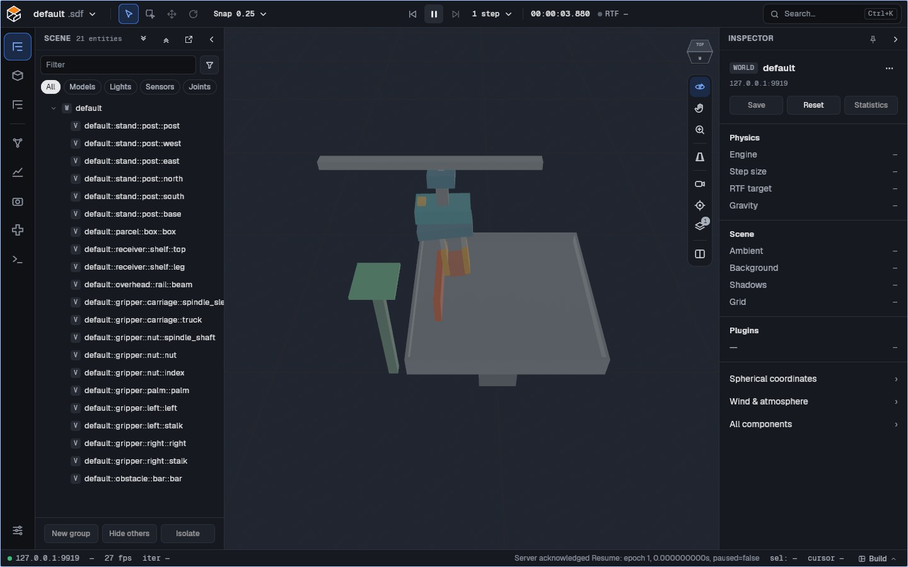
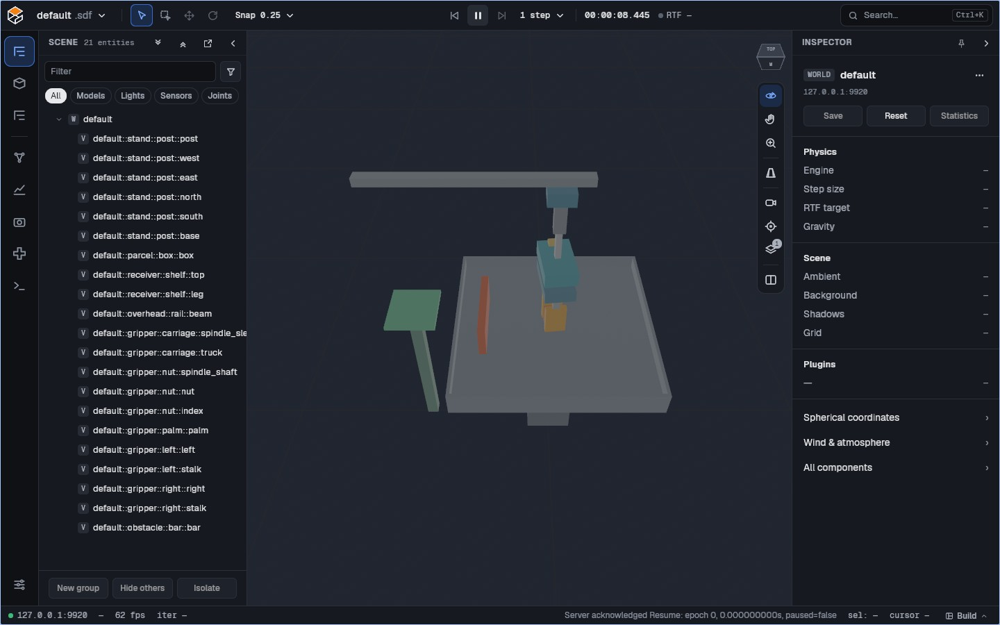

<!-- Copyright (C) 2026 Open Source Robotics Foundation -->
<!-- SPDX-License-Identifier: Apache-2.0 -->

# Off-center parcel recovery on the serial gripper

The robot delivered 20 of 22 parcel and motion combinations to the shelf. For the other two, it detected repeated slipping, returned the 1 kg parcel to the pickup tray, waited for the tray to take the weight, and opened. The same robot with grip feedback switched off delivered 18. [Recovered shelf delivery in gz-web-rs](http://127.0.0.1:8082/?backend=primitive&ui=full&quality=low&replay=1&lifecycle=1&url=ws%3A%2F%2F127.0.0.1%3A9919%2F) · [Supported set-down in gz-web-rs](http://127.0.0.1:8082/?backend=primitive&ui=full&quality=low&replay=1&lifecycle=1&url=ws%3A%2F%2F127.0.0.1%3A9920%2F)

| Parcel and +10 mm center-of-mass offset | Unassisted run | Feedback enabled |
|---|---|---|
| 400 g, friction 0.28, 4 s crossing command | 4,001/4,001 crossing ticks on both pads, shelf opening at 9.431 s | Identical recording and timing, zero alarms |
| 400 g, friction 0.28, 250 ms command | Alarm at 3.764 s, 360/4,001 ticks on both pads, 153 mm peak parcel motion within the palm, no shelf release | Added 7.155 N per jaw, 4,001/4,001 ticks on both pads, 22.3 mm peak relative motion, 12.6 mm minimum parcel clearance over the barrier, shelf opening at 9.468 s |
| 1 kg, friction 0.70, 250 ms command | Alarm at 3.765 s, 516/4,001 ticks on both pads, 302 mm peak relative motion, no shelf release | Added 7.189 N per jaw, detected continued slip at 3.814 s, returned to pickup. Tray first loaded at 8.035 s, supported opening at 8.445 s |

The +10 mm heavy parcel stayed on both pads for all 4,221 airborne recovery ticks. For the −10 mm heavy parcel, one pad briefly unloaded for four of 4,117 airborne recovery ticks. At least one pad remained loaded on every recovery tick. The tray averaged 9.224 N and 9.225 N respectively in the 30 ms before opening and carried 9.810 N in the final half second of each run. Across the 22 guarded trials the parcel accumulated zero normal impulse against the barrier. [Light unassisted control](http://127.0.0.1:8082/?backend=primitive&ui=full&quality=low&replay=1&lifecycle=1&url=ws%3A%2F%2F127.0.0.1%3A9918%2F) · [Heavy unassisted control](http://127.0.0.1:8082/?backend=primitive&ui=full&quality=low&replay=1&lifecycle=1&url=ws%3A%2F%2F127.0.0.1%3A9921%2F) · [Slow crossing](http://127.0.0.1:8082/?backend=primitive&ui=full&quality=low&replay=1&lifecycle=1&url=ws%3A%2F%2F127.0.0.1%3A9917%2F)




## What triggered the grip response

The acquisition, 460 mm obstacle route, initial jaw pressure, public 1 ms solve clock and four-second observation window match the earlier serial trial. Only the specified parcel mass, grip friction, center of mass along the opening axis, and duration of the rail command vary between conditions. Each center of mass lies inside the original box. The fixture preserves the calibrated principal moments about that center and all collision dimensions. The 400 g slow/medium/fast series uses −10, 0 and +10 mm offsets at friction 0.28 and command durations of 4,000, 1,000, 500 and 250 ms. At friction 0.85 the same offsets use both endpoint durations. The 1 kg controls use friction 0.70, both nonzero offsets and both endpoint durations.

The minimum-jerk rail command requests peak acceleration of 0.166, 2.656, 10.623 and 42.493 m/s² respectively. A bounded 80 N actuator tracks that profile. At 400 g, +10 mm, 250 ms, the guarded run reached 23.029 m/s² of measured forward acceleration. The largest single-step deceleration was 474.296 m/s². Carriage travel peaked at 520.017 mm against a 520 mm limit. The 4 s control reached 0.863 m/s² forward. Reported accelerations use differences of successive measured rail velocities during outbound motion. These trials sample the robot and its travel limits together.

Both policies observe the same force-weighted relative surface velocity from the native contacts at each pad. The existing guard responds after four consecutive milliseconds above 18 mm/s of slip or below 0.05 N of normal load. Guarded control adds one mean measured preload, capped at 20 N per jaw. Continued slip after a 45 ms settling window initiates a two-second command to the nearer station. Lowering waits for rail speed below 10 mm/s and position within 3 mm. Opening requires the existing upward-face, relative-speed and 30 ms weight-bearing checks. A blocked return holds both rail and spindle. The monitor-only control uses the same obstacle and shelf interlocks and records the same alarms.

## False alarms and limits

The guard signaled eight times across 22 unassisted conditions, counting the first alarm per condition. Four signaled parcels missed the shelf. Three others delivered but lost continuous bilateral support during transit. One centered 400 g parcel at friction 0.28 and 500 ms delivered with both pads loaded throughout. Its measured peak pad speeds were 20.5 and 29.0 mm/s.

Using delivery plus continuous bilateral support as the reference, the guard caught all seven adverse conditions, signaled in **1 of 15** successful conditions, and stayed quiet in the remaining 14. Bilateral support uses an independent native impulse measurement above 0.1 N on both pads, with neither station carrying the load. Using eventual delivery alone as the reference, **4 of the 18** successful controls received an alarm. These frequencies describe the chosen conditions. The cold and reset repetitions are deterministic verification. The two physical returns both selected pickup. A focused obstruction test exercises the receiver-side return hold. A loaded receiver-side return, diagonal center-of-mass offsets and physical hardware remain open.

## Reproduction and verification

From the workspace root, generate fresh SDFs and measurements, then record a selected condition through the public Rust example.

```bash
export GZ_SERIAL_CARRY_OUTPUT="$PWD/artifacts/serial-offset-matrix"
RUSTC_WRAPPER= cargo test --locked --release --no-default-features -p gz-sim-cli \
  --example serial_transfer -- --ignored serial_offset_matrix
RUSTC_WRAPPER= cargo run --locked --release --no-default-features -p gz-sim-cli \
  --example serial_transfer -- guarded-carry artifacts/serial-offset-recovery \
  --world "$GZ_SERIAL_CARRY_OUTPUT/m0.4-u0.28-x+10-t250-guarded.sdf" --travel-ms 250
```

Each of 44 mode/condition combinations ran from a fresh world, after reset, and through an independent ordinary CLI invocation, totaling 2,376,000 solves. All recorded visual poses and measurements repeated after reset. For the 14 quiet pairs every archived frame was byte-identical between modes. For every pair that raised an alarm, archived frames matched through the alarm. The four historical serial routes and the earlier 1.24 kg loaded trial reproduced their measurements and replay bytes. Extracting the native pad reader into a shared Rust module also preserved the original gantry's 24 paired physical outcomes, three detailed traces and three native archives. The browser verified every frame of five native WebGPU replays, totaling 2,267 frames and 47,607 displayed poses and shapes. All rewound to zero.

LLVM covered 321/324 changed executable lines (99.07%) and 507/528 changed regions (96.02%), relative to the preceding payload/contact implementation at `1291603`. The ordinary serial and gantry invocations and serial test executable were profiled separately. Compiled test-only files are outside the production change denominator. The case receipt includes each per-mode outcome, the two executable coverage denominators, archived stream hashes, and the five browser receipts. [Case measurements](serial-offset.json)
