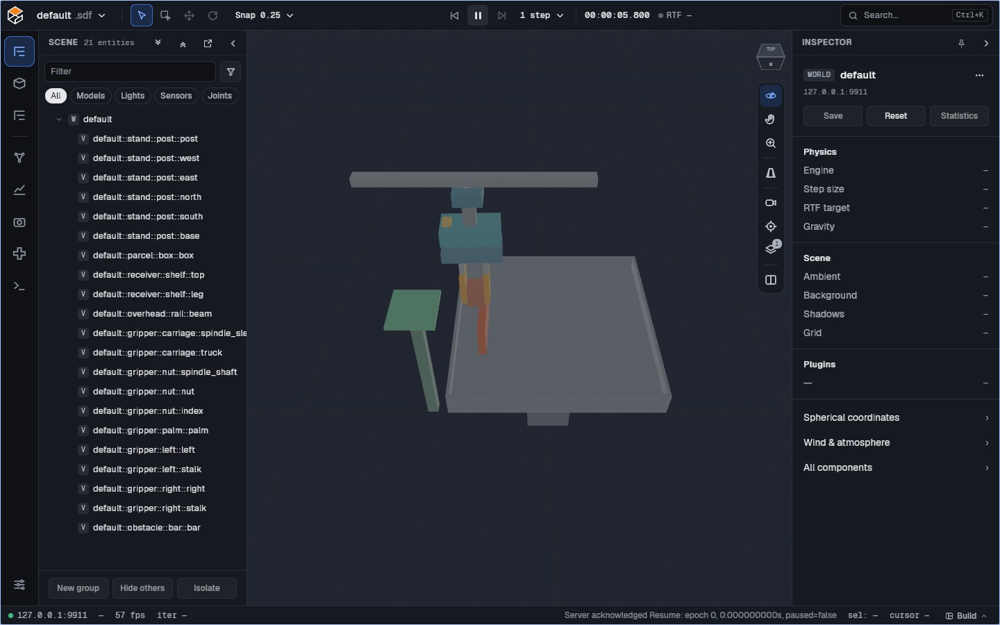
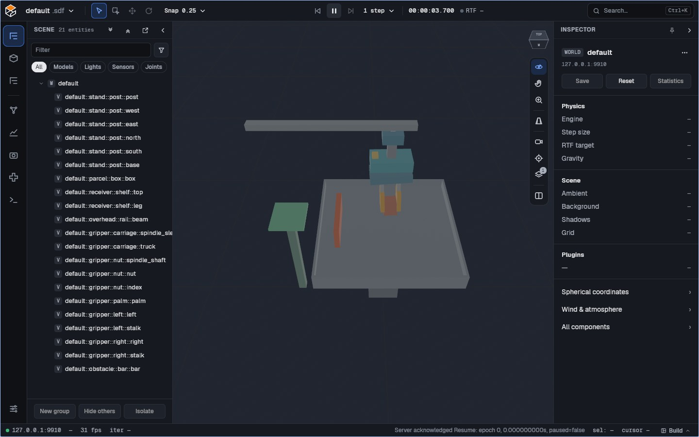

<!-- Copyright (C) 2026 Open Source Robotics Foundation -->
<!-- SPDX-License-Identifier: Apache-2.0 -->

# Measured parcel mass and grip friction on the obstacle route

The gripper delivered 1.245 kg with a grip friction coefficient of 0.85. The parcel cleared the barrier by 6.647 mm. At 1.2475 kg the lift reached only 105.9 mm, and the pre-travel sweep found that the parcel would hit the barrier. The gripper kept it at pickup with both pads loaded. These are sampled operating limits for this gripper, 460 mm route and 18-second controller sequence. [Successful transfer in gz-web-rs](http://127.0.0.1:8082/?backend=primitive&ui=full&quality=low&replay=1&lifecycle=1&url=ws%3A%2F%2F127.0.0.1%3A9911%2F) · [Insufficient lift](http://127.0.0.1:8082/?backend=primitive&ui=full&quality=low&replay=1&lifecycle=1&url=ws%3A%2F%2F127.0.0.1%3A9910%2F)

| Tested condition | Successful test | Neighboring failure |
|---|---|---|
| Increasing mass at friction 0.85 | 1.245 kg released at 8.892 s. Final shelf load 12.21345 N | 1.2475 kg stayed at pickup. Final shelf load 0 N |
| Decreasing friction at 400 g | 0.275 released at 9.178 s. Parcel clearance 8.189 mm | 0.2725 left the parcel on the tray. Rail motion was inhibited |
| Decreasing friction at 1.0 kg | 0.70 released at 9.118 s | 0.65 missed pickup |
| Varying friction at 200 g | 0.15, 0.35 and 0.85 completed | 0 and 0.125 missed pickup. At 0.25 and 0.30 the parcel reached the shelf but did not meet the release test |

The 1.245 kg parcel remained airborne between both pads throughout all 4,001 traverse observations. Its mean left and right compressive forces were 7.2205 and 7.2920 N, and its maximum shift relative to the palm was 1.640 mm. The receiving shelf carried a mean 11.4830 N over the qualifying 30 ms before opening. After release it carried the full weight, with zero final pad load. At 200 g and friction 0.25, the final shelf load was 1.8161 N, below the 1.84428 N minimum qualifying window mean. The full transfer outcome can vary nonmonotonically with friction.

The workcell uses the parcel's SDF mass and vertical gravity component for the expected shelf load and spindle feedback. Changing the payload scales its three diagonal moments of inertia with mass while fixing its size and center of mass. Both pad surfaces and the parcel receive the same isotropic coefficient. Other bodies, controls and the 1 ms solve clock retain their authored settings. The dispatch gate requires both measured pad normal reactions to exceed 0.1 N and the parcel to be off the tray and shelf. A frictionless closed-jaw control previously sent the empty carriage 462.2 mm down the rail. The corrected controller held its pickup command and the carriage was 0.009 mm from its starting coordinate at the scheduled arrival. [Frictionless missed pickup in gz-web-rs](http://127.0.0.1:8082/?backend=primitive&ui=full&quality=low&replay=1&lifecycle=1&url=ws%3A%2F%2F127.0.0.1%3A9908%2F)

| Loaded crossing | Insufficient clearance at dispatch |
|---|---|
|  |  |

## Distinguishing a recycled force from an impact

At 1.24 kg, ordinary Rapier 0.36.1 applied 0.104654 N s between the parcel and fixed barrier at 5.553 s. The stored native point had a positive 18.305 mm signed separation within the 20 mm prediction margin. Both collider skins were zero. The actual boxes were 10.786857 mm apart before the tick. Logging the native integrator and independently measuring the OBB distance at all eight 125 µs substeps found 10.786860 to 10.786882 mm of clearance. The stale solver plane therefore triggered a retreat during a physically clear passage. [Cached-contact control](http://127.0.0.1:8082/?backend=primitive&ui=full&quality=low&replay=1&lifecycle=1&url=ws%3A%2F%2F127.0.0.1%3A9907%2F)

Starting from the same 5.552 s state and recomputing the obstacle's native contacts removed the reaction. The implemented opt-in check requests a native geometry update when an unloaded cached contact is closing, its stored point has drifted by more than the incoming travel allowance, and a current box separating axis exceeds that allowance. The estimate includes both skins, linear travel, rotational reach and gravity. Rapier still solves every contact it finds. The check skips pairs with existing solve or warm-start impulses, and skips invalidation if both colliders have loaded neighbors. It supports a dynamic cuboid and a fixed cuboid. The serial route calls it for each monitored moving part and its barrier.

The corrected 1.24 kg run requested one refresh, produced zero obstacle impulse and opened at 8.982 s. The 400 g, 0.275 friction run also needed one refresh. In the earlier 200 g low-lift contact control the right jaw really reached the barrier. Its first solver point recorded +0.200532 mm, while the geometric gap closed to less than 1 nm by the last substep and later reached 66.84 µm overlap. All four original straight and obstacle qualification outputs still match byte for byte. [Corrected 1.24 kg transfer](http://127.0.0.1:8082/?backend=primitive&ui=full&quality=low&replay=1&lifecycle=1&url=ws%3A%2F%2F127.0.0.1%3A9909%2F) · [Original obstacle qualification](serial-obstacle.md)

A two-box regression reproduces the false reaction in zero gravity. With rechecking, the moving box follows its analytic straight-line endpoint within 1 picometre and experiences zero normal impulse. Three additional controls compare every tick's rigid state, signed reaction and warm-start history with the ordinary solver over 550 ms. All samples matched for a true impact, a box moving away and a resting loaded box. The resting control remained loaded for all 150 observations in its final 150 ms.

## Reproduce

The following generates the 26 self-contained SDF variants and verifies that every measurement repeats after a world reset. Choose a fresh output directory.

```sh
export RUSTC_WRAPPER=
export GZ_SERIAL_PAYLOAD_OUTPUT="$PWD/artifacts/payload-matrix"
cargo test --release --locked --no-default-features -p gz-sim-cli --example serial_transfer -- --ignored payload_matrix
cargo run --release --locked --no-default-features -p gz-sim-cli --example serial_transfer -- clear-obstacle artifacts/payload-pass --world "$GZ_SERIAL_PAYLOAD_OUTPUT/m1.2450-u0.8500.sdf"
cargo run --release --locked --no-default-features -p gz-sim-cli --example serial_transfer -- cached-obstacle artifacts/payload-cached --world "$GZ_SERIAL_PAYLOAD_OUTPUT/m1.2400-u0.8500.sdf"
cargo test --release --locked -p gz-physics-rapier --lib box_features::separated
```

The ordinary CLI produced a third independent outcome for each of the 26 conditions. All 78 outcomes agreed within each condition, covering 1,404,000 public physics steps. The browser checked all 2,712 native frames and 56,952 displayed poses and shapes across six replays, with each returning to time zero. Twelve example tests, six focused native tests and the full matrix passed. LLVM covered 200/202 changed executable lines (99.01%) and 357/361 changed regions (98.89%). [Per-condition loads, native substep traces, coverage and viewer receipts](serial-payload.json)
