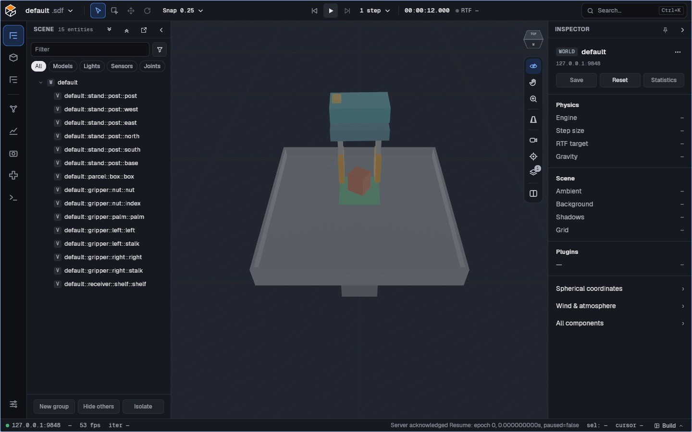

<!-- Copyright (C) 2026 Open Source Robotics Foundation -->
<!-- SPDX-License-Identifier: Apache-2.0 -->

# Place a parcel on a moving shelf

The screw-driven hand lifts a loose 200 g box, levels its wrist, and waits while a separate green shelf slides underneath. The hand lowers the box and adjusts the spindle height using the measured contact force. The jaws open once the intended shelf supports the parcel for 30 consecutive milliseconds with a mean force between 94% and 125% of its weight. The gripper then retracts. [Play the supported placement](http://127.0.0.1:8082/?backend=primitive&ui=full&quality=low&replay=1&lifecycle=1&url=ws%3A%2F%2F127.0.0.1%3A9848%2F) · [Play the early release](http://127.0.0.1:8082/?backend=primitive&ui=full&quality=low&replay=1&lifecycle=1&url=ws%3A%2F%2F127.0.0.1%3A9849%2F) · [Play with the shelf parked](http://127.0.0.1:8082/?backend=primitive&ui=full&quality=low&replay=1&lifecycle=1&url=ws%3A%2F%2F127.0.0.1%3A9850%2F)



| Native measurement | Supported placement | Deliberately open early | Receiving shelf stays parked |
|---|---:|---:|---:|
| Time jaws open | 9.216 s | 4.450 s | Stayed closed |
| Shelf reaction at opening | 1.845 N | 0 N | — |
| Peak downward speed after opening | 0.022 m/s | 0.942 m/s | — |
| Maximum downward travel after opening | 0.106 mm | 45.949 mm | — |
| Time with neither jaw nor shelf loaded after opening | 0 ms | 101 ms | — |
| Peak shelf impulse after opening | 0.00742 N·s | 0.15267 N·s | — |
| Final mean shelf / tray / pad-pair normal load | 1.962 / 0 / 0 N | 1.962 / 0 / 0 N | 0 / 1.962 / 14.062 N |

The early release reaches the same resting height as the successful placement. The 101 ms of unsupported motion and the 20.6× larger peak shelf impulse distinguish the drop. In the parked-shelf trial, the original tray qualified for the same force, contact-face and vertical-speed conditions on 3,913 ticks. The gripper continued holding because the loaded body was the pickup tray.

Each scene runs 12 s at a 1 ms public step. The prescribed shelf subdivides a step into four native solves. The force controller uses the complete interval sum and checks the latest loaded face direction. Using only the last slice would report 0.491 N for a stationary parcel weighing 1.962 N. The wrist and spindle use loaded SDF position controllers. The jaws open through persistent public slider-effort commands of −20 N per jaw. Final loads are averaged over the last 500 ms. Every reported value repeated exactly after loaded-world reset in all three trials.

Three release tests passed along with strict Clippy. LLVM executed 211 of 213 production example lines and 383 of 403 regions. The browser checked 301 frames, 4,515 poses and shapes, and rewind to zero in each replay.

## Reproduce

Run from the repository root with the ordinary gz-web-rs frontend on port 8082. The example prints the measured outcome and writes the native replay directly to a new directory.

```sh
RUSTC_WRAPPER= cargo test --locked --release --no-default-features -p gz-sim-cli \
  --example serial_place -- --nocapture
RUSTC_WRAPPER= cargo run --locked --release --no-default-features -p gz-sim-cli \
  --example serial_place -- supported target/my-serial-place
RUSTC_WRAPPER= cargo run --locked --release --no-default-features -p gz-sim-cli \
  --bin gz-sim-rs -- --server --replay --web-viewer 9848 target/my-serial-place
```

Use the mode `early` or `missing-shelf` to reproduce a control. Choose a fresh output directory and use ports 9849 and 9850 respectively for the links above. [Rust controller and verification](../../../crates/gz-sim-cli/examples/serial_place.rs) · [Authored gripper](../../../examples/worlds/local_robot_serial_grasp.sdf)
