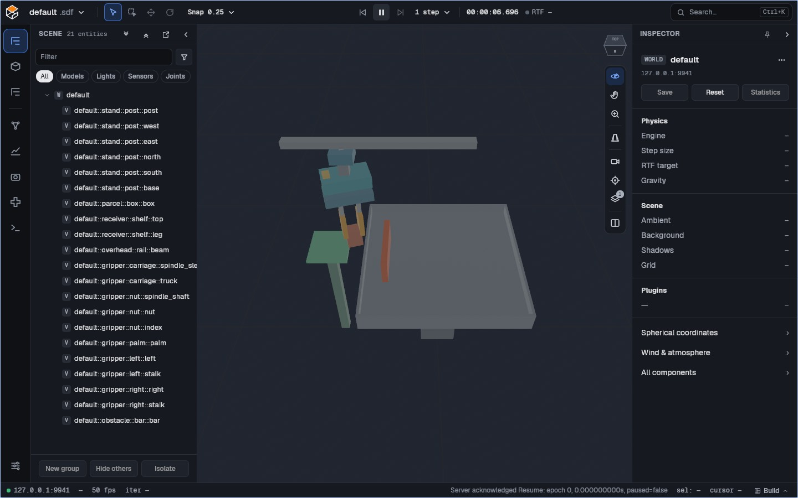
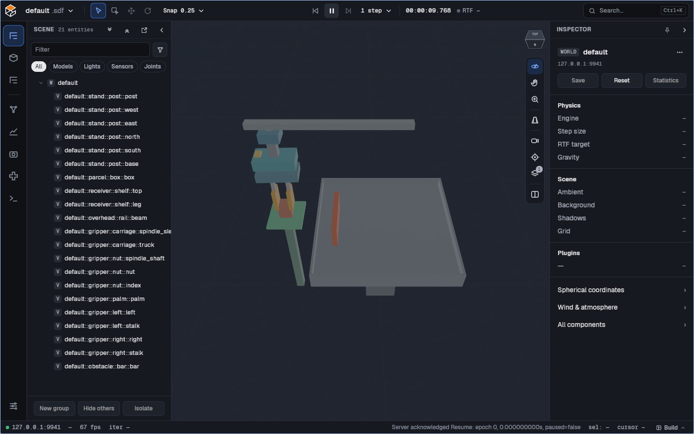

# Clearing a loaded shelf edge with a slippery parcel

The serial gripper now lifts a caught parcel clear of the receiving shelf before it tries to move sideways again. The 400 g parcel that previously stayed jammed under 13.247 N of upward shelf reaction finished resting on the shelf at its own weight of 3.924 N, with both jaws unloaded. The same controller withheld its opening command under the stronger 12 N disturbance. [Native trial measurements](serial-pressure.json)

| 1 ms historical trial | Before the correction | With the correction |
|---|---:|---:|
| First slip alarm / second alarm | 6,203 / 6,252 ms | 6,203 / 6,252 ms |
| First shelf-edge lift | — | 6,291 ms |
| Resume traverse / begin lowering | — | 6,696 / 8,742 ms |
| Open on measured shelf support | — | 9,768 ms |
| Final upward shelf reaction | 13.247 N | 3.924 N |
| Final combined finger reaction | 27.750 N | 0 N |

Both trials start from the same body states and contact points. The fixture has +10 and +8 mm horizontal center-of-mass offsets, a 460 mm rail and friction coefficient 0.28 at the parcel and pads. An 8 N downward pull acts for 65 ms from 6,199 ms. The high load first appears on the *sideways approach*. The parcel is already rotating when its lowest corner passes 0.019 mm above the shelf top. The upward reaction is 85.37 N out of 89.25 N total normal reaction. Its direction and the parcel's position distinguish that event from set-down.

The controller holds the rail and raises the screw joint toward its authored stop. It resumes its approach after the bounding sphere around the box guarantees clearance at the measured height, the shelf has supplied zero normal impulse for 30 ms and both jaws retained load throughout. At restart the actual lowest corner was 19.77 mm above the shelf, the all-orientation clearance was 1.49 mm, and the smaller jaw force stayed above 13.33 N. The spindle reached 1.856 rad against its 2 rad stop. During lowering, the controller can remove the extra tightening effort once the stationary upper face carries load continuously. The fingers still require 30 ms of qualified shelf support to open. [Independent point-impulse and eight-corner measurements](serial-pressure.json)




## Timestep and loading

The following applications use identical external commands, the same 2 ms actuator clock, and an 8 N pull over exactly 6,200–6,264 ms. Each observation combines the impulses of one, two or four ordinary public physics steps. Release uses the support sensor's per-physics-step history. Each policy at a given timestep has identical incoming body and contact states and an identical first alarm. The direct recovery controller retains the original tightening and return commands. A third, observe-only run measures the unassisted outcome.

| Physics step | Direct recovery opened | Corrected recovery opened | Individual native solves before opening | Mean upward force over final 30 ms |
|---|---:|---:|---:|---:|
| 0.5 ms | Jammed at 13.589 N | 10,640 ms | 60 | 3.68859 N |
| 1 ms | 13,918 ms | 13,962 ms | 30 | 3.68862 N |
| 2 ms | 9,080 ms | 9,112 ms | 15 | 3.68883 N |

At 0.5 ms the fine-clock peak and trough in the qualifying 30 ms were 4.357 and 3.397 N. Signed force was reconstructed independently from every reported parcel/shelf contact point, including the force direction for the parcel's ordering in each pair. The same audit reconstructed both jaw forces and the eight rotated corners of the parcel. Across the four 8 N schedules, the shelf carried 3.924 N over the final 500 ms, and the jaws and pickup tray carried zero.

All four zero-force controls delivered normally without a slip alarm. The 6 and 8 N runs with coefficient 0.28, and the three additional 8 N runs with coefficient 0.35, completed a supported recovery. The 12 N runs lost the grasp and withheld opening on every schedule. In the original 1 ms overload, the shelf and pickup ultimately carried 0.776 N and 3.121 N respectively, and the jaws were unloaded. This is a detected failed placement. The mass, material coefficients, obstacle, direction of disturbance and joint stops bound these results.

Opening time and the physical path varied with timestep. Before the pull, the maximum center position differences against the 0.5 ms trajectory were 2.23 mm for 1 ms and 4.95 mm for 2 ms. Through recovery they reached 37.75 and 45.75 mm at common 40 ms sample times. The final center differences were 3.28 and 3.11 mm. The 1 and 2 ms direct trials already succeeded, and the added release checks delayed their opening by 44 and 32 ms. [Times, pose differences and all trial outcomes](serial-pressure.json)

## Cost of a 2 ms controller update

The complete recorded example ran on CPU 9 of a Ryzen 9 9950X3D. Consecutive observation times include Bevy physics, feedback, commands and ordinary native frame capture. Each of three interleaved runs contributed 2,001 intervals covering the disturbed approach and placement. The table gives the median of the three percentiles after the other serial trials finished.

| Physics step | Solves per control update | p50 per update | p95 per update |
|---|---:|---:|---:|
| 0.5 ms | 4 | 642 µs | 717 µs |
| 1 ms | 2 | 319 µs | 353 µs |
| 2 ms | 1 | 154 µs | 173 µs |

While other serial qualification runs were active on this workstation, the corresponding p95 values were 1,123, 524 and 449 µs. Both batches are included in the receipt. These are measured costs for this 18 s robot route. [Per-run costs](serial-pressure.json)

## Worklog and verification

- Reproduced the jam with native forces. Changing the lowering gain could not affect the earlier edge event. Added a measured edge-clearance response and bounded relief of additional preload to the local serial workcell example.
- Added independently configurable public physics and controller clocks. The load signal and contact impulses are accumulated over complete native intervals. A partially aligned force pulse fails before simulation starts. Mean pad forces use the actual number of control observations, and a reported continuously carried parcel requires both jaws and no station load throughout each interval.
- Ran 19 combinations through all three policies, including loaded-world reset with exact equality of decisions, measurements and every recorded native pose. The observe-only and direct archive streams reproduced their pre-correction runs for all 19 pairs.
- Rechecked four historical workcell trials, 44 offset/acceleration trials and 32 earlier diagonal slip trials. All 80 retained their terminal decisions. 71 archives were byte-identical. The earlier 1.24 kg loaded route also reproduced its native archive exactly. Nine guarded placements opened at different times following the change to preload feedback. [Detailed regression and timing receipts](serial-pressure.json)
- The normal Rust example suite passed all 22 active tests. Changed production coverage reached **425/428 executable lines (99.30%)** and **664/691 LLVM regions (96.09%)**, including the ordinary CLI and example tests. Strict release Clippy passed.
- The gz-web-rs browser checked 1,827 native frames and 38,367 displayed poses and shapes, rewinding all four to zero. The links below use the local viewer on port 8082.

[Original jam](http://127.0.0.1:8082/?backend=primitive&ui=full&quality=low&replay=1&lifecycle=1&url=ws%3A%2F%2F127.0.0.1%3A9940%2F) · [Corrected 1 ms transfer](http://127.0.0.1:8082/?backend=primitive&ui=full&quality=low&replay=1&lifecycle=1&url=ws%3A%2F%2F127.0.0.1%3A9941%2F) · [0.5 ms transfer](http://127.0.0.1:8082/?backend=primitive&ui=full&quality=low&replay=1&lifecycle=1&url=ws%3A%2F%2F127.0.0.1%3A9942%2F) · [12 N failed grasp](http://127.0.0.1:8082/?backend=primitive&ui=full&quality=low&replay=1&lifecycle=1&url=ws%3A%2F%2F127.0.0.1%3A9943%2F)

## Reproduce

Run from the workspace root. Choose fresh output directories for the recordings.

```bash
export RUSTC_WRAPPER=
export GZ_SERIAL_PRESSURE_OUTPUT="$PWD/artifacts/serial-pressure-matrix"
cargo test --release --locked --no-default-features -p gz-sim-cli \
  --example serial_transfer -- --ignored serial_pressure_matrix --test-threads=4

world="$GZ_SERIAL_PRESSURE_OUTPUT/p500-c2-u0.28-n8-t6201-d64-guarded.sdf"
cargo run --release --locked --no-default-features -p gz-sim-cli \
  --example serial_transfer -- guarded-carry artifacts/serial-pressure-replay \
  --world "$world" --control-ms 2 --pull 6201,64,8

GZ_SERIAL_PRESSURE_AUDIT="$PWD/artifacts/serial-pressure-forces.json" \
  cargo test --release --locked --no-default-features -p gz-sim-cli \
  --example serial_transfer -- --ignored serial_pressure_force_audit

GZ_SERIAL_PRESSURE_COST="$PWD/artifacts/serial-pressure-cost.json" \
  taskset -c 9 cargo test --release --locked --no-default-features -p gz-sim-cli \
  --example serial_transfer -- --ignored serial_pressure_step_cost
```
