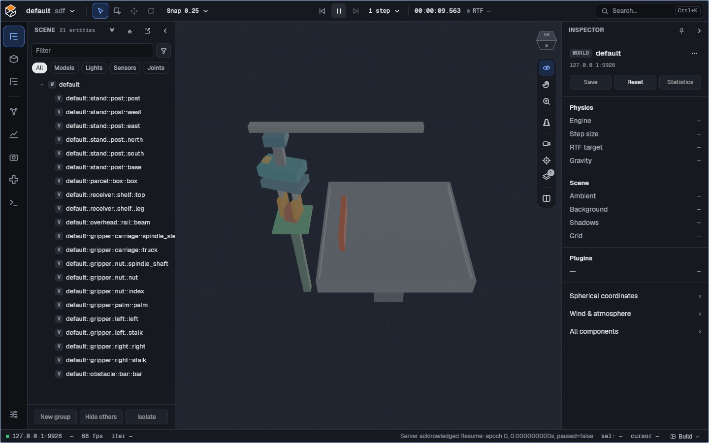
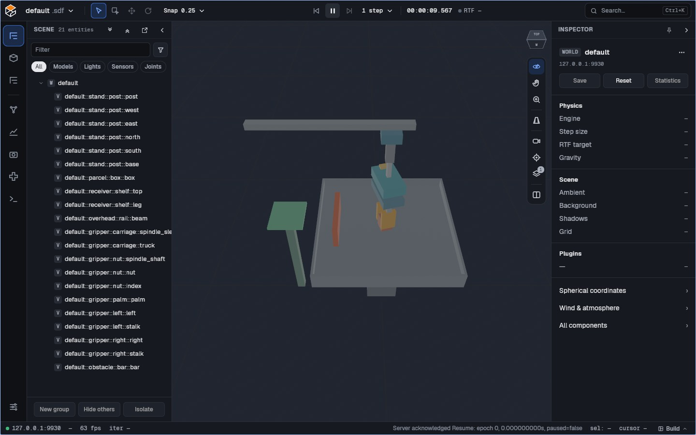

<!-- Copyright (C) 2026 Open Source Robotics Foundation -->
<!-- SPDX-License-Identifier: Apache-2.0 -->

# Set down a slipping parcel on the reachable side

The serial gripper placed all eight disturbed parcels on a support, including four that started slipping after they cleared the barrier. It returned the four early slips to the pickup tray and took the four late slips to the receiving shelf. The fingers stayed in contact until the support took the load in all eight trials. With the original fixed jaw pressure, two of the eight reached a verified release. All eight undisturbed controls reached the shelf without a grip alarm. [Late set-down in gz-web-rs](http://127.0.0.1:8082/?backend=primitive&ui=full&quality=low&replay=1&lifecycle=1&url=ws%3A%2F%2F127.0.0.1%3A9928%2F) · [Early return](http://127.0.0.1:8082/?backend=primitive&ui=full&quality=low&replay=1&lifecycle=1&url=ws%3A%2F%2F127.0.0.1%3A9930%2F)

| 400 g parcel, grip friction 0.35 | Early pull | Late pull |
|---|---|---|
| First and last loaded 1 ms solves | 4,450–4,514 | 6,200–6,264 |
| Measured first alarm / decision to set down | 4,454 / 4,503 ms | 6,204 / 6,253 ms |
| Verified opening with a 30 ms load window | 9,266–9,684 ms at pickup | 9,563–9,880 ms at the receiver |
| Final horizontal distance from station center | 1.04–1.58 mm | 1.09–1.47 mm |
| Final load on the selected station | 3.924 N | 3.924 N |
| Verified releases with fixed pressure | 0 of 4 | 2 of 4 |




## Matched motion and grasp

The four center-of-mass locations combine ±10 mm along the jaw opening axis with ±8 mm along the rail. Each trial uses the same collision boxes, mass, inertia about the shifted center, rail target, and 1 ms public clock. For each offset and start time, the experiment runs feedback and monitor-only policies, with either a 65 ms downward pull of 8 N or a zero-force control. The nonzero pull delivers 0.520 N·s at the parcel's center of mass. The robot receives only its ordinary joint, pose and contact measurements.

Immediately before each pull, the two live policies and their zero-force controls agreed bit for bit on the ten native body poses and twists, and on every reported contact normal, point lever and impulse. With force applied, the policies remained identical at the first tactile alarm. These are hashes of measured physical outputs. The controller resumes the same deterministic command history on reset. [Matched incoming states, per-trial outcomes and native archive hashes](serial-receiver.json)

An independent measurement used only the published palm and parcel poses. It compared each disturbed parcel with its undisturbed twin at every millisecond from one tick before the pull until 100 ms after it ended. At the first alarm, the parcel had moved 0.2202–0.2204 mm relative to the palm beyond its normal motion. At the end of the observation window this difference was 20.05–20.26 mm with feedback and 49.14–126.45 mm with fixed pressure. Both disturbed trajectories were identical through the first alarm in all eight comparisons.

The controller tests the nearer support first by sweeping the parcel and five moving link boxes, at their measured orientations, along the remaining signed rail distance. It checks the other support if the nearer path is blocked. If neither path is clear, it holds the rail and spindle and keeps the jaws closed. It continues checking the chosen path during travel. Independent geometry regressions cover a blocked first choice, an intersecting barrier blocking both choices, and missing collision observations. The end-to-end cases used a stationary barrier and two fixed stations.

For the +10/+8 mm late pull, the rail was 334.735 mm from pickup before the first loaded solve and 345.134 mm away when the second alarm selected the receiver. Both fingers carried the parcel for all 2,546 recovery ticks before shelf contact. The shelf averaged 3.689 N in the 30 ms before opening at 9.563 s and settled to 3.924 N. No tested parcel delivered normal impulse to the barrier. The unassisted +10/+8 mm parcel shifted 151.5 mm in the palm, missed verified release, and ended partly supported by both stations. [Unassisted late slip](http://127.0.0.1:8082/?backend=primitive&ui=full&quality=low&replay=1&lifecycle=1&url=ws%3A%2F%2F127.0.0.1%3A9929%2F) · [Undisturbed control](http://127.0.0.1:8082/?backend=primitive&ui=full&quality=low&replay=1&lifecycle=1&url=ws%3A%2F%2F127.0.0.1%3A9931%2F)

## Cost and measured limits

On a Ryzen 9 9950X3D pinned to logical CPU 9, the median p50/p95 step cost across three interleaved release runs was 133.6/177.4 µs for late recovery, 115.9/151.4 µs for the disturbed fixed-pressure control, and 129.9/176.2 µs for the undisturbed guarded transfer. Each run samples the same 4,001 public intervals from 6,200 through 10,200 ms. Consecutive Bevy ingress timestamps include the completed solve, contact checks, controller and ordinary frame extraction. Disk writes and browser playback occur separately. The three controls follow different physical trajectories after the alarm, so the difference includes changed contact work.

At friction 0.28, the +10/+8 mm parcel still reached a verified receiver set-down under a 6 N pull. At 8 N the closed jaws ended pressing the parcel against the shelf with 13.25 N on the shelf, and the support window withheld opening throughout the 18 s trial. At 12 N the parcel lost both pads and never reached a supported release. These additional runs bound failure at lower friction. [Boundary runs and timing blocks](serial-receiver.json)

## Local rigid-robot acceptance

| Capability | Demonstrated | Next acceptance check |
|---|---|---|
| Grasp and placement | Mass, friction, diagonal center of mass and carry acceleration have distinct success and failure controls. A withdrawing shelf has a separate catch-and-reopen test. [Payload limits](serial-payload.md) · [Acceleration and false alarms](serial-offset.md) · [Shelf withdrawal](serial-withdrawal.md) | Resolve the measured 0.28-friction overpressure at 8 N. Require the station to bear the load without excessive residual jaw force, retain the 12 N loss-of-grip control and distinguish loss before support from placement. |
| Collision and joints | The serial rail, screw, universal wrist and jaws grasp and clear a fixed box. The spherical wrist has a separate moving-parent torque and momentum check. [Obstacle clearance](serial-obstacle.md) · [Moving screw and universal wrist](moving-screw-wrist.md) · [Spherical wrist](ball-wrist.md) | Run the loaded serial route against a changing obstacle or support. Check actuator limits, anchor drift, placement error and contact forces at 0.5, 1 and 2 ms with the same physical controller periods. |
| Inertia and solver switching | The project has loaded inertia and link-count measurements. The mixed-joint gripper parks and wakes, including its active speed references. [Inertia measurements](arm-inertia.json) · [Capped spindle and wrist](capped-spindle.md) | Compare the complete obstacle and slip-recovery sequence with an always-dynamic run across loaded operating limits. Check first resumed pad impulses, angular momentum, outstanding commands, and p95 cost. |
| Integration | Local SDF, ordinary Rust CLI, loaded reset, measurable contact reports and native gz-web-rs playback are exercised here. [Release and coverage roadmap](../../MULTIFIDELITY_WORKLOG.md) | Qualify the combined port candidate and workspace coverage on the exact hosted build. Pin its CPU execution profile and retain independent controls for release decisions. |

## Reproduce

The matrix test generates reusable SDF files in a new directory. The second command records the late +10/+8 mm recovery via the ordinary serial transfer example.

```bash
export RUSTC_WRAPPER=
export GZ_SERIAL_RECEIVER_OUTPUT="$PWD/artifacts/serial-receiver-matrix"
cargo test --release --locked --no-default-features -p gz-sim-cli --example serial_transfer \
  -- --ignored serial_receiver_matrix
cargo run --release --locked --no-default-features -p gz-sim-cli --example serial_transfer \
  -- guarded-carry artifacts/my-receiver-run \
  --world "$GZ_SERIAL_RECEIVER_OUTPUT/x+10-y+8-t6200-n8-guarded.sdf" --pull 6200,65,8
```

The ignored `serial_receiver_slip_trace` and `serial_receiver_step_cost` tests reproduce the independent motion and timing checks. Set `GZ_SERIAL_RECEIVER_MOTION` and `GZ_SERIAL_RECEIVER_COST` to new output filenames to keep their per-tick motion samples and per-run percentiles. The review timed the optimized test executable with `taskset -c 9`.

The 32 policy, offset, timing and force combinations repeated all measurements and sampled poses from cold start and after reset. An independent CLI invocation matched each result, totaling 1,728,000 native steps. All 44 preceding offset/acceleration archives and reports reproduced byte for byte. The four native WebGPU replays passed 1,824 frame comparisons and 38,304 displayed shape and pose checks, with every replay rewinding to zero. Exact change coverage was 226/228 executable lines (99.12%) and 363/375 regions (96.80%) relative to `85414d3`. The release test suite passed 21 regular checks and strict Clippy passed. [Machine-readable results](serial-receiver.json)
