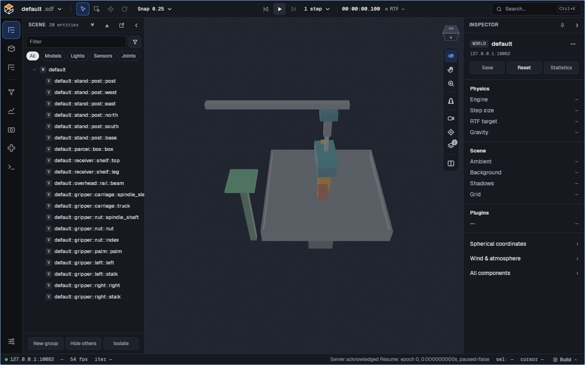

<!-- Copyright (C) 2026 Open Source Robotics Foundation -->
<!-- SPDX-License-Identifier: Apache-2.0 -->

# Holding a screw joint's physical speed limit after a jaw strike

The serial robot with its link inertias concentrated to 1/256 of nominal now keeps moving in the commanded direction after a strike on either jaw. Under a separate applied torque, the native solver previously overshot the 0.8 rad/s speed stop by 33.6% in one direction and 32.7% in the other. Continuing with a physics clock chosen from the screw's loading and inertia brought both overshoots below 0.21% in the 24 ms comparison. [Positive torque in gz-web-rs](http://127.0.0.1:8082/?backend=primitive&ui=full&quality=low&replay=1&lifecycle=1&url=ws%3A%2F%2F127.0.0.1%3A10062%2F) · [Negative torque in gz-web-rs](http://127.0.0.1:8082/?backend=primitive&ui=full&quality=low&replay=1&lifecycle=1&url=ws%3A%2F%2F127.0.0.1%3A10063%2F)

| Load or route | Spindle speed before → after (rad/s) | Peak link or parcel position error before → after (mm) | Peak orientation error before → after (°) |
|---|---:|---:|---:|
| Left jaw, positive drive | minimum −0.8230 → +0.2533 | 3.147 → 0.094 | 1.501 → 0.062 |
| Right jaw, positive drive | minimum −0.8100 → +0.5105 | 3.345 → 0.098 | 1.418 → 0.065 |
| Parcel misses both jaws, positive drive | minimum −0.8239 → +0.2689 | 3.647 → 0.094 | 1.521 → 0.061 |
| Left jaw, +3 N·m, speed motor removed | maximum +1.0686 → +0.80163 | 2.103 → 0.025 | 2.208 → 0.013 |
| Left jaw, −3 N·m, speed motor removed | minimum −1.0613 → −0.80162 | 4.438 → 0.039 | 2.133 → 0.018 |

## Where the reversal came from

The original jaw trigger refined the first impact to 1 µs native steps, then reverted to a single 1 ms native step. The positive 0.65 rad/s drive reversed 10 ms into the left strike and 15 ms into the right. Bypassing both jaws still produced a reversal. Under +3 N·m the peak remained 0.82090 rad/s with 64 internal projected Gauss–Seidel sweeps, and 0.81036 rad/s with 256 extra solver iterations. Changing the direction of the mathematically equivalent helical guide constraint removed the left reversal in one experiment, but increased its translation error and left a +1.07078 rad/s peak under torque. The time resolution of the coupled helical guide and speed stop affected the result even in flight. [Previous impact measurement](serial-incoming-impact.md)

The local world plugin accepts one optional scoped screw joint through `<speed_stop_joint>default::gripper::spindle</speed_stop_joint>`. The screw needs positive finite effort and speed limits. The option can run alone or with incoming-box-face contact pairs. It uses the two joint frames and rotates each axis into that body's principal inertia frame. The free relative angular acceleration under the rated couple equals the rated torque times the sum of the two projected inverse inertias. A world-mounted end contributes zero. Dividing by the angular speed limit and by the number of native temporal solver iterations gives a rate. Multiplying the rate by the public step duration, rounding up and capping at the authored `native_steps` sets a minimum number of native calls per tick. This loading estimate is scoped to the admitted joint and the tested loads.

At nominal inertia a missed parcel keeps the ordinary single call. At 1/256 inertia the floor is 147 calls per millisecond, and an incoming strike requests 1,000 on that tick. The actuator, command sampling, contact reporting and public clock stay at 1 ms. The existing native joint and contact constraints act together through the interval. The Bevy receipt reports the floor, the total native steps, and which contact pairs requested extra resolution. Removal and reset have separate regressions.

## Matched-state checks

Five runs used the same complete rail, screw, universal wrist, jaws and 200 g parcel. Every branch started with identical SDF and body states. Within each row, its first public tick used the same native steps, contact and actuator history in all compared runs. The six ending poses and twists and every joint position and speed matched exactly at 1 ms. For the following 23 ms the ordinary branch used one native call per public step, the new policy used 147, and independent fine runs used 4,000 and 8,000. The two fine results agreed within 0.00179 mm and 0.00119° over all five rows. The table compares public states with the finest run. The widest remaining per-tick spindle speed difference was 0.145 rad/s in the miss control.

The left and right active jaw impacts retained 42.68748 and 67.92389 mN·s respectively. Cumulative normal impulses in the new and matched ordinary branches agreed within 8.4 × 10⁻¹⁷ N·s in all five rows. The miss produced zero contact. Axial parcel momentum change agreed with independently summed signed contact impulses to 8.52 × 10⁻⁸ N·s. Total transverse momentum of the five moving links plus parcel stayed below 6.71 × 10⁻¹⁶ kg·m/s along the free rail axis. The peak screw position residual was below 0.00023 mm, down from 2.5204 mm under positive torque. The strike runs used 4,381 native calls over 24 public ticks, up from 1,023. The miss used 3,528. The fine runs are accuracy references.

Matching the struck state at 1 ms isolates the later joint response. For this concentrated distribution, the initial 1 µs impact still differs from a continuously fine 125 ns approach by 2.06% on the left and 23.36% on the right. Refining the later speed stop leaves that impact discrepancy open. Both longer native recordings sample the full 100 ms. Their positive and negative load peaks were +0.80199 and −0.80154 rad/s. Each of the 101 frames per clip passed WebGPU replay and rewind checks. [Per-case measurements, coverage and replay checks](serial-spindle-stop.json) · [Five worlds and both native recordings](serial-spindle-stop.tar.xz)

## Verification

Thirteen robot example tests and nineteen local contact policy tests passed. Strict release Clippy passed for the affected physics and scene libraries and the robot example. Counts below cover changed executable production lines and regions from base `532e820` to `b608e42`, including the example's measurement logic. The three instrumented executables and their merged profile are identified in the measurement file.

| Crate | Changed lines | Changed regions |
|---|---:|---:|
| gz-physics-rapier | 24/24 | 49/50 |
| gz-physics-multifidelity | 3/3 | 5/5 |
| gz-sim-scene | 63/63 | 117/119 |
| gz-sim-cli | 31/32 | 54/55 |

All 25 numeric traces repeated byte for byte after the final build. Three ordinary headless SDF runs reproduced the example's 18 final body positions exactly. Two further 100 ms recordings reproduced the served native frame streams byte for byte. The six principal moving visuals matched independent native poses in every frame, and the browser checked all 4,040 displayed poses and shapes across both replays.

## Reproduce

```sh
RUSTC_WRAPPER= cargo run --locked --release --no-default-features -p gz-sim-cli --example serial_impact_inertia -- --divisor 16 --automatic --stop-guard --substeps 1000 --compare --write-world spindle.sdf
RUSTC_WRAPPER= cargo run --locked --release --no-default-features -p gz-sim-cli --bin gz-sim-rs -- spindle.sdf --physics-engine multifidelity --iterations 24
```

Use `--right` or `--miss` for the other active routes. Add `--passive-spindle capped` for a held +3 N·m command, or also `--reverse-torque` for −3 N·m. The example supplies that held command through Bevy after loading the passive SDF. Add `--ticks 100 --replay spindle-replay` to record the full native motion. Both passive recordings and all three active worlds are in the archive.


