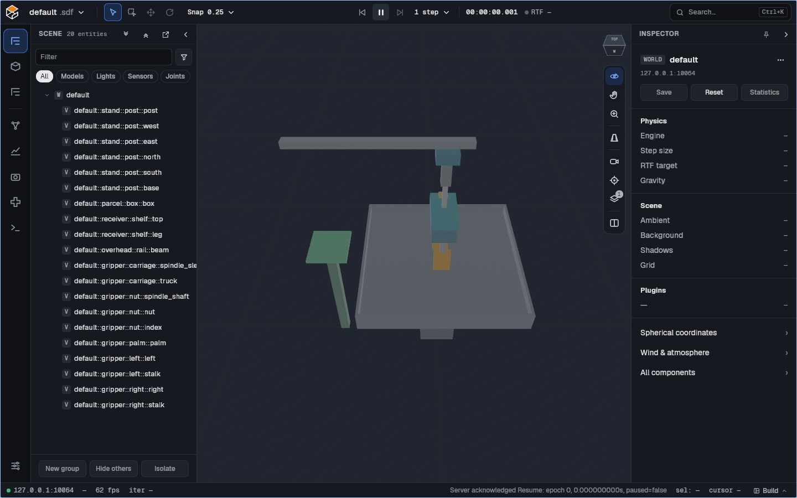

<!-- Copyright (C) 2026 Open Source Robotics Foundation -->
<!-- SPDX-License-Identifier: Apache-2.0 -->

# Solving a gripper impact when the two faces already touch

An opt-in local SDF policy reduced the p95 cost of a 200 g parcel strike from 66.56 to 1.35 ms on the left jaw and from 63.26 to 1.34 ms on the right. Both runs kept the same 1 ms controller clock. Over 24 ms, every link and the parcel stayed within 0.80 mm and 0.45° of a separately initialized simulation advancing continuously at 10 ns. [Native right-jaw replay](http://127.0.0.1:8082/?backend=primitive&ui=full&quality=low&replay=1&lifecycle=1&url=ws%3A%2F%2F127.0.0.1%3A10064%2F) · [Independent comparisons and timing](serial-touching-solver.json)

| Initially touching | Left jaw | Right jaw |
|---|---:|---:|
| Landing impulse | 44.557 mN·s | 45.291 mN·s |
| Difference from continuous 125 ns | 2.20% | 4.82% |
| Difference from continuous 25 ns | 2.03% | 4.46% |
| Difference from continuous 10 ns | 2.01% | 3.18% |
| Maximum position error against 10 ns | 0.794 mm | 0.484 mm |
| Median time for all 24 steps, original → selective | 64.57 → 4.41 ms | 63.06 → 4.41 ms |

The moving robot links have 32.65% of their nominal inertia and retain their original masses. The smaller budget checks contact geometry four times and uses eight temporal iterations and sixteen fixed-time constraint passes per check. The old budget refreshed geometry 500 times with four temporal iterations. Increasing temporal iterations alone at fewer native calls was slower on the same fixture. All 2,880 timed public steps matched the separate observed body trajectories. Each of eight configurations ran five fresh trials in each of three reordered blocks on CPU 18. [Original timing study](serial-impact-cost.md)

**The initial separation decides which solver is appropriate.** The Bevy policy only selects the touching budget for one registered, initially parallel face closing along its normal, with the incident face center inside the receiver footprint. Both angular velocities must be zero, the native world must be free of active contacts, and any registered screw must accept the requested clock. Otherwise the configured impact budget remains in force. Simultaneous arrivals, a sideways sweep, an edge approach, a live contact in the other lane, the low-inertia loaded screw, removal and reset have regression coverage. A miss stays on the ordinary clock.

Forcing the four-call solver across a 50 µm starting gap gave 11.64% and 13.63% impulse errors against continuous 125 ns. The automatic policy kept 500 calls and reproduced the original solver exactly. At 350 µm the 500-call right-jaw case still missed the 1° orientation target at 1.82°. Positive-gap geometry and collision timing remain an open accuracy problem. [Native separated approach](http://127.0.0.1:8082/?backend=primitive&ui=full&quality=low&replay=1&lifecycle=1&url=ws%3A%2F%2F127.0.0.1%3A10065%2F)

The hard-contact reference itself has measurable timestep sensitivity. On the initially touching right jaw it delivered 47.58 mN·s at 125 ns, 47.40 mN·s at 25 ns, and 46.78 mN·s at 10 ns. A separate first-tick control alternating 7 and 8 ns steps delivered 43.54 mN·s. The 1/256-inertia right jaw was more sensitive still, moving from 55.06 to 47.44 mN·s over the tested refinements. These are comparisons with specific numerical grids. The physical limiting impulse for the extreme case remains unresolved. [Signed spindle speed-stop qualification](serial-spindle-stop.md)

All 18 serial-robot tests, 21 contact-policy tests and 344 scene library tests passed. The final scene change covered 70/70 executable lines and 150/150 regions. The example covered 11/11 changed lines and 18/18 regions. The earlier combined example changes for matching first-step solver settings measured 68/69 lines and 100/101 regions. Strict release Clippy passed.

Use the native simulator or export the example's SDF and recording. The original simulator entry point reproduced all 18 final body positions in three worlds. WebGPU checked all 25 frames and 500 shapes and poses per recording and rewound both to zero. [Portable SDF and both recordings](serial-touching-solver.tar.xz) · [Viewer instructions](../../LOCAL_RIGID_ROBOT.md)

```sh
RUSTC_WRAPPER= cargo run --release --locked --no-default-features -p gz-sim-cli \
  --example serial_impact_inertia -- --divisor 1.75 --automatic --substeps 500 \
  --touching-budget --right --write-world target/fast-jaw.sdf --replay target/fast-jaw
```


