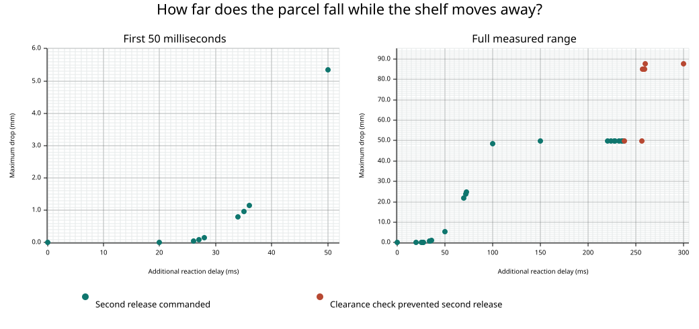

<!-- Copyright (C) 2026 Open Source Robotics Foundation -->
<!-- SPDX-License-Identifier: Apache-2.0 -->

# Catch a parcel when its receiving shelf withdraws

The serial gripper starts opening over a loaded shelf at 9.216 s. Eight milliseconds later, the shelf moves down 50 mm and sideways 200 mm. The contact sensor detects two consecutive low-load steps at 9.226 s. With immediate feedback, the jaws regain pressure and keep the 200 g parcel continuously supported. With the same release ramp running open-loop, the parcel falls 87.45 mm onto the original pickup tray. [Play immediate recovery](http://127.0.0.1:8082/?backend=primitive&ui=full&quality=low&replay=1&lifecycle=1&url=ws%3A%2F%2F127.0.0.1%3A9860%2F) · [Play a 50 ms delayed catch](http://127.0.0.1:8082/?backend=primitive&ui=full&quality=low&replay=1&lifecycle=1&url=ws%3A%2F%2F127.0.0.1%3A9861%2F) · [Play the open-loop drop](http://127.0.0.1:8082/?backend=primitive&ui=full&quality=low&replay=1&lifecycle=1&url=ws%3A%2F%2F127.0.0.1%3A9862%2F)



| Additional delay after detection | Time without pad, shelf or tray support during withdrawal | Maximum parcel drop before shelf return | Outcome |
|---|---:|---:|---|
| 0 ms | 0 ms | 0.00 mm | Reclosed at 9.226 s, then placed the parcel at 15.223 s. |
| 27 / 28 ms | 0 / 1 ms | 0.101 / 0.156 mm | Both placed. Continuous support ended between these adjacent settings. |
| 35 / 36 ms | 8 / 9 ms | 0.969 / 1.150 mm | Both placed. Sag exceeded 1 mm at 36 ms. |
| 50 ms | 25 ms | 5.353 mm | Caught and placed again. |
| 237 / 238 ms | 105 / 106 ms | 49.898 / 49.898 mm | At 237 ms the hand cleared the returning shelf and reopened. At 238 ms it retained the parcel and withheld the second release. |
| Open loop | 212 ms | 87.447 mm | Hit the pickup tray at up to 0.980 m/s downward. The tray carried the full 1.962 N at the end. |

All delays use the same loaded state, gravity, 100 ms jaw-opening ramp and shelf motion. The two jaw efforts change together through a checked batch. A recovery first restores closing pressure, checks for both pad reactions, then raises the hand enough to clear the measured parcel bottom. The shelf must return to within 0.5 mm of its receiving pose with speed below 2 mm/s. Before the second approach, the parcel must have spent the latest 100 ms held only by its jaws and at least 5 mm above the receiving surface. The second descent repeats the full support-force test. These boundaries were measured for this parcel and mechanism on a 1 ms control clock.

The first controller version retracted to a fixed spindle target. It could retry at a 72 ms delay and lacked clearance at 73 ms. Using the measured position of the slipped parcel let the hand attempt supported placement at 237 ms. Some late catches still carried residual load just after opening. At 237 ms the final 500 ms averaged 1.957 N on the shelf and zero pad load, compared with the nominal 1.962 N weight. The 27–28 ms interval is the relevant boundary for applications requiring continuous physical support.

Sixteen release tests passed. A separate sweep ran 29 response delays. Tested resets reproduced the immediate catch, delayed catch, and open-loop drop exactly. Strict Clippy passed. LLVM exercised 213/216 changed lines and 321/335 regions in the controller, example and scene input path, including all 21 lines and 43 regions in the atomic effort command. Each gz-web-rs replay checked 501 frames, 7,515 visual poses and shapes, and rewind to zero.

## Reproduce

Run from the repository root with the gz-web-rs frontend on port 8082. The example prints measurements and writes a new native archive. Use the `open-loop` mode for the uncontrolled comparison, or change `--delay-ms` for a delayed recovery.

```sh
RUSTC_WRAPPER= cargo run --locked --release --no-default-features -p gz-sim-cli \
  --example serial_place -- withdrawal target/my-shelf-recovery --delay-ms 0
RUSTC_WRAPPER= cargo run --locked --release --no-default-features -p gz-sim-cli \
  --bin gz-sim-rs -- --server --replay --web-viewer 9860 target/my-shelf-recovery
```

Regenerate the timing measurements and figure with the separate release sweep.

```sh
RUSTC_WRAPPER= cargo test --locked --release --no-default-features -p gz-sim-cli \
  --example serial_place withdrawal_timing_sweep -- --ignored --nocapture > target/withdrawal-sweep.log
RUSTC_WRAPPER= cargo run --locked --release --manifest-path tools/physics-audit/numerics/Cargo.toml \
  --bin serial_withdrawal -- target/withdrawal-sweep.log target/withdrawal.svg
```

[Feedback and shelf trajectory](../../../crates/gz-sim-cli/examples/serial_place/withdrawal.rs) · [Loaded contact measurement and tests](../../../crates/gz-sim-cli/examples/serial_place.rs)
