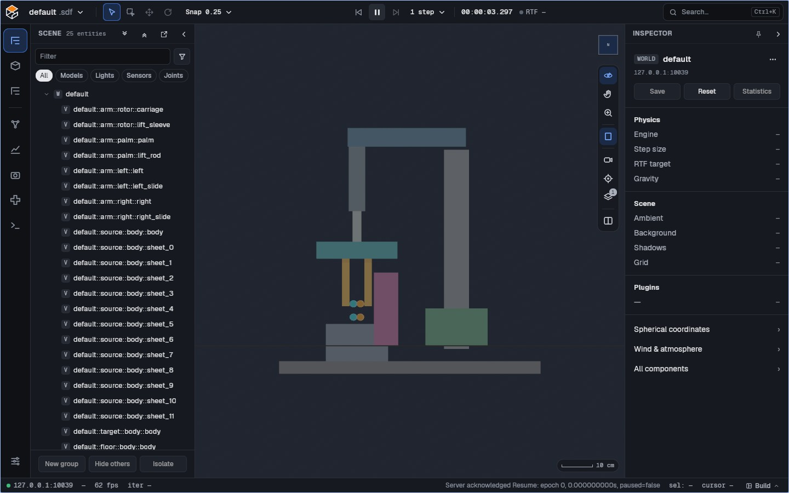

# Refine the folded sheet only as it lands

The robot’s 8.4 g folded sheet rebounded 11.014 mm with selective contact refinement, 11.029 mm with continuous fine material steps over the same landing interval, and 1.262 mm on the original coarse clock. Selective refinement used 80 of the 73,600 native intervals in the full robot run. The 1 ms controller and 62.5 µs rigid steps kept exactly the same schedule. [Watch the actual robot in gz-web-rs](http://127.0.0.1:8082/?backend=primitive&ui=full&quality=low&replay=1&lifecycle=1&url=ws%3A%2F%2F127.0.0.1%3A10039%2F) · [Matched-state impact study](sheet-impact-rebound.md)



## What triggers a finer solve

Add `landing_step_ns="1000"` to the ordinary `gz-sim-deformables-system` SDF plugin to allow a maximum 1 µs internal material interval. The option currently admits one local material, one fixed or linearly translating finite box, articulated pads and one rigid exchange per native step. The solver publishes its last selection through `gz_sim_scene::deformable::finite_landing_step`. Reset restores the initial clock and clears the trigger history.

Before each solve the policy checks the committed particles against the receiver in its collision frame. It requests refinement when an unheld particle moving toward the top face faster than 0.1 m/s is predicted to reach it in this native interval. The test uses relative velocity and gravity and requires the particle skin to fit inside both lateral bounds. It applies during the first millisecond of compression and stops early if an articulated pad takes load. The default solver still resolves edge contact and slow settling on its authored clock. [Implementation and admission](../../../crates/gz-sim-scene/src/deformable/landing_refinement.rs)

## Against measured contact

The first request came on the native interval ending at 3.2519375 s. All five requested windows had measured table impulse. All three independently observed fast whole-sheet landings were already refined on their first loaded native interval. The remaining two requests covered local particle contact. The independent check calls a fast landing the first measured table reaction after at least one millisecond clear of both pads and table, with the previously measured downward relative center-of-mass speed exceeding 0.1 m/s.

| Result on the matched release | Coarse | Adaptive | Fine throughout the 80 ms comparison |
|---|---:|---:|---:|
| First rebound | 1.262 mm | 11.014 mm | 11.029 mm |
| Upward impulse in first millisecond | 9.677 mN s | 12.246118 mN s | 12.246137 mN s |
| Total upward impulse in 80 ms | 14.874 mN s | 12.246118 mN s | 12.246137 mN s |
| Native steps over 80 ms | 1,280 | 1,280 | 1,280 |

The comparison starts 500 µs after the bench stops. The fine control selects 63 material subdivisions per 62.5 µs native interval throughout those 80 ms. At the coarse resolution the sheet lands a second time inside the comparison window, explaining its larger **total** impulse despite the weaker first strike. On the normal supported transfer and early retained withdrawal the policy issued zero requests and reproduced every coarse actuator observation exactly. A world reset also reproduced every actuator observation and every refinement decision in each of the three adaptive cases.

## Cost on this machine

Two sequential, oppositely ordered comparisons ran on a shared 16-core Ryzen 9 9950X3D workstation. Times include the local Bevy, rigid and material solves. They exclude writing and displaying the recording.

| Clock | Wall time in 80 ms impact window | p95 native step in window | Whole-run p95 cost per 1 ms actuator interval |
|---|---:|---:|---:|
| Coarse | 256–289 ms | 0.246–0.280 ms | 3.29–5.11 ms |
| Adaptive | 507–535 ms | 0.326–0.362 ms | 4.82–5.29 ms |
| Matched continuous fine | 16.52–18.22 s | 14.91–16.61 ms | 4.29–4.53 ms |

The selective solve saved about 97% of the comparison-window cost against continuous fine integration, while roughly doubling that window’s cost versus coarse. A whole-run 95th percentile alone largely misses the short, expensive conditional windows.

## Independent robot runs from pickup

When both the rigid and material solvers stepped every 1 µs from cold startup, normal placement completed after 4.3 million native commits and carried the entire 82.404 mN on the table. The early withdrawal completed after 4.6 million commits with 1.61654 N squeeze and 82.420 mN vertical jaw support. In both cases the finer full robot began opening 2 ms earlier. The adaptive configuration reproduced its coarse control on both complete trajectories.

The continuously fine late-drop robot stopped after 3,345,183 committed steps at 3.345183 s on a material-contact refusal. That run has no complete trajectory for comparison. Refining only the material from the start while retaining 62.5 µs rigid steps also refused during pickup at 0.6275625 s. The rebound and cost comparisons above therefore use a continuous fine interval starting from the same falling state. [Source inputs, outcomes and executable identities](sheet-adaptive-landing.json)

## Validation

Four scene policy tests and 16 folded-sheet robot tests passed on the integrated checkout. Strict release Clippy passed. LLVM coverage of changed production code reached 154/155 lines and 248/253 regions in the Bevy scene, and 212/216 lines and 395/415 regions in the CLI. The counts exclude test code and match each instrumented executable to its own raw profile by build ID. [Per-file coverage, build identities and controls](sheet-adaptive-landing.json)

## Reproduce

```sh
RUSTC_WRAPPER= cargo run --locked --release --no-default-features -p gz-sim-cli \
  --example local_robot_foundations -- sheet-impact-clock target/adaptive-sheet \
  --mode drop-late --clock adaptive --landing-step-ns 1000 --verify-reset
```

Use `--clock coarse` or `--clock matched-fine` for the matched controls. Choose `--mode finite` for ordinary placement or `--mode drop-early` for retained withdrawal. The live WebGPU view independently verified 3,144 measured particle positions and 6,550 primitive poses and shapes over 262 frames, including rewind. [Physics, timing and coverage data](sheet-adaptive-landing.json)
